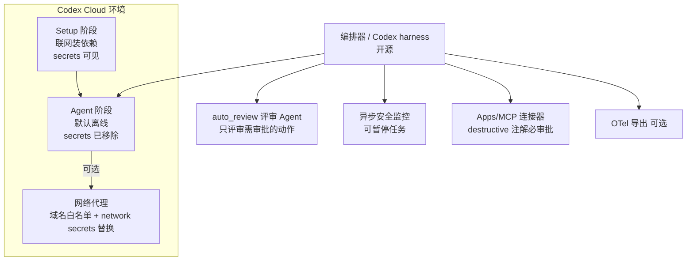
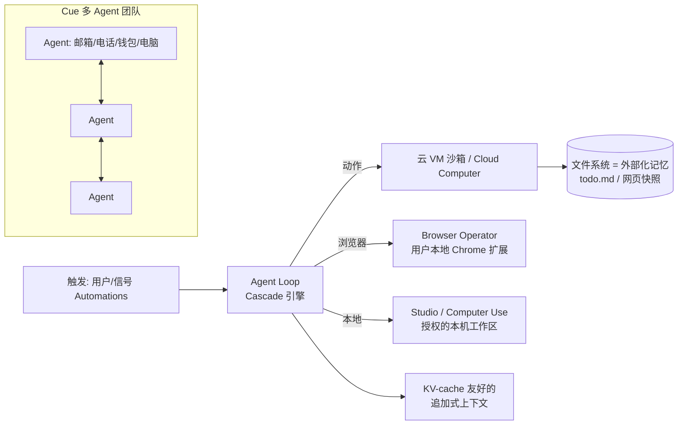
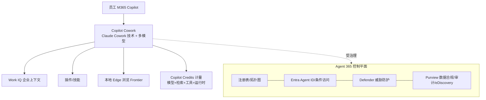
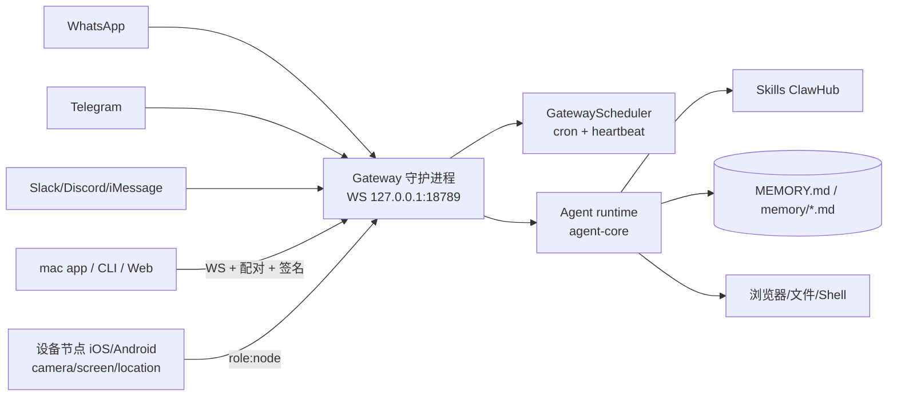
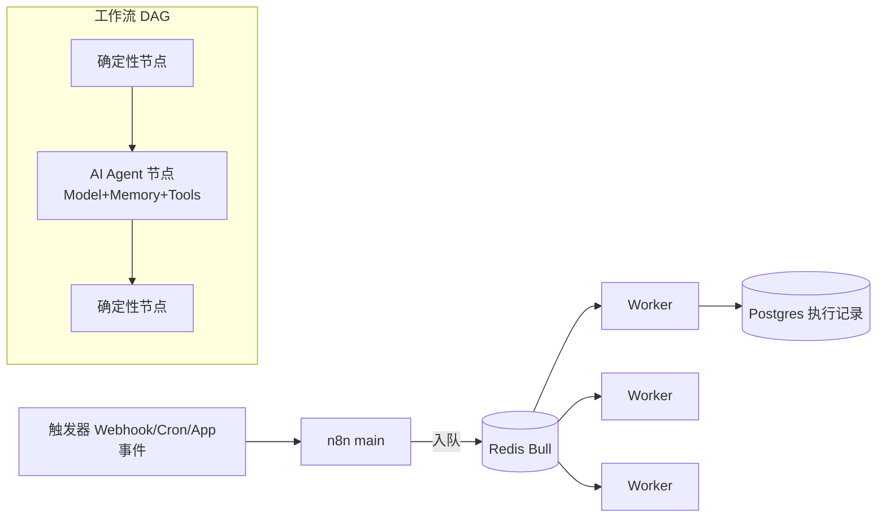
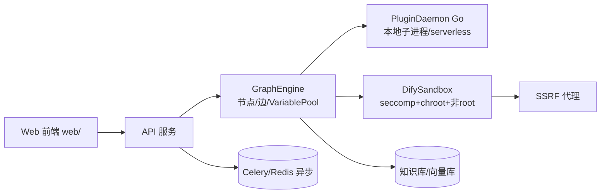
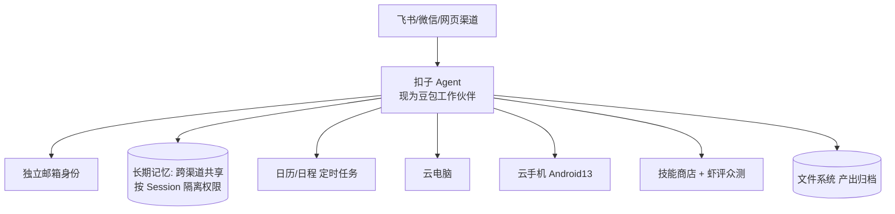
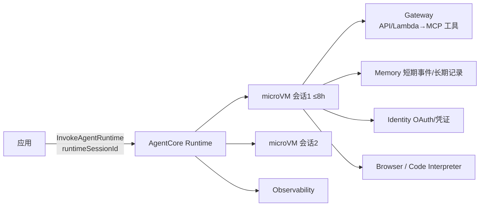
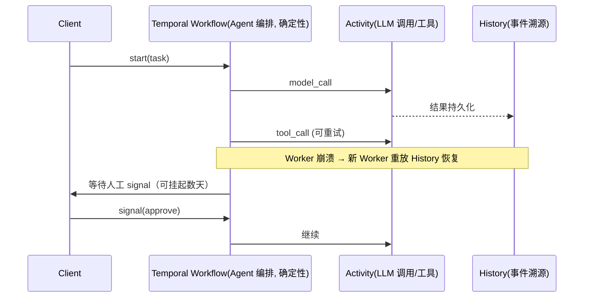

> 本文是 v1《e2e-workflow-landscape.md》的续篇，不再重复 v1 已覆盖的全景信息。资料优先取自一手来源：官方文档、工程博客、GitHub、官方定价页和监管公告。
>
> 标注约定：
> - **[二手]**：来自媒体或聚合站。
> - **[推断]**：作者依据公开信息做的推论。
> - **[待核实]**：没能找到一手来源。
>
> 信息截至 2026-10-01。

# 0. 本版新增的关键结论（先看这里）

1. **"Harness 放在沙箱外，凭证不进沙箱"已是头部厂商的共识。**
   - Anthropic 的 Managed Agents 把会话、harness 和沙箱拆成三层，沙箱只作为一个工具来调用。
   - Cowork 在迭代中把 agent loop 从 VM 里移到了宿主机。
   - Codex Cloud 的 secrets 只在 setup 阶段可见，agent 阶段默认断网。
   - Copilot Cowork 直接采用了 Claude Cowork 的技术平台。

   来源：[Anthropic Managed Agents](https://www.anthropic.com/engineering/managed-agents)、[How we contain Claude](https://www.anthropic.com/engineering/how-we-contain-claude)、[Codex 安全](https://developers.openai.com/codex/agent-approvals-security.md)、[Microsoft](https://www.microsoft.com/en-us/copilot/blog/2026/03/30/copilot-cowork-now-available-in-frontier/)
2. **人工逐条审批被证明不可靠，审批正在交给模型自动评审。** Anthropic 的遥测数据显示，用户对权限弹窗的批准率约为 93%，存在明显的"审批疲劳"。于是 Claude Code 推出了 auto mode（分类器审批），Codex 推出了 `auto_review`（评审 Agent）。真正兜底的仍然是环境层的出网控制和文件边界。
3. **OpenAI 在收缩"可视化画布"路线。** Agent Builder 已宣布弃用，2026-11-30 关停，ChatKit 保留。重心转向 Agents API 和 Codex harness。与此同时，Zapier 把独立的 Agents 产品并回 Zap。两个信号放在一起看：**纯画布式 Agent 构建器作为独立产品的价值在下降，画布正在退化成一种"确定性骨架"。** [OpenAI](https://developers.openai.com/api/docs/guides/agent-builder)
4. **单任务成本的大头是模型 token，算力占比很小。** 按 Manus 公开的数据推算，一个约 50 步的任务大约花 1–2 美元的模型费用，而沙箱只要几美分（见 §2.8）。所以 **KV-cache 命中率**是最重要的成本指标。
5. **国内已进入"政策加治理"阶段。**
   - 三部委联合发布《智能体规范应用与创新发展实施意见》。
   - 工信部 NVDB 发布了 OpenClaw "六要六不要"。
   - 截至 2026-08-31，已有 1112 款生成式 AI 服务完成备案。
   - IDC 调研显示：智能体在企业业务中的渗透率只有 18%；62% 的企业把数据权限与安全合规列为首要障碍。

   来源：[IDC](https://www.idc.com/resource-center/blog/idc%E6%B4%9E%E5%AF%9F%EF%BC%9A%E6%94%BF%E7%AD%96%E4%B8%8E%E5%B8%82%E5%9C%BA%E5%85%B1%E6%8C%AF-%E3%80%8A%E6%99%BA%E8%83%BD%E4%BD%93%E5%AE%9E%E6%96%BD%E6%84%8F%E8%A7%81%E3%80%8B/)

---

# 1. 代表性产品深度拆解（12 个）

每个产品都按同一框架拆解：架构 → 循环/编排 → 执行环境 → 工具 → 记忆/上下文 → 技能 → 触发 → 多 Agent → 人在回路/权限 → 安全/凭证 → 观测/评测 → 部署/定价 → 局限 → 案例。

## 1.1 Anthropic：Claude Managed Agents + Claude Code + Cowork

**架构（Managed Agents）**：把 Agent 虚拟化成三个接口。
- **Session**：只追加的事件日志，持久保存在服务端。
- **Harness**：无状态的循环。崩溃后通过 `wake(sessionId)` 和 `getSession` 重放事件，从断点继续。
- **Sandbox**：被当作工具来调用，接口是 `execute(name,input)→string`，需要时才 `provision`，挂了就换一个（"cattle not pets"）。

收益：p50 TTFT 下降约 60%，p95 下降超过 90%。凭证要么在初始化时绑定到资源上（例如 git remote），要么存进 vault，再经 MCP 代理注入。**Harness 本身永远拿不到凭证。** [来源](https://www.anthropic.com/engineering/managed-agents)

```mermaid
flowchart LR
  U[应用/用户事件] -->|SSE/事件| S[(Session 事件日志<br/>持久化)]
  H1[Harness 实例 A<br/>无状态循环] <-->|getEvents/emitEvent| S
  H2[Harness 实例 B<br/>wake(sessionId) 恢复] <-.-> S
  H1 -->|execute(name,input)| SB1[Sandbox 容器<br/>按需 provision]
  H1 -->|MCP 调用| P[MCP 代理]
  P -->|取凭证| V[(Vault<br/>OAuth tokens)]
  P --> EXT[外部 SaaS]
  H1 --> M[Claude 模型]
  SB1 -. git token 初始化时注入 remote .-> G[Git 仓库]
```

**产品形态（官方文档）**：核心概念是 Agent、Environment、Session、Events。
- Environment 可以选 Anthropic 托管的云沙箱，也可以选**自托管沙箱**。
- 内置工具：Bash、文件操作、web search/fetch（可配域名白名单）、MCP。
- 支持中途 steer 和 interrupt，支持 cron 式的 "scheduled deployments"。
- 限制：目前是 beta，MCP tunnels 和 "dreaming" 在更小范围的预览中；因为是有状态设计，**不适用 ZDR/HIPAA BAA**。[文档](https://platform.claude.com/docs/en/managed-agents/overview)

**三种隔离模式（2026-05 工程博客）**：

| 产品 | 隔离 | 关键设计 | 教训 |
|---|---|---|---|
| claude.ai 代码执行 | gVisor 临时容器，每个会话一个 FS | 纯服务端运行 | 最弱的一环是自研的代理和编排 |
| Claude Code | OS 级沙箱：macOS 用 Seatbelt，Linux 用 bubblewrap。工作区内可写，网络默认拒绝 | 权限弹窗减少 84%；运行时已开源 | 弹窗批准率约 93%，审批疲劳；有 3 个漏洞出现在"信任对话框之前"的配置解析阶段（例如仓库里 .claude/settings.json 定义的 hook） |
| Cowork | 本地完整 VM：macOS 用 Apple Virtualization，Windows 用 HCS。只挂载用户选中的文件夹；凭证留在宿主 keychain，VM 只拿到每会话的降权 token | 后来把 agent loop 移出 VM，只把代码执行留在 VM 里，提高可用性；文件夹挂载分只读、读写、读写但禁删三种 | 攻击者把自己的 API key 藏在恶意文件里，借白名单域名 api.anthropic.com 把文件外传到自己的账号，后来在 VM 内加 MITM 代理修复；VM 不透明，企业 EDR 看不到里面 |

来源：[How we contain Claude across products](https://www.anthropic.com/engineering/how-we-contain-claude)

- **模型层防护的数据**：在 Gray Swan ART 基准上，Opus 4.7 单次攻击成功率约 0.1%，100 次自适应攻击后约 5–6%。auto mode 能在执行前拦下约 83% 的过度执行行为，对良性命令的误拦率约 0.4%。
- **红队实验**：攻击者通过钓鱼让员工粘贴一段恶意 prompt，25 次中有 24 次成功外传了 ~/.aws/credentials。这说明**当指令来自用户本人时，模型层防护无效，只有出网控制和文件边界能挡住。**

**上下文与记忆**：
- 官方建议：即时检索（just-in-time）、compaction、结构化笔记、子 Agent 只返回 1–2K token 的摘要。[Context engineering](https://www.anthropic.com/engineering/effective-context-engineering-for-ai-agents)
- 长任务的做法是 initializer Agent 加进度文件：init.sh、功能清单 JSON、claude-progress.txt，再配合 git 提交，跨会话接力。[Long-running harness](https://www.anthropic.com/engineering/effective-harnesses-for-long-running-agents)
- Claude Code 用 CLAUDE.md 做项目记忆，也提供技能、子 Agent、hooks、插件。

**触发**：
- Claude Code Routines：在云端按定时、API 或 GitHub 事件触发。
- Cowork：支持云端继续执行和手机端接管。
- Claude in Chrome 的定时任务依赖本机开机。

**商业化**：Anthropic 年化收入在 2026 年 7 月底约 650 亿美元 [Reuters](https://www.reuters.com/technology/anthropic-revenue-run-rate-tops-65-billion-source-says-2026-08-17/)。Claude Code 年化收入约 80 亿美元（2026-05）**[二手]**。

## 1.2 OpenAI：Codex Cloud / Agents API / ChatGPT Work / AgentKit

- **执行环境**：
  - 旧版 Codex Cloud 是隔离容器加**两阶段运行**：setup 阶段可以联网安装依赖，**agent 阶段默认断网**；secrets 只在 setup 阶段可用，进入 agent 阶段前删除。
  - 新版 Codex Cloud 改为可复用的持久环境，提供 "network secrets"，由代理在请求发往允许的目的地时替换成真实凭证。
  - 本地运行时，macOS 用 Seatbelt，Linux 用 bwrap+seccomp；`.git`、`.codex`、`.agents` 目录强制只读。
  - [来源](https://developers.openai.com/codex/agent-approvals-security.md)



- **审批模型**：
  - 两层控制：sandbox mode（技术上能做什么）和 approval policy（什么时候要问人）。
  - `approvals_reviewer = "auto_review"` 把需要审批的请求交给评审 Agent，检查数据外泄、凭证探测、持久削弱安全、破坏性操作四类风险。critical 级直接拒绝；出现故障时 **fail closed**。
  - 企业可以用 `guardian_policy_config` 替换租户策略。
  - 另有异步安全监控，可以事后暂停任务。
  - MCP 工具如果带 destructive 注解，一律需要审批。
- **网络策略**：默认白名单；deny 优先；拦截私网和本地地址；做 best-effort 的 DNS rebinding 检查。文档明确写着，网络代理**不过滤** web search、MCP、浏览器流量和模型请求，这些要单独配置控制。
- **上下文**：GPT-5.1-Codex-Max 用 compaction 跨多个上下文窗口运行，OpenAI 称内部任务可超过 24 小时；Responses API 提供服务端 compaction（`compact_threshold`）。[System card](https://openai.com/index/gpt-5-1-codex-max-system-card/)、[Compaction](https://developers.openai.com/api/docs/guides/compaction)
- **多 Agent**：子 Agent 只在用户明确要求时才派生。官方建议轻量的 worker 用小模型，并提醒 token 消耗会显著增加。
- **Agents API**（公测）：托管 harness 加三种计算选项：OpenAI 沙箱、自有基础设施、合作伙伴沙箱。[来源](https://openai.com/index/introducing-the-agents-api/)
- **AgentKit / Agent Builder**：提供 typed edges、版本化、trace graders 和 human approval 节点。**但已宣布弃用，2026-11-30 关停**，ChatKit 保留。[来源](https://developers.openai.com/api/docs/guides/agent-builder)
- **产品线变化**：ChatGPT agent 和 Atlas 已下线，由 ChatGPT Work 和 workspace agents 承接（见 v1）。
- **观测**：OTel 事件包括 conversation_starts、api_request、tool_decision、tool_result 等；用户 prompt 默认脱敏。

## 1.3 Manus（2.0 + Cue）

- **循环**：单一 LLM 驱动的 agent loop，在 VM 沙箱里执行。一个任务平均约 **50 次工具调用**；输入和输出 token 比约 **100:1**；框架已经**重写过 4 次**。[Manus 博客](https://manus.im/blog/Context-Engineering-for-AI-Agents-Lessons-from-Building-Manus)
- **上下文工程的六条原则**（一手来源，值得照搬）：
  1. 围绕 KV-cache 设计。前缀保持稳定，不要在 system prompt 开头放精确到秒的时间戳；上下文只追加；JSON 序列化要确定。以 Sonnet 为例，缓存命中的输入 0.30 美元/MTok，未命中 3 美元/MTok，相差 10 倍。
  2. 工具"遮蔽而不删除"。用状态机配合 logits masking 或 response prefill 约束可选动作；工具名用统一前缀（browser_、shell_）。
  3. 把文件系统当作无限上下文。压缩必须可恢复，比如保留 URL 或文件路径。
  4. 用 todo.md 复述目标，对抗 lost-in-the-middle。
  5. 保留错误轨迹，让模型从失败中学习。
  6. 避免上下文过于同质，防止"自我 few-shot"。
- **2.0 新能力**：
  - Cascade 引擎：在一种测试配置下，token 减少 23.2%，耗时减少 28.2%，成本降低 32%（非总体平均）。
  - Studio：本地文件工作区。
  - Cloud Computer：持久云机，可以用来跑自动化或游戏服务器。
  - Remote Control / Computer Use：在本机一个独立的可见工作区里操作。
  - Automations：信号触发。
  - **Cue**：一个 Agent 团队应用，**每个 Agent 有自己的邮箱、电话号码、钱包和电脑**，Agent 之间可以按频道协作。
  - [来源](https://help.manus.im/en/articles/17190150-what-is-new-in-manus-2-0)



- **定价**：按 credits 计费，消耗取决于任务复杂度、时长、模型、VM 和 API 用量。Cloud Computer 另收月费，分 10、30、50 美元三档。
- **局限与用户抱怨**：Reddit 上反复有人反映循环和失败部署会大量消耗 credits，退款很难。官方政策是：只有经核实的平台 bug 才退款，指令含糊、主观不满意、第三方故障都不退。[政策](https://help.manus.im/en/articles/12992237-how-does-our-ai-agent-s-credit-refund-policy-work)、[用户帖](https://www.reddit.com/r/ManusOfficial/comments/1t2fiux/burned_150000_credits_on_manus_wrong_deployments/) **[二手：用户自述]**
- **沙箱技术**：外界常说 Manus 用 E2B，**[待核实，本次未找到一手来源]**。

## 1.4 Microsoft：Copilot Cowork + Agent 365（+ Copilot Studio / Power Automate）

- **架构**：微软明确表示 "bringing the technology platform that powers Claude Cowork into Microsoft 365 Copilot"。具体做法是把 Anthropic 的 agent 平台和模型，接上 Work IQ 上下文、M365 权限和合规栈，并内置 Claude 和微软的技能，例如日历管理、每日简报。[来源](https://www.microsoft.com/en-us/copilot/blog/2026/03/30/copilot-cowork-now-available-in-frontier/)
- **执行**：云端托管，笔记本关机也能继续；在 Frontier 计划中可通过本地 Edge 浏览器操作网页；支持插件（Harvey、LSEG、monday.com 等）。
- **计费**：
  - 每个任务的价格由四项决定：模型用量、上下文检索、工具调用、运行时长。
  - PayGo 价格为 0.01 美元/Copilot Credit。
  - 预算上限分租户、组、用户三级，可设告警；用户额度不够时可以发起 credit 申请。
  - 微软内部测试称，比 Claude Cowork 加 M365 connector 便宜 30–40%（**厂商自测**）。
  - 预览期已有超过一半的财富 500 强在用。
  - [来源](https://www.microsoft.com/en-us/microsoft-365/blog/2026/06/16/copilot-cowork-is-now-generally-available/)
- **Agent 365（一手定价，补齐 v1 缺口）**：**15 美元/用户/月，年付**，也包含在 M365 E7 中。能力包括：注册表、Agent 关系图谱、按 MCP server 粒度的最小权限、生命周期规则（例如自动让闲置 Agent 过期、标记无主 Agent）。底层复用 Entra（Agent ID、条件访问）、Defender、Purview 和 Intune。[官方页](https://www.microsoft.com/en-us/microsoft-agent-365)



- **Copilot Studio 与 Power Automate（补缺）**：
  - Copilot Studio 按 Copilot Credits 计费：生成式回答 2 credits，Agent 动作（包括 computer use）5 credits，agent flow 每 100 个动作 13 credits。容量包 200 美元/25,000 credits/月，或按 0.01 美元/credit 付费。
  - Power Automate 云流仍按 Power Automate 许可证计费。云流转成 agent flow 是**单向**的，转换后改按 Copilot Credits 计费。
  - 官方计费说明引入了 "harness" 的概念，Copilot Studio 支持三种 harness。
  - 来源：[计费](https://learn.microsoft.com/en-us/microsoft-copilot-studio/requirements-messages-management)、[Agent flows](https://learn.microsoft.com/en-us/microsoft-copilot-studio/flows-overview)、[Credits Guide 2026-09](https://cdn-dynmedia-1.microsoft.com/is/content/microsoftcorp/microsoft/bade/documents/products-and-services/en-us/ai/Copilot-Credits-Guide-September-2026.pdf)

## 1.5 Google：Gemini Enterprise Agent Platform

- **构建**：低代码的 Agent Studio 可以导出到代码优先的 ADK。ADK 新增了图式子 Agent 编排，Gemini 模型经 ADK 每月处理超过 6 万亿 token。
- **运行**：
  - Agent Runtime 冷启动不到 1 秒，支持连续运行数天，有资料称**最长 7 天** **[二手/文档摘要]**。
  - Agent Sandbox 用于代码执行和 computer use；Code Execution 的状态最长保留 14 天。
  - Memory Bank 加 Memory Profiles 提供长期记忆，默认 TTL 365 天。
  - Sessions 支持自定义 ID，可以映射到 CRM 记录。
- **治理**：
  - Agent Identity：每个 Agent 一个加密身份。
  - Agent Registry：统一登记 Agent、工具和技能。
  - Agent Gateway：内置 Model Armor，防提示注入和数据泄漏。
  - Anomaly/Threat Detection：用统计模型加 LLM-as-judge 检测异常，也能识别反弹 shell 之类的行为。
- **优化**：Agent Simulation 用合成用户和虚拟工具做测试；Evaluation 用多轮 autorater；Optimizer 会自动聚类失败案例并建议修改指令。
- **客户案例**：Payhawk 用 Memory Bank 后，报销提交时间缩短 50% 以上；Gurunavi 预计满意度提升 30% 以上（客户自述）。
- 来源：[发布博客](https://cloud.google.com/blog/products/ai-machine-learning/introducing-gemini-enterprise-agent-platform)、[Memory Bank](https://docs.cloud.google.com/gemini-enterprise-agent-platform/scale/memory-bank/setup)、[Code Execution](https://docs.cloud.google.com/gemini-enterprise-agent-platform/scale/sandbox/code-execution-overview)

## 1.6 OpenClaw（开源个人 Agent）

- **架构**：
  - 每台主机跑**一个长期驻留的 Gateway 守护进程**，统管所有消息渠道：WhatsApp（Baileys）、Telegram、Slack、Discord、Signal、iMessage、WebChat。
  - 控制端（mac app、CLI、web）和设备节点（iOS、Android、headless，暴露 camera、screen、location 等能力）都通过 WebSocket 连到 `127.0.0.1:18789`。
  - 协议用 TypeBox 定义并生成 JSON Schema。有副作用的方法必须带**幂等键**。
  - 新设备需要配对审批，连接时要签名 challenge。
  - [架构文档](https://docs.openclaw.ai/architecture)
- **调度**：Gateway 内核有一个 `GatewayScheduler`，统一驱动 cron 和 heartbeat；睡眠唤醒后会补跑错过的任务，并合并重复 tick。cron 每次运行用一个新会话；heartbeat 是主会话里的定时回合。
- **会话与记忆**：私聊默认共享一个会话，群聊互相隔离；记忆存在 `MEMORY.md` 和 `memory/*.md` 这类工作区文件里。[会话](https://docs.openclaw.ai/concepts/session)
- **安全模型**："每个网关一个可信操作者"，不提供敌对多租户隔离。提供 `openclaw security audit --deep` 做自查。[安全](https://docs.openclaw.ai/security)



- **ClawHub 恶意技能（一手数据，补齐 v1 缺口）**：
  - Koi Security 2026-02-01：审计了 ClawHub 上全部 **2,857** 个技能，发现 **341** 个恶意技能，其中 335 个属于同一场 "ClawHavoc" 行动。手法是用伪造的 "Prerequisites" 诱导用户执行载荷，在 macOS 上安装 AMOS 窃密木马。也有技能窃取 `~/.clawdbot/.env` 里的凭证。
  - Koi 2026-02-16 更新：ClawHub 增长到 **10,700+** 个技能，恶意技能增至 **824** 个。[Koi](https://www.koi.ai/blog/clawhavoc-341-malicious-clawedbot-skills-found-by-the-bot-they-were-targeting)
  - 安天 CERT（截至 2026-02-05）：历史上共出现过至少 **1,184** 个恶意技能包，来自 12 个作者 ID，其中一个 ID 上传了 677 个。[Antiy](https://www.antiy.net/Download/clawhavoc-analysis-of-large-scale-poisoning-campaign-targeting-the-openclaw-skill-market-for-ai-agents.pdf)
  - v1 中"超过 1100"的出处就是安天。
- **监管提示**：2026-03-11，工信部 NVDB 发布"六要六不要"，要点包括：避免公网暴露、最小权限、放在容器或 VM 里运行、重要操作要人工审批、审查技能包（拒绝要求下载 ZIP、执行脚本或输入密码的包）、保留审计日志。[中新网](https://www.chinanews.com.cn/sh/2026/03-11/10585276.shtml)、[工信部](https://hubca.miit.gov.cn/zwgk/wlaqgl/art/2026/art_638f3543616745d2bd58915c18aa4d37.html)

## 1.7 n8n

- **编排**：以 DAG 工作流为主。AI Agent 节点（`n8n-nodes-langchain.agent`）是一个 "Tools Agent"，挂载 Chat Model、Memory、Tool 子节点，按工具名、描述和 schema 选工具。[文档](https://github.com/n8n-io/n8n-docs/blob/main/docs/integrations/builtin/cluster-nodes/root-nodes/n8n-nodes-langchain.agent/tools-agent.md)
- **扩展**：生产环境用 **queue mode**：主进程加 Redis（Bull）任务队列加多个 worker，数据库必须是 Postgres（不支持 SQLite），worker 并发建议不低于 5。[Queue mode](https://docs.n8n.io/deploy/host-n8n/configure-n8n/scaling/enable-queue-mode)



- **许可与定价**：采用 Sustainable Use License（fair-code），允许内部使用，但不能拿去转售托管服务；云版和企业版按执行次数计费（见 v1）。
- **客户案例**（官方案例页，客户自述）：
  - Vodafone：33 个安全工作流，节省 5,000 人天和 220 万英镑。
  - Delivery Hero：单个 IT 运维工作流每月节省 200 小时。
  - [Vodafone](https://n8n.io/case-studies/vodafone/)
- **局限 [推断]**：Agent 节点是"一个节点内部的循环"，长时任务和人工等待依赖工作流本身的 Wait 节点；没有每个 Agent 一台独立的计算环境。

## 1.8 Dify

- **架构**：
  - API 和 worker 中的 **GraphEngine** 负责执行工作流：工作流 JSON 定义节点和边，数据通过 VariablePool 传递，另有执行限制、LLM 配额等层。
  - **PluginDaemon** 是独立的 Go 服务，管理三类插件运行时：本地（子进程，通过 stdin/stdout 通信）、调试、serverless。
  - **DifySandbox** 运行不可信代码：一个长期驻留的容器，加 seccomp 系统调用白名单、chroot、非 root 运行，出网走 SSRF 代理。
  - 来源：[workflow_entry.py](https://github.com/langgenius/dify/blob/7e6745e105771a87853e1016bc241a2024629639/api/core/workflow/workflow_entry.py)、[plugin-daemon](https://github.com/langgenius/dify-plugin-daemon)、[DifySandbox](https://dify.ai/blog/dify-ai-blog-introducing-difysandbox)



- **许可证（一手来源，补齐 v1 缺口）**：在 Apache 2.0 基础上附加条件。
  1. 未经书面授权，**不得用源码运营多租户环境**（一个租户即一个 workspace）。
  2. 使用前端时**不得移除或修改 LOGO 和版权信息**。
  3. 贡献者须同意产品方可以调整许可证，贡献的代码可用于商业用途。

  对内部单租户部署通常没有影响；**如果内部平台要做多 workspace 的多租户，需要授权**。[LICENSE](https://raw.githubusercontent.com/langgenius/dify/main/LICENSE)
- 融资：2026 年 3 月 3000 万美元，估值 1.8 亿美元（见 v1）。

## 1.9 字节：豆包 / 豆包工作（扣子作为能力层；扣子 2.0 → 2.5 → 3.0 → 并入豆包）

> **现状（2026-10）**：字节对外的生产力主品牌已经是**豆包 / 豆包工作**，扣子成为智能体、技能和工作流的**能力层**。详见文末补充一节的 B、C 部分。

**组织与品牌变化**

- **2026-07-30**：飞书产品团队与豆包产品团队整合，由赵祺负责，飞书负责人谢欣向其汇报。
- **2026-08-24**：TRAE、扣子团队整体并入豆包。
  - TRAE Work 和扣子的工作场景能力并入豆包工作。
  - TRAE IDE/CLI 归入豆包品牌下的编程线。
  - 来源：[新浪财经](https://finance.sina.com.cn/stock/t/2026-08-24/doc-inipmnpq6049441.shtml)
- **2026-08-25**：发布「豆包工作」，来源：[飞书](https://www.feishu.cn/content/article/7677519271848610746)、[新黄河](https://www.jinantimes.com.cn/news-240-5307296.html)。
  - 三个入口：独立 PC 端、豆包 App 内的工作入口、飞书内入口。
  - 用飞书账号登录后继承本人权限，产出可以回流飞书。
  - 验证过的流程可以沉淀为 Skill。
  - 飞书 Aily 智能伙伴升级为"豆包工作伙伴"，有独立身份、权限和记忆。
- **分层**：
  - 入口：豆包 / 豆包工作
  - 编程：TRAE
  - 智能体、技能、工作流能力：扣子
  - 组织、知识、权限：飞书
  - 模型与云：火山引擎

**扣子版本演进**（历史，2026-08 之前扣子是独立品牌）

- **2.0（2026-01）**：推出 Agent Skills（最佳实践加工具的封装，有技能商店）、Agent Plan（把数小时到数天的目标拆解后持续执行并主动汇报）、Agent Office 和 Agent Coding；服务用户超过 1000 万。[IT之家](https://www.ithome.com/0/914/507.htm)
- **2.5（2026-04-07，"Agent World"）**：
  - **人格**：每个 Agent 有独立邮箱身份，与用户账号的资源权限隔离；长期记忆在飞书、微信、网页等渠道之间共享，但**按 Session 隔离权限，私聊内容不会泄露到群聊**。
  - **装备**：日历和日程（定时任务）、文件系统，以及**云电脑和云手机**（Android 13）。重要操作仍由人接管。
  - **技能**：技能商店，加上"虾评"技能评测平台，技能要通过 Agent 众测才能上架。
  - **开发**：推出扣子编程 CLI。
  - [eNet](http://enet.com.cn/article/2026/0407/A202604071275228.html)
- **3.0（2026-06-01）**：定位为"人 + 多 Agent"协作的 AI 工作平台。
  - 支持接入 **Claude Code、Codex CLI、OpenClaw 等本地 Agent**，本地与云端 Agent 协同。
  - 手机、电脑、网页多端可用。
  - 来源：[IT之家](https://www.ithome.com/0/958/277.htm)、[腾讯新闻](https://news.qq.com/rain/a/20260601A05XU000)

**开源**：Coze Studio 和 Coze Loop 采用 Apache-2.0（见 v1）。

**观察**

- 扣子 2.5 和 Manus Cue 几乎同时走到了"每个 Agent 有独立身份、电脑、记忆和日程"这一步，形态和 Grok Bot 高度同构。
- 这套能力随后被收进豆包工作，以"豆包工作伙伴"的形式出现：有独立身份，并继承飞书权限。
- 对内部平台来说，更值得对标的是"**Agent 能力层 + 办公套件权限继承**"这种组合，而不是独立的 Agent 构建平台。

下图为扣子 2.5 时期的 Agent 结构，能力现由豆包工作 / 豆包工作伙伴承接。



## 1.10 AWS Bedrock AgentCore

- **组件**：Runtime、Memory、Gateway（把 API 和 Lambda 包装成 MCP 工具）、Identity、Browser、Code Interpreter、Observability。框架无关，可以接 LangGraph、CrewAI、Strands 等。
- **Runtime 隔离**：**每个 runtimeSessionId 一个专属 microVM**，CPU、内存和文件系统都独立；会话结束后终止 VM 并清理内存。单个会话最长 **8 小时**，默认空闲 15 分钟后回收。可以配置会话存储，在停止和恢复之间保留文件系统。[会话隔离](https://docs.aws.amazon.com/bedrock-agentcore/latest/devguide/runtime-sessions.html)、[生命周期](https://docs.aws.amazon.com/bedrock-agentcore/latest/devguide/runtime-lifecycle-settings.html)



- **定价**：按资源和调用量计费，见 v1。
- **客户案例**（AWS 博客，客户自述）：nOps 上线时间缩短 75%；Mobileye 支持响应时间缩短 90%；Bluesight 周期性报告耗时减少 96%。[nOps](https://aws.amazon.com/blogs/machine-learning/how-nops-shipped-finops-agents-75-faster-with-amazon-bedrock-agentcore/)、[Mobileye](https://aws.amazon.com/blogs/machine-learning/how-mobileye-transformed-support-operations-using-amazon-bedrock-agentcore/)
- **局限**：8 小时的会话上限意味着跨天的任务需要外部持久化，比如 Temporal 或 Step Functions **[推断]**。

## 1.11 Zapier（AI by Zapier + Zapier MCP）

- **编排**：Agent 是 Zap 里的一个 AI 步骤，可以和确定性步骤混排；支持逐工具"运行前审批"、结构化输入输出；单次运行的 task 上限默认 75，最高可调到 500；管理员可禁用模型，也可设发布审批（见 v1 迁移文档）。
- **Zapier MCP**：托管的 MCP 端点覆盖 **9,000+ 应用、40,000+ 动作**，通过 `discover_zapier_actions`、`enable_zapier_action`、`execute_zapier_read_action`、`execute_zapier_write_action` 这类**元工具**按需发现动作，避免一次把上万个工具塞进上下文。每次 MCP 工具调用计 2 个 task。[docs](https://docs.zapier.com/mcp/overview/how-tools-work)
- **启示**：大规模连接器库用"发现、启用、执行"三段式加读写分离，和 Manus 的"遮蔽而不删除"是两种不同的解法。前者省上下文，后者保 KV-cache。

## 1.12 基础设施：Temporal 与 E2B（附 Modal）

- **Temporal**：Workflow 是确定性代码，执行历史以事件溯源方式持久化；Activity 承载有副作用的调用，自动重试。
  - 和 OpenAI Agents SDK 的集成于 **2026-03-23 GA**：agent 编排跑在 Workflow 里，每次模型调用作为 Activity 持久化，worker 重启后状态不丢。
  - 沙箱集成处于公开预览。
  - 估值 125.5 亿美元（2026-09）。
  - [Temporal](https://temporal.io/blog/announcing-openai-agents-sdk-integration)、[docs](https://docs.temporal.io/develop/python/integrations/openai-agents)



- **E2B**：基于 Firecracker microVM。pause 默认保存文件系统和内存，耗时约每 GiB 内存 4 秒；resume 约 1 秒；也支持只保存文件系统的快照。[persistence](https://docs.e2b.dev/sandbox/persistence)。冷启动约 150ms 的说法 **[二手]**。
- **Modal（补缺）**：
  - 2026 年 5 月 C 轮 3.55 亿美元，估值 46.5 亿美元。官方称 Sandboxes 产品贡献超过三分之一的收入，累计启动超过 10 亿个沙箱。[Modal](https://modal.com/blog/modal-series-c)
  - 2026-09-28 有报道称其正以 157.5 亿美元估值洽谈 7.5 亿美元融资。[TechCrunch](https://techcrunch.com/2026/09/28/source-inference-provider-modal-labs-closing-in-on-750m-round-at-15-75b-valuation/) **[信源为知情人士]**

---

# 2. 关键技术专题

## 2.1 Harness 与编排：agent loop、图、DAG、持久化工作流

| 范式 | 代表 | 优点 | 缺点 | 适合 |
|---|---|---|---|---|
| LLM agent loop（ReAct 加工具调用） | Claude Code/Cowork、Codex、Manus、OpenClaw | 通用；能处理长尾任务；随着模型变强自动受益（Anthropic 称"harness 里的假设会过时"） | 方差大，成本不可预测，需要强隔离和强护栏 | 开放式知识工作、编码 |
| 显式图 / 状态机 | LangGraph、MS Agent Framework、ADK graph | 可控、可测试，支持 checkpoint 和人工中断点 | 图需要人来设计，跟不上模型能力的提升 | 有明确阶段的多 Agent 业务流程 |
| DAG / 可视化工作流 | n8n、Zapier、Make、Dify、Coze Studio、UiPath Maestro | 业务人员能维护；审计友好；行为确定 | 分支爆炸；Agent 只是图里的一个节点 | 集成型、事件驱动的自动化 |
| 持久化工作流引擎 | Temporal、Step Functions、Maestro（BPMN） | 崩溃可恢复，能等待人工数天，能精确重试 | 编程模型有门槛，要求 workflow 代码确定 | 跨天任务、关键流程、审批流 |
| 托管 meta-harness | Claude Managed Agents、OpenAI Agents API、Gemini Agent Runtime | 不必自建循环、沙箱和记忆，模型升级时 harness 同步优化 | 厂商锁定；有数据驻留和 ZDR 限制 | 快速上线、不追求底层控制 |

**趋势**：
- 行业正在分层：**"Agent loop 管认知，持久化引擎管时间，DAG 管集成"**。
- FastGPT v4.15.2 把 Workflow Agent 和 ToolCall 统一到一个共享的 Agent Loop 内核，可以通过 `AGENT_ENGINE` 在 `fastAgent` 和 `piAgent` 之间切换。piAgent 很可能指 OpenClaw 底层使用的 pi agent core **[推断]**。[FastGPT](https://doc.fastgpt.io/zh-CN/self-host/upgrading/4-15/4152)
- 这说明国内开源平台也在把"可插拔的 harness"做成一层抽象。

## 2.2 沙箱与计算隔离：成本和启动速度的权衡

| 技术 | 代表 | 隔离强度 | 启动 / 状态 | 备注 |
|---|---|---|---|---|
| OS 级进程沙箱（Seatbelt / bubblewrap+seccomp / Landlock） | Claude Code、Codex CLI | 中 | 几乎零开销，复用本机环境 | 依赖用户机器；网络默认拒绝；Docker 里可能失效 |
| gVisor 容器 | claude.ai 代码执行 | 中高（用户态内核） | 容器级，秒级以内 | 适合临时、无状态的执行 |
| 加固容器（seccomp+chroot） | DifySandbox | 中 | 常驻 | 成本最低；只适合运行代码片段 |
| Firecracker microVM | E2B、AgentCore Runtime | 高（独立内核） | 约百毫秒级冷启动；快照 pause/resume | 多租户的主流选择 |
| 完整 VM（Apple Virtualization / HCS / 云主机） | Cowork、Manus Cloud Computer、云桌面 OpenClaw 镜像 | 高 | 秒到分钟级；可长期驻留 | 能跑桌面和浏览器；EDR 不可见；成本高 |
| 有状态、可 fork 的沙箱 | Daytona | 高 | 支持快照、fork、暂停 | 适合并行探索和回滚 |

**设计要点**（主要来自 Anthropic 和 OpenAI 的一手经验）：
1. **隔离强度要和用户的监督能力匹配**。开发者能读懂 bash，可以用轻量沙箱加审批；知识工作者读不懂，就应该用 VM 做强边界。
2. **出网白名单本质上是在"授予能力"，而不只是过滤目的地**。放行 api.anthropic.com 就等于放行了"上传文件到任意账号"这个能力。
3. **自己写的组件往往是最弱的一环**。hypervisor、seccomp、gVisor 都很可靠，出问题的是自研的代理和配置解析。
4. **持久"一人一机"和临时"一任务一沙箱"可以组合使用**。Manus 的做法是 Cloud Computer 作为常驻主机，任务沙箱按需 provision。
5. 需要提前和企业安全团队谈好 **EDR 和审计的可见性**。可以参考 Cowork 用 pull 方式导出 OTLP 日志的做法。

## 2.3 上下文工程与记忆

| 机制 | 做法 | 代表 |
|---|---|---|
| 前缀缓存优化 | 前缀稳定、上下文只追加、序列化确定、工具定义不变 | Manus（KV-cache 是第一指标） |
| Compaction（压缩） | 接近阈值时生成摘要；服务端可加密压缩 | Claude（compaction）、OpenAI Responses `compact_threshold`、FastGPT 上下文压缩快照 |
| 可恢复的裁剪 | 删掉正文但保留 URL 或路径 | Manus |
| 上下文外置到可查询日志 | session 事件流放在上下文窗口之外，可以按位置切片回读 | Claude Managed Agents |
| 文件即记忆 | todo.md、progress.txt、MEMORY.md、CLAUDE.md、AGENTS.md | Manus、Anthropic、OpenClaw、Codex |
| 托管长期记忆 | 自动抽取、画像、TTL 管理 | Google Memory Bank（默认 TTL 365 天）、AgentCore Memory、扣子 / 豆包工作 |
| 子 Agent 隔离 | 子 Agent 只返回 1–2K token 的摘要 | Claude Code、Codex |
| 工具空间管理 | logits 遮蔽，或"发现→启用"元工具 | Manus、Zapier MCP |

**风险**：持久记忆会成为**投毒后的持久化通道**。注入一旦写进 memory 或 CLAUDE.md，每次启动都会被重新加载。Anthropic 建议在会话启动时用分类器扫描。另外，多 Agent 之间如果把子 Agent 的输出当作"可信内容"，会造成信任升级。[来源](https://www.anthropic.com/engineering/how-we-contain-claude)

## 2.4 工具集成：MCP、原生 API、computer-use 与可靠性数据

| 方式 | 优点 | 缺点 | 适用 |
|---|---|---|---|
| MCP（远程或本地） | 生态标准；OAuth 2.1；可注册；可审计 | 远程 server 在批准之后仍可能改变行为；工具输出本身就是注入面；工具太多会让模型变笨 | 主流 SaaS 和内部系统 |
| 原生 API / 连接器库 / CLI | 稳定、低延迟、权限精细 | 每个都要开发和维护 | 高频核心系统 |
| 聚合 MCP（Zapier MCP、AgentCore Gateway） | 一个端点覆盖上千应用 | 多一跳；计费叠加 | 长尾 SaaS |
| 浏览器自动化（DOM/CDP，如 Playwright） | 不依赖 API | 页面一改就坏；有反爬问题 | 没有 API 的 Web 系统 |
| 视觉 computer use（截图加点击） | 最通用，桌面应用也能用 | 慢、贵；注入风险高 | 遗留系统、兜底方案 |

**基准数据**（注意：除标注一手的以外，多为聚合站数据，模型版本迭代很快，只能看趋势）：

| 基准 | 衡量什么 | 数据 | 来源 |
|---|---|---|---|
| OSWorld（369 个真实桌面任务） | computer use | 人类 72.36%；2024 年论文发表时最好的模型只有 12.24%；2025-07 升级为 OSWorld-Verified | [一手](https://os-world.github.io/) |
| OSWorld-Verified 2026 | 同上 | 聚合站显示 2026-09 最高约 86%，已超过人类基线 | [聚合](https://www.llmboard.ai/benchmarks/osworld-verified-485) **[二手]** |
| Terminal-Bench 2.0 | 终端和编码 Agent | 最高约 82–83% | [聚合](https://llm-stats.com/benchmarks/terminal-bench-2) **[二手]** |
| WebArena-Verified | Web Agent | 最高约 71% | [聚合](https://benchmarklist.com/benchmarks/webarena_verified/) **[二手]** |
| τ²-bench（telecom） | 工具调用加对话策略 | 头部接近饱和（约 99%） | [Artificial Analysis](https://artificialanalysis.ai/evaluations/tau2-bench) **[二手]** |
| 浏览器提示注入 | Claude for Chrome | 没有缓解措施时攻击成功率 23.6%，加缓解后降到 11.2%；后续自适应攻击约 1% | [Anthropic](https://claude.com/blog/claude-for-chrome)、[研究](https://www.anthropic.com/research/prompt-injection-defenses) |

**解读 [推断]**：
- 公开基准正在快速饱和，**对内部选型的参考价值越来越低**。内部更应该建自己的任务集，覆盖内部系统、权限和数据。
- computer use 的准确率已经能用，但**成本、速度和注入风险**仍然决定它只能做兜底方案。

## 2.5 持久化执行与长时任务

各家对"长"的定义和最长时限：

| 产品/组件 | 最长时限 | 来源 |
|---|---|---|
| AgentCore Runtime | 单会话 8 小时 | 一手 |
| Gemini Agent Runtime | 多日，有资料称 7 天 | 二手 |
| Codex | 内部任务超过 24 小时 | 一手 |
| Claude Managed Agents | 分钟到小时级，加定时部署 | 一手 |
| Temporal | 理论上无限，可挂起等待人工 signal | 一手 |

**常见模式**：
1. **事件日志加无状态 worker**：Managed Agents 的 session，以及 Temporal 的 history。
2. **把检查点外置**：进度文件加 git，见 Anthropic 的 long-running harness。
3. **MCP Tasks**：协议层的异步任务。2026-07-28 版规范把它改成了扩展（见 v1）。
4. **调度器**：例如 OpenClaw 的 GatewayScheduler，在 Gateway 重启后从存储里重建计划；也可以用外部的 cron 或事件总线。

**要点**：
- 有副作用的步骤要**幂等**：OpenClaw 要求带幂等键，Temporal 的 Activity 自动重试。
- 等待人工时要能挂起而不占资源。
- 恢复时要区分"重放"和"重新执行"。

## 2.6 安全：提示注入、凭证保管、审批与自动评审、审计

**威胁框架**：OWASP《Top 10 for Agentic Applications 2026》把 ASI01 "Agent Goal Hijack"（目标劫持）列为第一位。[OWASP](https://genai.owasp.org/resource/owasp-top-10-for-agentic-applications-for-2026/)。Anthropic 把风险分成三类：用户误用、模型越界、外部攻击；防护作用在三个对象上：环境、模型、外部内容。

**纵深防御的分层**（按"确定性"从强到弱）：

| 层 | 措施 | 代表实现 |
|---|---|---|
| 环境 | VM/microVM/沙箱；挂载最小化；出网白名单加 MITM 校验 | Cowork VM 内代理；Codex 网络代理与私网拦截 |
| 凭证 | 凭证不进沙箱：vault 加代理注入；只在 setup 阶段可见；每会话降权、可单独吊销的 token | Managed Agents vault+MCP 代理；Codex network secrets；Cowork 宿主 keychain |
| 工具权限 | 读写分离；destructive 注解必须审批；逐工具审批 | Codex MCP 注解；Zapier per-tool approval；Agent 365 MCP 最小权限 |
| 审批 | 人工审批加**自动评审**（分类器或评审 Agent，故障时 fail-closed） | Claude Code auto mode；Codex `auto_review`；Grok Bot 类的 Auto-review |
| 模型 | 注入训练、探针、Model Armor | Anthropic；Google Agent Gateway |
| 内容 | 对工具返回值做实时检查（可以用小模型）；缓存式 web search 降低注入暴露 | Claude Code/Cowork 代理；Codex `web_search="cached"` |
| 供应链 | 技能和插件签名、审核、众测、扫描 | 扣子"虾评"众测；Koi Clawdex；ClawHub 举报自动隐藏 |
| 审计 | OTel 与审计日志、eDiscovery、身份可追溯 | Codex OTel；Purview；Google Agent Identity |

**关键数据**：
- 人工审批的批准率约 93%。
- 沙箱让弹窗减少 84%。
- auto mode 漏放约 17% 的过度执行行为，误拦约 0.4%。
- 用户本人粘贴的恶意 prompt，25 次中成功外传 24 次。

结论：**审批只能降低概率，只有环境边界能把损失封顶。**

## 2.7 评测与可观测性

- **轨迹层**：要能看到每次工具调用的输入输出、模型层级和 token/task 消耗。例如 Zap history、Codex OTel、Managed Agents 事件流、FastGPT 的 LLM 请求追踪（默认保留 6 小时）。
- **评测层**：
  - 离线：trace graders（Agent Builder）、Coze Loop、LangSmith。
  - 仿真：Google Agent Simulation，用合成用户加虚拟工具。
  - 在线：多轮 autorater。
  - 失败聚类加自动改提示词：Google Agent Optimizer。
- **业务层**：Agent 365 的 Agent 分析和 ROI、Copilot Cowork 的单任务成本、Make Grid 的 credit 消耗热力图。
- **安全层**：异常检测（Google）、异步安全监控可暂停任务（Codex），以及会话启动时扫描记忆（Anthropic 的建议）。
- **观察 [推断]**：要按"任务"而不是按"请求"来度量。核心指标包括：任务成功率、人工介入率、单任务成本、KV-cache 命中率、审批命中和误拦率、回滚次数。

## 2.8 成本结构：单任务的经济账（示意估算）

**假设 [推断，仅供量级参考]**：
- 一个约 50 步的任务（Manus 公开的平均值）。
- 平均每步上下文约 40K token，累计输入约 2M token；输出约 20K token（输入输出比约 100:1）。
- 价格参照 Manus 博客给出的 Sonnet 价格：缓存命中 0.30 美元/MTok，未命中 3 美元/MTok，输出按 15 美元/MTok 计（输出价为假设）。

| 项 | 90% 缓存命中 | 30% 缓存命中 |
|---|---|---|
| 输入 | 1.8M×0.3 + 0.2M×3 = 1.14 美元 | 0.6M×0.3 + 1.4M×3 = 4.38 美元 |
| 输出 | 0.30 美元 | 0.30 美元 |
| 计算（例：AgentCore 2 vCPU/4GB 跑 10 分钟） | 约 0.036 美元 | 约 0.036 美元 |
| 合计 | **约 1.5 美元** | **约 4.7 美元** |

计算资源按 AgentCore 价格估算：0.0895 美元/vCPU-h，0.00945 美元/GB-h（见 v1 定价页）。

**对照厂商的计费单位**：

| 厂商 | 计费单位 |
|---|---|
| Copilot Cowork | 0.01 美元/credit，按模型、检索、工具、运行时计算 |
| Copilot Studio | Agent 动作 5 credits，即 0.05 美元 |
| Agentforce | 约 0.10 美元/动作 |
| Zapier | MCP 每次调用 2 个 task |
| Genspark | Plus 24.99 美元/月含 10,000 credits；Pro 249.99 美元/月含 125,000 credits；Team 30 美元/席位/月含 12,000 credits；年付约省 20% |

Genspark 定价来源：[Genspark](https://www.genspark.ai/membership-benefits-lp)、[Help](https://www.genspark.ai/helpcenter/membership-plans)；Team 档 **[二手]**。

**结论 [推断]**：
- 模型 token 占单任务成本的 90% 以上。
- 提升缓存命中率、控制步数、给子任务配小模型、用结构化工具减少截图式 computer use，这几项是主要的降本手段。
- 持久"一人一机"的常驻成本，主要来自闲置时长，而不是任务本身。

---

# 3. 市场深度

## 3.1 规模（注明口径）

- **Gartner（2026-09-16）**：
  - 2026 年全球 AI 支出 2.67 万亿美元，同比增长 49.5%。
  - 其中 "AI Agents and Assistants"（跨职能和消费者 Agent 及助手）：2025 年 164.8 亿美元，2026 年 292.2 亿美元，2027 年 654.7 亿美元。
  - "AI Application Development Platforms"：2026 年 95.4 亿美元，增速从 28% 上调到 39%。
  - Gartner 还认为 GenAI 在 2026 年处于"幻灭低谷"，企业更多是在用现有供应商内嵌的 AI 功能。
  - [Gartner](https://www.gartner.com/en/newsroom/press-releases/2026-09-16-gartner-forecasts-worldwide-ai-spending-to-grow-49-point-5-percent-in-2026)
- **Gartner（2025-08）**：到 2026 年底，40% 的企业应用会集成任务型 Agent，而 2025 年不到 5%。[Gartner](https://www.gartner.com/en/newsroom/press-releases/2025-08-26-gartner-predicts-40-percent-of-enterprise-apps-will-feature-task-specific-ai-agents-by-2026-up-from-less-than-5-percent-in-2025)
- **IDC**：到 2029 年，Agentic AI 相关支出约 1.3 万亿美元。这是包含 Agentic AI 的整体 AI 支出口径。[IDC](https://my.idc.com/getdoc.jsp?containerId=prUS53765225) **[口径较宽]**
- **IDC 中国**：活跃智能体数量 2026 年约 495 万个，2031 年约 3.5 亿个，2026–2031 年复合增长率 135.3%。**这是数量口径，不是金额。**
- **注意**：有二手文章引用 Gartner "2026 年 Agent 软件 2065 亿美元"，口径不同（属于更宽的软件定义），**[二手，不建议引用]**。

## 3.2 采用现状

- **McKinsey 2025**：62% 的组织至少在试验 AI Agent，23% 已在至少一个职能中规模化；但在任何单一职能里，规模化的比例都不超过 10%。[McKinsey PDF](https://www.mckinsey.com/~/media/mckinsey/business%20functions/quantumblack/our%20insights/the%20state%20of%20ai/november%202025/the-state-of-ai-2025-agents-innovation_cmyk-v1.pdf)
- **IDC 中国 2026 调研**：智能体在企业业务中的渗透率 18%；62% 的企业把数据权限与安全合规列为跨系统执行的首要障碍；选平台时，58.7% 的企业把治理与合规放在第一位。
- **厂商侧信号**：
  - 微软称 Copilot Cowork 预览期覆盖超过一半的财富 500 强。
  - Anthropic 年化收入约 650 亿美元。
  - Genspark 年化收入超过 2 亿美元（v1）。
  - Gartner 仍维持"超过 40% 的 Agentic 项目会在 2027 年前取消"的预测（v1）。

## 3.3 企业采购标准（综合 IDC、Gartner 和厂商定价设计 [推断]）

1. **治理与合规**：身份、权限、审计、数据驻留、DLP。这是准入门槛，没有就进不了门。
2. **与现有系统和数据的集成深度**，例如 Work IQ、企业知识、ERP/CRM。
3. **成本可预测**：预算上限、单任务成本可见、防止失控循环。
4. **可靠性**：任务成功率、可恢复性、人工接管。
5. **厂商锁定与多模型**：微软强调多模型，Gemini 支持 Claude。
6. **对异构 Agent 的统一管理**：IDC 认为这是下一阶段的关键需求。

## 3.4 创业公司在哪赢，大厂在哪赢 [推断，基于案例]

- **大厂赢**：
  - 绑定办公套件和数据（M365、Workspace、Salesforce、飞书、钉钉、企业微信）。
  - 安全和合规栈可以直接复用（Entra、Purview）。
  - 把 Agent 打进现有许可证捆绑销售（E7、Copilot USL）。
- **创业公司赢**：
  - 体验和迭代速度：Manus 重写了 4 次框架；Genspark ARR 快速增长。
  - 开源社区和自托管：n8n、Dify、OpenClaw。
  - 基础设施单点做深：Temporal、Modal、E2B、Daytona 的估值都在飙升。
- **被挤压的**：
  - 独立的画布式构建器：Agent Builder 弃用，Flowise 和 Langflow 被收购。
  - 单点的浏览器 Agent：Atlas 下线。
- **结局**：要么被平台吸收，要么被并购。

## 3.5 中国市场特点

- **"养龙虾"潮的细节**（补充 v1）：
  - 1 月底，腾讯、阿里、百度、字节陆续支持一键部署。
  - 3 月初，腾讯、百度办线下免费安装活动；马化腾在朋友圈感慨"没有想到会这么火"。
  - 腾讯云 Lighthouse 上"养虾"用户超过 10 万。
  - 价格战：阿里云 9.9 元的镜像每天限量抢购；ArkClaw 给 Coding Plan Lite 用户（9.9 元/月）7 天免费体验；京东云低至 0.46 元/小时。
  - 安全补丁：腾讯电脑管家 18.0 推出 AI 安全沙箱，火山引擎发布三层纵深安全防护方案。
  - 平台冲突：据报道，Google 曾大面积封禁通过 OpenClaw 接入的 Google AI 服务；微软、Meta 的高管警告不要在普通工作站上运行。
  - [36氪](https://www.36kr.com/p/3715653109200263)
- **合规**：
  - 生成式 AI 服务需要**备案**（国家网信办）或**登记**（调用已备案模型的应用，由地方网信办登记）。截至 2026-08-31 累计备案 1112 款。[网信办公告](https://www.cac.gov.cn/2026-09/14/c_1791136833136332.htm)
  - 三部委《智能体规范应用与创新发展实施意见》提出：分类分级与决策权限、行为管控、供应链安全、智能体互联协议（AIP）、智能体注册平台（数字身份、能力声明）、智能体软件商店。[IDC 解读](https://www.idc.com/resource-center/blog/idc%E6%B4%9E%E5%AF%9F%EF%BC%9A%E6%94%BF%E7%AD%96%E4%B8%8E%E5%B8%82%E5%9C%BA%E5%85%B1%E6%8C%AF-%E3%80%8A%E6%99%BA%E8%83%BD%E4%BD%93%E5%AE%9E%E6%96%BD%E6%84%8F%E8%A7%81%E3%80%8B/)（政策原文本次未取到，**[以官方文本为准]**）
  - 安全提示：工信部 NVDB 的"六要六不要"（3 月 11 日），以及 CNCERT 的相关提示。[CNCERT](https://www.cert.org.cn/publish/main/11/2026/20260312144519429724511/20260312144519429724511_.html)
- **信创与私有化 [推断，未找到量化数据]**：
  - 金融、政务、央国企通常要求私有化或专属云部署，模型要能国产化替代（Qwen、GLM、DeepSeek、混元等），还要适配国产 CPU/GPU 和操作系统。
  - 这类需求更倾向于开源可自托管的平台（Dify、Coze Studio、FastGPT），再加上国产模型。
  - 海外闭源的托管 Agent（Managed Agents、Copilot Cowork）在国内基本不可用，或者受数据出境约束。
- **入口差异**：国内 Agent 的主入口是 IM（微信、企业微信、QQ、飞书、钉钉），海外则是办公套件加浏览器。

---

# 4. 补缺汇总（v1 标注的缺口）

| 项 | 结论 | 来源 |
|---|---|---|
| Make | 2026-02-02 推出新一代 Make AI Agents（公开测试，可视化推理、可共享、Agent 库，3000+ 应用）；2026-08-12 推出 Maia（对话式搭建）；按 credits 计费 | [Make](https://www.make.com/en/blog/announcing-next-generation-make-ai-agents)、[Maia](https://www.make.com/en/blog/maia-conversational-ai-coworker-for-ai-agents-and-automation) |
| Power Automate / Copilot Studio | 见 §1.4，云流转成 agent flow 是单向的，转换后按 Copilot Credits 计费 | Microsoft Learn |
| FastGPT | v4.14.7（2026-02）Agent 模式；v4.14.9（2026-03）AI 虚拟机；v4.15.2（2026-07）Agent Loop 重构，可切换 fastAgent/piAgent | [GitHub](https://github.com/labring/FastGPT/releases/tag/v4.14.7)、[文档](https://doc.fastgpt.io/zh-CN/self-host/upgrading/4-15/4152) |
| Modal | 2026-05 C 轮 3.55 亿美元，估值 46.5 亿美元；Sandboxes 贡献超过三分之一收入；据传在洽谈 157.5 亿美元估值的新一轮 | §1.12 |
| Lindy | 2025-08 推出 Lindy 3.0 "Autopilot"，给 Agent 配云端电脑做 computer use；定价约 Plus 49.99、Pro 99.99、Max 199.99 美元/月 **[以官网为准]** | [Lindy 3.0](http://www.lindy.ai/blog/lindy-3-0)、[Pricing](https://www.lindy.ai/pricing) |
| Relevance AI | 2025-05 B 轮 2400 万美元（Bessemer 领投），产品为 Workforce 和 Invent；2026-09 发布 Invent 2.0。**v1 中"2026 年 A 轮 1000 万美元"有误，予以更正** | [TechCrunch](https://techcrunch.com/2025/05/06/relevance-ai-raises-24m-series-b-to-help-anyone-build-teams-of-ai-agents/)、[PR](https://www.prnewswire.com/news-releases/relevance-ai-launches-invent-2-0-to-help-companies-quickly-build-test-and-iterate-autonomous-ai-agent-workforces-302890646.html) |
| Genspark 定价 | 见 §2.8 | 官方页 |
| Agent 365 定价 | 15 美元/用户/月，年付；包含在 E7 中 | 官方页 |
| ClawHub 数字 | Koi：2,857 个中 341 个恶意，后增至 10,700+ 个中 824 个；安天：历史累计 1,184 个 | §1.6 |
| Dify 许可证 | 修改版 Apache 2.0：禁止多租户运营、禁止去除 LOGO，需商业授权 | §1.8 |
| 新发现 | **OpenAI Agent Builder 将于 2026-11-30 关停** | §1.2 |

---

# 5. 给内部团队的观察（更新版，供第 2、3 步参考）

## 5.1 自建、外购、基于开源二次开发的选项

| 选项 | 组合示例 | 优点 | 风险/成本 |
|---|---|---|---|
| A. 外购 SaaS | Copilot Cowork + Agent 365；Gemini Enterprise；ChatGPT workspace agents；豆包工作（飞书内，原扣子 / 豆包企业版能力） | 上线最快，合规栈现成 | 数据驻留和出境问题；被生态锁定；按用量计费难以预测；内部系统接入受限；国内可用性 |
| B. 托管 harness + 自建产品层 | Claude Managed Agents / OpenAI Agents API / AgentCore / Gemini Agent Runtime，加内部 UI、连接器、治理 | 不必自建循环和沙箱，模型升级同步受益 | 厂商依赖；ZDR/HIPAA 等限制；跨境问题 |
| C. 基于开源二次开发 | Dify / Coze Studio / FastGPT / n8n 做流程层；OpenClaw 做个人 Agent 参考 | 可私有化，二次开发快，有社区 | 许可证约束（Dify 多租户、n8n 不能转售）；架构不一定适合"一 Bot 一机"；安全要自己补（OpenClaw 是单操作者模型） |
| D. 用开源组件自建 | LangGraph/ADK/MS Agent Framework 或自研 loop + Temporal + E2B/Firecracker/Daytona + MCP + 自研控制平面 | 完全可控，可以做深度差异化 | 团队投入最大；安全上"自研组件最弱"的教训 |
| 混合（常见） | 流程层用 C；Agent 运行时用 B 或 D；治理层自建；模型多供应商 | 平衡 | 集成复杂度 |

## 5.2 关键设计决策，以及各家的选择

| 决策点 | 选项 | 谁选了什么 |
|---|---|---|
| Harness 放在沙箱内还是外 | 内（单容器）还是外（只把沙箱当工具） | Anthropic 从"内"迁到"外"；Cowork 把 loop 移出 VM；Codex 用编排器加容器 |
| 隔离技术 | OS 沙箱 / gVisor / microVM / 完整 VM | Claude Code、Codex 用 OS 沙箱；claude.ai 用 gVisor；E2B、AgentCore 用 Firecracker；Cowork、Manus Cloud Computer 用 VM |
| 环境生命周期 | 每任务临时 / 每会话 / 每 Bot 持久 | AgentCore 每会话最长 8 小时；Codex 用可复用环境；Manus Cloud Computer 和扣子（现豆包工作）云电脑每 Agent 持久 |
| 凭证 | 注入沙箱 / vault 加代理 / 只在 setup 阶段 | Managed Agents 用 vault+MCP 代理；Codex 只在 setup 阶段加 network secrets；Cowork 用宿主 keychain 加降权 token；OpenClaw 用 .env（曾被攻击） |
| 审批 | 每步人工 / 逐工具 / 自动评审 / 只审批越界动作 | Zapier 逐工具；Codex 和 Claude 用自动评审加沙箱内免审批；ChatGPT agent 对高影响动作要求确认 |
| 编排 | Loop / 图 / DAG / 持久化 | 见 §2.1 |
| 记忆 | 文件 / 托管记忆服务 / 知识库 | Manus 和 OpenClaw 用文件；Google 和 AWS 用托管服务；扣子（现豆包工作）跨渠道共享、按会话隔离 |
| 工具空间 | 全部加载 / 遮蔽 / 发现再启用 | Manus 用遮蔽；Zapier MCP 用元工具；Google 和 Agent 365 用注册表加网关 |
| Agent 身份 | 继承用户 / 独立主体 | Cue 和扣子 2.5 起给 Agent 独立邮箱（现为有独立身份、继承飞书权限的豆包工作伙伴）；Google 用 Agent Identity；Entra Agent ID；Anthropic 认为最终可能两者兼有 |
| 多 Agent | 显式派生子 Agent / 角色团队 / 管理者 Agent | Codex 只在明确要求时派生；Cue 用频道团队；HiClaw 用 Manager Agent |
| 计费 | 席位 / credits / 按动作 / 按执行次数 | 见 v1 §2.6 |

## 5.3 观察（不是结论）

1. **"每个 Bot 一台持久电脑、一个身份、记忆和日程"**已经在 Manus Cue、扣子 2.5 及之后的豆包工作伙伴、Copilot Cowork 云端版中出现。这不再是差异点，但实现质量（隔离、凭证、成本）仍然是差异点。
2. 架构上，**"session 日志、无状态 harness、可替换沙箱"三分离**加上**凭证保管在沙箱外**，是被多家验证过的形态。这和"一 Bot 一机"的持久主机可以叠加：持久主机作为"常驻的手"，任务沙箱按需 provision。
3. 安全上应该**以环境层为底线**（出网白名单要当作能力授予来审视），把自动评审当作减少审批疲劳的手段，而不是兜底。还要重点防住**持久记忆和技能这两条投毒持久化路径**。
4. 成本上，**KV-cache 命中率、步数和模型分级**这三项决定单任务成本。需要从第一天就做任务级的成本观测，以及租户、团队、用户三级预算。
5. 公开基准接近饱和，内部应该建**基于真实内部任务的评测集**和仿真环境。
6. 国内场景需要同时满足备案或登记、分类分级权限、审计，以及可能的私有化和国产模型要求。可以关注《实施意见》里的 AIP 协议和智能体注册平台对互联互通的影响。
7. 生态上，**MCP + Agent Skills + AGENTS.md 是低风险的投入**。画布式构建器建议定位为"确定性骨架或业务模板层"，不要当成独立产品。

---

# 附：主要一手来源

- Anthropic：[Managed Agents 工程](https://www.anthropic.com/engineering/managed-agents)｜[Managed Agents 文档](https://platform.claude.com/docs/en/managed-agents/overview)｜[How we contain Claude](https://www.anthropic.com/engineering/how-we-contain-claude)｜[Context engineering](https://www.anthropic.com/engineering/effective-context-engineering-for-ai-agents)｜[Long-running harness](https://www.anthropic.com/engineering/effective-harnesses-for-long-running-agents)｜[Sandboxing](https://www.anthropic.com/engineering/claude-code-sandboxing)｜[Prompt injection defenses](https://www.anthropic.com/research/prompt-injection-defenses)
- OpenAI：[Codex 审批与安全](https://developers.openai.com/codex/agent-approvals-security.md)｜[Agent Builder 弃用](https://developers.openai.com/api/docs/guides/agent-builder)｜[Compaction](https://developers.openai.com/api/docs/guides/compaction)｜[Agents API](https://openai.com/index/introducing-the-agents-api/)
- Manus：[Context Engineering](https://manus.im/blog/Context-Engineering-for-AI-Agents-Lessons-from-Building-Manus)｜[Manus 2.0](https://help.manus.im/en/articles/17190150-what-is-new-in-manus-2-0)
- Microsoft：[Cowork Frontier](https://www.microsoft.com/en-us/copilot/blog/2026/03/30/copilot-cowork-now-available-in-frontier/)｜[Cowork GA](https://www.microsoft.com/en-us/microsoft-365/blog/2026/06/16/copilot-cowork-is-now-generally-available/)｜[Agent 365](https://www.microsoft.com/en-us/microsoft-agent-365)｜[Copilot Studio 计费](https://learn.microsoft.com/en-us/microsoft-copilot-studio/requirements-messages-management)
- Google：[Agent Platform](https://cloud.google.com/blog/products/ai-machine-learning/introducing-gemini-enterprise-agent-platform)
- AWS：[AgentCore 会话](https://docs.aws.amazon.com/bedrock-agentcore/latest/devguide/runtime-sessions.html)
- OpenClaw：[架构](https://docs.openclaw.ai/architecture)｜[安全](https://docs.openclaw.ai/security)｜[Koi ClawHavoc](https://www.koi.ai/blog/clawhavoc-341-malicious-clawedbot-skills-found-by-the-bot-they-were-targeting)｜[安天](https://www.antiy.net/Download/clawhavoc-analysis-of-large-scale-poisoning-campaign-targeting-the-openclaw-skill-market-for-ai-agents.pdf)
- n8n / Dify / FastGPT / Zapier / Make：[n8n queue](https://docs.n8n.io/deploy/host-n8n/configure-n8n/scaling/enable-queue-mode)｜[Dify LICENSE](https://raw.githubusercontent.com/langgenius/dify/main/LICENSE)｜[dify-plugin-daemon](https://github.com/langgenius/dify-plugin-daemon)｜[FastGPT 4.15.2](https://doc.fastgpt.io/zh-CN/self-host/upgrading/4-15/4152)｜[Zapier MCP](https://docs.zapier.com/mcp/overview/how-tools-work)｜[Make AI Agents](https://www.make.com/en/blog/announcing-next-generation-make-ai-agents)
- 基础设施：[Temporal × Agents SDK](https://temporal.io/blog/announcing-openai-agents-sdk-integration)｜[E2B persistence](https://docs.e2b.dev/sandbox/persistence)｜[Modal C 轮](https://modal.com/blog/modal-series-c)
- 市场与政策：[Gartner 2026-09](https://www.gartner.com/en/newsroom/press-releases/2026-09-16-gartner-forecasts-worldwide-ai-spending-to-grow-49-point-5-percent-in-2026)｜[McKinsey 2025](https://www.mckinsey.com/~/media/mckinsey/business%20functions/quantumblack/our%20insights/the%20state%20of%20ai/november%202025/the-state-of-ai-2025-agents-innovation_cmyk-v1.pdf)｜[IDC 中国](https://www.idc.com/resource-center/blog/idc%E6%B4%9E%E5%AF%9F%EF%BC%9A%E6%94%BF%E7%AD%96%E4%B8%8E%E5%B8%82%E5%9C%BA%E5%85%B1%E6%8C%AF-%E3%80%8A%E6%99%BA%E8%83%BD%E4%BD%93%E5%AE%9E%E6%96%BD%E6%84%8F%E8%A7%81%E3%80%8B/)｜[网信办备案](https://www.cac.gov.cn/2026-09/14/c_1791136833136332.htm)｜[工信部 NVDB](https://hubca.miit.gov.cn/zwgk/wlaqgl/art/2026/art_638f3543616745d2bd58915c18aa4d37.html)｜[OWASP Agentic Top 10](https://genai.owasp.org/resource/owasp-top-10-for-agentic-applications-for-2026/)｜[OSWorld](https://os-world.github.io/)

---

# 补充：大厂个人 Agent 动态（来自头条文章及核实）

> **来源文章**：ZFinance《独家丨字节「小豆」呼之欲出，腾讯三路推进，个人 Agent 已成大厂组织能力之战》，今日头条，2026-10-01 发布。原文链接：[头条](https://m.toutiao.com/article/7691629998968422947/)。WebFetch 打开短链返回 500 错误，改用移动端 UA 的 curl 成功取得全文。
>
> **标注约定**：
> - **[独家/未核实]**：只有该文披露，没有找到其他来源。
> - **[已核实]**：有一手来源，或有多家媒体交叉印证。

## A. 文章要点

1. **背景**：过去一个月，大厂在个人 Agent 上的动作明显变多，包括 Manus 推出 Cue、阿里推"我的千问"、腾讯多线铺开、字节加速 Spell 项目的产品化。文章把这场竞争定义为"下一代系统级交互中枢"之争：搜索、电商、出行、支付最终可能都会退化成 Agent 调用的底层接口。
2. **字节「小豆」**：
   - 豆包的个人助理独立 App，内部可能已定名「小豆」。
   - 由李福祥（豆包 Chat 与搜索产品负责人）主导孵化。Spell 由硬件团队 Ocean 孵化，作为底层和端侧能力的供给方。
   - 第二条线是童遥负责的办公生产力和跨端生态：豆包 PC 端加办公产品线，并向手机操作系统级入口延伸。
   - 组织沿革：2025 年秋赵祺接手豆包产品；2026 年夏飞书产品团队整建制并入豆包。
   - 文章对"为什么做独立 App"的解释：主端（豆包）追求确定性的信息交互效率，考核回答质量和停留时长；Agent 面对长链路任务的不确定性，需要长程记忆和对失败的容忍度。两者的评测体系和数据飞轮放不进同一个产品。
3. **腾讯"三路"**：
   - 微信原生助理「小微」：坐拥通讯录、消息、小程序和支付，但受微信"不打扰"文化约束最大。
   - 腾讯云「LightVela」：给每个人一个常驻云端的 Agent 实例，通过 IM 下指令。文章认为门槛偏高。
   - 独立 App「Handy Bot」：包袱最少，可以放开测主动提醒和跨端代办，形态最接近 Muse。**（更新：2026-10 腾讯混元官方回应"内容失实、无此产品计划"，相关服务号已注销，见 F 节）**
   - 另外，元宝也在增强智能体模块。文章称字节"有了 WorkBuddy 的前车之鉴"后感到了压力。
4. **其他**：
   - 齐俊元（前豆包 PC 端负责人）创办的 Today AI 已推出个人 Agent 产品。
   - 文章称扎克伯格曾对内强调，个人 Agent 必须从预训练阶段重新设计。
   - 路线分化：Meta 走全栈重构（模型、VM、记忆和安全权限一起做）；Instinct 这样的初创公司守在中间层，"死磕推理管线"，也就是决定哪一步用小模型、哪些信息进上下文、何时并发。
   - Agent 处理一次复杂任务的 token 消耗可能是普通对话的数十倍。
5. **观点**：受超级 App 的生态墙限制，国内的"个人 Agent"短期内可能更像"平台 Agent"，由此带来"Agent 代表用户还是代表平台"的悖论。文章还认为，个人 Agent 最终会走向随身硬件和操作系统。

## B. 核实结果

| 声明 | 核实情况 | 来源 |
|---|---|---|
| 字节 Spell 从 2026 年 4 月开始内测，计划推出独立个人助理 App，暂名「小豆」 | **已核实（多家媒体基于知情人士）**。注意差异：界面新闻称 Spell 由"豆包手机助手团队"主导，头条文章称由 Ocean 硬件团队孵化 | [界面](https://www.jiemian.com/article/15151283.html)、[动点科技](https://cn.technode.com/post/2026-09-30/bytedance-doubao-xiaodou-standalone-ai-assistant-app/) |
| 李福祥、童遥的分工和"两条线"的组织架构 | **[独家/未核实]** | 仅本文 |
| 飞书产品团队并入豆包；赵祺负责豆包 | **已核实**。2026-07-30 飞书产品团队与豆包产品团队整合，由赵祺负责，飞书负责人谢欣向其汇报；2026-08-24 TRAE 和扣子团队整体并入豆包体系 | [新浪财经](https://finance.sina.com.cn/stock/t/2026-08-24/doc-inipmnpq6049441.shtml) |
| 「豆包工作」 | **已核实**。2026-08-25 发布，是面向生产力的 Agent。用飞书账号登录后继承本人权限；飞书内原来的豆包企业版入口升级为豆包工作；验证过的流程可以存成 Skill；"豆包工作伙伴"有独立身份、权限和记忆 | [飞书官网](https://www.feishu.cn/content/article/7677519271848610746)、[新黄河](https://www.jinantimes.com.cn/news-240-5307296.html) |
| 微信「小微」 | **已核实**。2026 年 6 月开始灰度测试，可以用文字或语音发消息（发送前需确认），能调起美团、瑞幸、滴滴等小程序，支付需手动确认 | [腾讯新闻实测](https://news.qq.com/rain/a/20260623A003GI00)、[虎嗅](https://www.huxiu.com/article/4869447.html) |
| 腾讯 LightVela | **已核实（官方文档）**。由腾讯轻量云团队推出，为每个用户托管一个 7×24 小时在线的 "Hermes Agent" 实例，有独立运行环境和资源隔离，可接入微信、QQ、飞书，带长期记忆、技能和自动任务。开通需 QQ 或微信登录，并完成**实名认证**。套餐示例：2 核 4GB、50GB 存储、每月 100 模型积分。模型可选腾讯云 Token Plan，各家 Coding Plan，或任何 OpenAI 兼容端点 | [官方页](https://www.tencentcloud.com/act/pro/LightVela)、[文档](https://lightvela.com/zh-cn/docs/who-is-lightvela-for/)、[模型配置](https://lightvela.com/zh-cn/docs/configuration/model/)。"Hermes Agent"即 Nous Research 的开源 Hermes Agent（**已核实**，见 F 节） |
| 腾讯 Handy Bot | **部分核实（媒体报道）**。已在微信上线服务号，简介为 "Your Personal AI Agent"，计划推出独立 App，仍在内测。**更新（2026-10-04/05）：腾讯混元官方回应"内容失实，官方无此产品计划"，服务号已注销 → 视为已被官方否认** | [人人都是产品经理](https://www.woshipm.com/ai/6472701.html)、[华尔街见闻](https://wallstreetcn.com/articles/3782805) |
| 阿里"我的千问" | **已核实**。2026-09-22 云栖大会上宣布加速打造 Personal Agent，目标是构建统一的个人 Context，已接入授权的健康、运动、理财数据，开放平台覆盖 20 多个领域、超过 1000 家申请伙伴 | [21 经济网](https://www.21jingji.com/article/20260923/herald/6bd03994747c1f24359baaceff0e0438.html)、[网易](https://www.163.com/dy/article/L7EPGPDB05568W0A.html) |
| Today AI（齐俊元） | **已核实**。公司为此间无限，2026 年 7 月内测，9 月公测，9-24 上线中国版，覆盖 iOS、Android、Windows、Mac、Linux。主打长期 "Living Memory"、主动跟进、早晚报，并配一台 24 小时在线的 Cloud Computer。"国内首款"属于营销表述；"25 亿美元估值"属于传闻 **[未核实]** | [品玩](https://www.pingwest.com/a/317164)、[凤凰网](https://feng.ifeng.com/c/8wgVvfchQKA)、[ChooseAI](https://www.chooseai.net/news/7325/) |
| Meta Muse | **已核实（一手）**。2026-09-08 在美国上线，内部代号 Hatch，基于 Muse Spark 系列模型，通过 Muse App、WhatsApp 和 muse.ai 使用。有免费档，付费档为 20 美元和 100 美元/月 | [Meta](https://about.fb.com/news/2026/09/introducing-muse-personal-ai-agent/)、[Reuters](https://www.reuters.com/business/meta-launches-ai-agent-that-can-access-other-apps-send-emails-make-payments-2026-09-08/)、CNBC 亦有报道 |
| Instinct | **已核实**。2026-09-28 C 轮融资 10 亿美元，估值 100 亿美元（Sequoia、Benchmark、Coatue）；一个月前刚以 25 亿美元估值融资 2.5 亿美元。产品形态是 Agent 自带虚拟手机和电脑，按 computer use 的方式操作；支持电话代办；可以通过信任网络和朋友的 Instinct Agent 协作 | [SiliconANGLE](https://siliconangle.com/2026/09/28/everyday-personal-ai-assistant-startup-instinct-raises-1b-at-10b-valuation/) |
| "扎克伯格对内强调个人 Agent 需从预训练重新设计" | **[独家/未核实]**。Meta 官方只提到模型针对 CLI/技能调用、长上下文、长轨迹指令遵循和注入意识做了专门训练 | [Meta 安全博客](https://research.meta.ai/blog/security-and-safety-for-ai-agents-our-approach-with-muse) |
| "WorkBuddy 前车之鉴" | WorkBuddy 的存在已在 v1 和 v2 中核实；"让字节感到压力"属于**作者判断** | — |

## C. 我们报告的遗漏与更正

**更正**：
1. **扣子的版本和组织**：v2 §1.9 原来写的是"扣子 2.0 → 2.5"，**已按本节改写**。
   - **扣子 3.0 已于 2026-06-01 上线**，定位为"人 + 多 Agent"协作的 AI 工作平台，支持接入 **Claude Code、Codex CLI、OpenClaw 等本地 Agent**，本地和云端 Agent 可以协同。[IT之家](https://www.ithome.com/0/958/277.htm)、[腾讯新闻](https://news.qq.com/rain/a/20260601A05XU000)
   - 2026-08-24，扣子团队并入豆包体系，扣子的工作场景能力整合进「豆包工作」。
   - 所以字节对外的生产力主品牌已经是**豆包 / 豆包工作**，扣子退到智能体、技能和工作流能力层。
2. **字节的产品分层**（据新浪财经梳理）：豆包和豆包工作作为入口；TRAE IDE/CLI 做编程；扣子提供智能体、技能和工作流能力；飞书负责组织、知识和权限；火山引擎负责模型和云服务。v1 和 v2 中"扣子是独立平台"的说法**已按此更新**。

**遗漏（新增）**：

3. **海外的消费级个人 Agent 浪潮**：v1 和 v2 都漏掉了 **Meta Muse**（2026-09-08）和 **Instinct**（估值 100 亿美元）。这两家把"一人一机的持久个人 Agent"推到了大众消费市场。
4. **Meta Muse 的安全架构**是本轮最值得参考的一手材料，与 Grok Bot 的形态高度同构：
   - **每个用户一台 Muse Secure VM**。Agent 和用户数据都在这台 VM 里，VM 是用户数据的"记录系统"。连接器凭证也存在 VM 内，而不是集中存在 Meta 的基础设施上。
   - VM 里分成两个安全域：
     - **runtime cell**：用 `systemd-nspawn` 隔离，cell 内的 root 映射为宿主上的非特权用户；系统调用受过滤（例如禁用 io_uring），内核能力受限。harness、工作区和工具都在这里。
     - **cell 之外的安全服务**：`hatch-safety`（独立的分类器）、`privsep`（内置连接器的业务逻辑在 cell 外执行，按 cgroup 设凭证白名单）、`authd`（存凭证，并签发**替身 token**）、**Sentinel**（连接器动作和全部出网的**唯一授权方**）、独立的 Postgres。
     - 两个域之间通过带 SO_PEERCRED 校验的 Unix socket 通信。
   - **出网管控**：Sentinel 在 L4 和 L7 两层检查出网请求，包括主机名、解析后的 IP、方法、路径和解码后的请求体，并防 SSRF。凭证在网络边界即时替换，Agent 只见过替身 token。
   - **"tainted egress"**：用 eBPF 和 LSM hook 做内核级的数据流污点追踪。读过用户数据的进程会失去自动放行的资格，转入人工审批。
   - **人工审批是"严格的能力授予"**：审批通过客户端 UI 直达 Sentinel，不经过 Agent 对话。授权范围可以是一次、本会话、本任务、限时或永久，后续调用必须严格匹配授权范围。
   - **最小权限细化**：
     - 读写分离，比 OAuth scope 更细。
     - 邮件连接器会过滤一次性验证码、重置密码链接和魔法登录链接，防止 Agent 被利用去冒充用户登录其他网站。
     - 浏览器由 cell 外的 broker 持有 CDP 连接。浏览器子 Agent 只能看到无障碍树（accessibility tree），不能执行 JS；用户接管时 Agent 暂停。
     - 购物要求每次人工审批，并使用单次、限商户、限金额、限时的虚拟卡（Stripe Link）。
   - **其他**：漏洞赏金最高 30 万美元，其中单用户提示注入最高 13 万美元。计划推出 **Confidential VM**：用户密钥加密，Meta 也无法访问。
   - 来源：[Meta 安全博客](https://research.meta.ai/blog/security-and-safety-for-ai-agents-our-approach-with-muse)
5. **国内个人 Agent 的分布**：
   - 字节：小豆（个人）和豆包工作（办公）两条线。
   - 腾讯：小微（微信原生）、LightVela（云端托管实例，需要实名）、WorkBuddy（v1 已列）、元宝（据字母榜独家，将推出个人智能体，见 F 节）。Handy Bot 已被腾讯混元官方否认。
   - 阿里："我的千问"，以统一个人 Context 加领域 Agent 为核心。
   - 创业公司：Today AI（前字节高管创办）。
   - 结论：v2 §3.5 只写到"养龙虾"，**漏掉了 2026 年 9 月由 Muse 引发的"个人 Agent"第二波**。

## D. 对内部平台的含义（观察，非结论）

1. **"一人一机 + 独立身份 + 长期记忆 + IM 入口"已被 Muse、Instinct、Today、LightVela、Cue、豆包工作伙伴普遍采用。** 内部平台的形态没有问题，差异化在于企业上下文、权限继承（豆包工作"继承飞书权限"是很好的参照）和治理。
2. **Muse 的 VM 内双安全域架构值得直接对照内部设计**，具体包括：runtime cell 加 cell 外的 Sentinel、authd、privsep；替身 token；污点追踪决定是否需要审批；把审批当作有范围的能力授予。它和 Anthropic "凭证不进沙箱"的思路一致，但更进一步：**连连接器代码本身都移出了 Agent 的执行域。**
3. **组织层面**：字节用独立 App（小豆）而不是在主端加一个功能入口，理由是"Agent 和 Chat 的评测体系不兼容"。这一点对内部平台同样适用：Agent 平台需要单独的评测指标（任务完成率、人工介入率、单任务成本），不能沿用对话类产品的指标。
4. **合规**：LightVela 开通前强制实名认证，属于国内个人 Agent 托管的合规常态 **[推断]**。内部平台则需要员工身份和组织权限继承。

## E. 补充二：《腾讯内测个人智能体，Meta 的解法是独立虚拟机》（头条，橙林笑风，2026-10-01）

> **来源**：[头条原文](https://m.toutiao.com/article/7691614285146948136/)。
>
> **文章核心观点**：个人 Agent 的难点不在模型，而在"任务跑在哪台机器上"，也就是状态、调度、权限和恢复。文章判断国内三家处于不同的确定性层级：
> - 腾讯 Handy Bot：服务号在内测，未获官方确认（此后已被官方否认，见 F 节）。
> - 阿里：方向已表态，还没有可用产品。
> - 字节：Spell 被曝在研发。
>
> 文章大部分内容与上文 A–D 重叠，下面只记录**新增或需要修正**的部分。

**1. Muse 的规模、算力规格和商业模式（新增，已核实）**

- **规模**
  - 上线一周用户超过 50 万，其中 DAU 超过 25 万，累计 prompt 超过 200 万（The Information 引用内部数据）。
  - 登顶美国 App Store。
  - 来源：[The Decoder](https://the-decoder.com/metas-ai-agent-muse-draws-500000-users-in-a-week-along-with-claims-it-copied-openclaw/)、[TEXXR](https://texxr.com/1295459/meta-muse-surpasses-500000-users)
- **云电脑**
  - 每个用户免费获得一台完整的 Ubuntu 云电脑，可以装软件、编译代码、上网。
  - 说法出自 MSL 工程 VP David Singleton。
  - 来源：[The Decoder](https://the-decoder.com/metas-muse-agent-gives-every-user-a-full-cloud-computer-running-ubuntu-linux/)
- **单机规格【用户探测，非官方】**
  - 每个沙箱 2 核、8GB 内存，系统为 Ubuntu 24.04，宿主 CPU 为 AMD EPYC 9D25（Turin）。
  - 沙箱机器上没有 GPU，推理在单独的 GPU 集群上完成。
  - 有用户称 Muse 主动提出可以给这台 VM 配置 SSH。
  - 来源：[Tom's Hardware](https://www.tomshardware.com/pc-components/cpus/meta-muse-runs-agents-on-amd-epyc-turin-hosts-with-two-cores-and-8gb-of-memory-ai-agent-can-pass-terminal-commands-to-ubuntu-host-system)
  - **对内部容量规划的参考**：常驻 Agent 机可以是"小规格 CPU 机 + 集中推理"的组合。
- **商业模式（一手表态）**
  - 扎克伯格在 Meta Connect 上表示：大量免费额度（起步约每周 1 亿 tokens，并附带 VM），长期靠对 Agent 完成的交易收取小额抽成盈利。
  - 同时接入了 PayPal，以及 Walmart、Best Buy、Sephora 等零售商。
  - 来源：[Yahoo Finance](https://finance.yahoo.com/technology/article/metas-zuckerberg-says-muse-ai-agent-will-take-a-small-fee-from-transactions-234639802.html)、[访谈实录](https://ceointerviews.ai/interview/1325705/)
  - 这与上文 A.5 的"代表用户还是代表平台"悖论直接相关：**抽成模式让这个悖论具体化了。**
- **Connect 新增功能**：实时视频对话、Agent 专属邮箱地址、操控 Mac 应用。[The Decoder](https://the-decoder.com/metas-muse-agent-gives-every-user-a-full-cloud-computer-running-ubuntu-linux/)
- **与 OpenClaw 的关系（新增）**
  - MSL 产品负责人 Nat Friedman 承认，Muse 作为产品"深受 OpenClaw 启发"，但代码是从零写的。
  - 有用户发现 Muse 中有与 OpenClaw 同名、内容几乎相同的文件，例如 SOUL.md。
  - 来源：[The Decoder](https://the-decoder.com/metas-ai-agent-muse-draws-500000-users-in-a-week-along-with-claims-it-copied-openclaw/)
  - 这说明 **OpenClaw 的工作区文件约定（SOUL/MEMORY 等）正在成为事实范式**。

**2. ChatGPT Work 的运行时细节（新增，补充 §1.2）**

- 2026-07-09 发布。基于 Codex harness，**每个任务运行在隔离的 cloud microVM 中**，另配一个托管的 Chrome 服务，Agent 通过工具调用操作它。
- **持久化方式与 Muse 不同**：
  - ChatGPT Work 不让一台 VM 常开，而是把工作区同步到持久存储，需要时恢复到新的 microVM 上。
  - Agent 对这台机器的"主权"远小于 OpenClaw。
  - 这是"常驻 VM（Muse）"与"按需恢复 microVM（Work）"两种成本路线的对照。
- **规格（报道/用户探测）**：
  - Pro：8 CPU、20GB 内存、64GB 磁盘。
  - Plus：约 14–15GB 内存。
  - 头条文章写的"约 15GB 内存、9 核以上"只对应 Plus 档的用户探测结果，**不宜当成统一规格**。
- **桌面端双模式**：
  - 云模式：与 Web、移动端同步。
  - 本地模式：直接操作用户本机，不与云端同步。
- **后续计划**：据报道三周用户超过 1000 万【未经官方确认】。Greg Brockman 称 Chat 与 Work 将在年底合并。
- 来源：
  - [Latent Space](https://www.latent.space/p/unpacking-chatgpt-work)
  - [TPS Report](https://tpsreport.news/news/chatgpt-work-agent-10-million-users)
  - [OpenAI Release Notes](https://help.openai.com/en/articles/6825453-chatgpt-release-notes)：官方确认 Work 面向付费档，**但未公布 VM 规格**。

**3. 文章中不作采纳或需修正的点**

- 文章称"三家目前都没有官宣"。这一说法对阿里不够准确：阿里已在云栖大会公开宣布方向（见 B 表），只是还没有独立的可用产品。
- Handy Bot 的消息来源是"《读佳》报道、AIBase 转述"，属于二手信息，与 B 表结论一致，**此后（10-04/05）已被腾讯混元官方否认**，见 F 节。
- 文章没有提到 LightVela、小微和"小豆"，信息面比第一篇窄。

**4. 对内部平台的新增含义**

- **成本模型要显式选路线**，二选一：
  - (a) 常驻小规格 VM（Muse：2 核 8G）；
  - (b) 工作区持久化 + 按需拉起 microVM（ChatGPT Work）。
  - 在内部平台上，(b) 的空闲成本更低，(a) 更适合需要 7×24 主动任务的 Bot。可以考虑混合：常驻一个轻量调度器，重任务按需拉起 microVM。
- **推理与执行分离部署**（CPU 沙箱集群 + GPU 推理集群）已被 Muse 验证，可以直接沿用。

---

# 补充 F：10 月最新动态（截至 2026-10-10）

> **检索范围**：2026-10-02 至 10-10，另补录了几项 9 月下旬但此前漏掉的重要事件，均已标注日期。
>
> **标注**：
> - 默认是一手来源，或有多家媒体交叉印证。
> - 【二手】表示只有媒体转述。
> - 【独家/未核实】表示单一来源爆料。

## F.1 结论先行

1. **个人 Agent 已是所有海外头部厂商的标配，而且形态一致。** 我们之前漏掉了两个一手产品：
   - **OpenAI Dots**（09-29）
   - **Google Gemini Spark**（05-19 发布，7 月扩大）
   
   加上 Muse、Instinct、Cue，都是"一个 Agent 一台云电脑 + 常驻 + 主动 + IM/协作工具入口 + 审批"。
2. **"Agent 如何向第三方网站表明身份"成为新的主战场。**
   - 9-20 起，亚马逊封禁 Muse 代用户购物。
   - 10-06，Meta 与 Sierra 发布开放协议 **Personal Agent Protocol（Poppy）**。
   - 10-07，微软发布 **MXC 执行容器 GA**，并预告用 Entra 区分 Agent 和人的操作。
3. **国内需要更正一处**：**腾讯 Handy Bot 已被腾讯混元官方否认**，服务号已注销。腾讯的个人 Agent 主线转向**元宝**（独家）和 LightVela。小豆仍在内测，未上线。
4. **托管 harness 继续加码"多 Agent 编排"**：
   - Claude Managed Agents 新增 dynamic workflows（10-09）。
   - AWS 推出 Bedrock Managed Agents powered by OpenAI（09-29 预览）。
   - n8n 推出 Agents（09-25）。
   - 这些都是"Agent 做主、工作流做工具"的混合范式，印证了 v2 §2.1 的判断。
5. **基础设施层（E2B、Daytona、Browserbase）本期没有新融资。** 资金集中在个人 Agent 应用层：Manus 超过 5 亿美元，Nous Research 9000 万美元。

## F.2 海外个人 / 通用 Agent

| 事件 | 要点 | 来源 |
|---|---|---|
| **OpenAI Dots**（09-29，之前漏掉） | 定位"始终在线"的个人 Agent，由 GPT-6 Astra 驱动，**每个 dot 有自己的云电脑和浏览器**，通过插件连接 4000 多个应用。入口包括 ChatGPT（桌面、网页、移动）、Slack、Teams，可语音通话。空闲时用**只读工具**做"proactive research"。auto-review 审批，支持自定义允许/审批/禁止规则，改密码等动作必须本人操作。提供 Activity View。凭证可代填但不暴露给模型。先向 Pro、Business Premium 开放，企业版为 beta。**"专家 dot"**有独立身份和凭证，可由 IT 配发，**将接入 Microsoft Agent 365 治理** | [OpenAI](https://openai.com/index/introducing-dots/) |
| **ChatGPT Work / Codex** | 10-08 起 GPT-6.1 Sol 进入 Work 和 Codex，并提供 Ultrafast 模式（Pro $500 档和企业版，支持美国和欧洲的推理驻留）。GPT-5.5 于 10-14 从 ChatGPT、Work、Codex 退役，API 不受影响。新桌面 App 已把 Chat、Work、Codex 合一（旧版保留为 ChatGPT Classic）。Oracle 案例称超过 10 万员工在用 Work 和 Codex（**厂商案例**） | [Changelog](https://learn.chatgpt.com/docs/changelog)、[Release notes](https://help.openai.com/en/articles/6825453-chatgpt-release-notes)、[Oracle](https://openai.com/index/oracle/) |
| **Meta Muse** | 10-07 推出 iPad 版（Mac 版 9 月已上线），微软宣布将出 Windows 原生版（未定日期）。新增面向小企业的连接器：Asana、Canva、Dropbox、Figma、QuickBooks、GitHub、Klaviyo、Zoom、Meta 广告账户、Notion、Granola。Sensor Tower 估算安装量超过 660 万【二手估算】。训练数据**默认开启**，可关闭；没有企业管理后台和 SSO【二手】 | [TechCrunch](https://techcrunch.com/2026/10/07/metas-muse-launches-on-ipad-just-a-month-after-its-mobile-debut/)、[9to5Mac](https://9to5mac.com/2026/10/07/meta-launches-muse-for-ipad-following-weeks-as-the-top-iphone-app/)、[CNBC](https://www.cnbc.com/2026/10/07/meta-muse-personal-ai-agents-dazzle.html)、[eesel（二手）](https://www.eesel.ai/blog/meta-muse-for-work) |
| **亚马逊封禁 Muse**（09-20，之前漏掉） | 亚马逊称 Muse 访问前未告知、浏览时不表明 Agent 身份、疑似存储用户凭证，因此依据使用条款拦截。背景：8 月第九巡回法院在 Perplexity 案中认定"访问者是用户"，反黑客法这条路走不通，亚马逊转而依靠合同和服务条款。亚马逊自己的 Buy for Me 会表明身份，并允许品牌退出 | [GeekWire](https://www.geekwire.com/2026/amazon-blocks-metas-muse-ai-assistant-in-new-standoff-over-agentic-shopping/)、[Bloomberg](https://www.bloomberg.com/news/articles/2026-09-21/amazon-blocks-meta-s-muse-ai-agent-from-its-retail-site) |
| **Instinct** | 10-05 支持把 Agent 拉进群聊（好友没有账号也能用），个人 Agent 与群 Agent 隔离，共享信息前需授权。仍是邀请制。Muse 和 Instinct 近两周都加了打电话能力 | [TechCrunch](https://techcrunch.com/2026/10/05/instinct-brings-its-ai-agent-to-group-chats-even-for-friends-without-an-account/) |
| **Gemini Spark**（05-19，之前漏掉）/ **Gemini agent**（10-08） | Spark 是 24/7 云端个人 Agent，基于 Gemini 3.5 和 Antigravity harness，支持定时与触发、技能、MCP 连接，高风险动作先问人。**Gemini agent** 是 Google Cloud 在 Gemini at Work 发布的企业"通用工作 Agent"，内置多模型路由、成本控制和治理 | [Google（Spark）](https://blog.google/innovation-and-ai/products/gemini-app/next-evolution-gemini-app/)、[Google（Gemini agent）](https://blog.google/innovation-and-ai/infrastructure-and-cloud/google-cloud/gemini-at-work/) |
| **Claude Managed Agents** | 10-09 推出 **dynamic workflows（beta）**：Agent 自己写一个"分阶段运行多个 Agent 并汇总结果"的程序，由服务端后台执行，通过 `workflow_run.*` 事件跟踪。权限策略新增 `auto`，由服务端逐个调用判断放行、拒绝或暂停审批。Compliance API 的 Cowork 和 Claude Code 会话转录接口已 GA，本地会话转录仍是 beta | [Claude Platform release notes](https://platform.claude.com/docs/en/release-notes/overview) |
| **Microsoft** | 10-07 Windows 发布会：**Microsoft Execution Containers（MXC）GA**。这是策略驱动的 Agent 隔离层，统一 JSON 策略加 SDK，后端可选进程容器（AppContainer、Seatbelt、Bubblewrap）、会话容器（独立 Windows 账户和桌面）、WSL 容器、microVM（实验）。支持 Enforcement、Learning、Permissive 三种模式和活动报告。Windows 365 云 PC 支持 MXC。GitHub Copilot、OpenClaw、Codex 已接入，Claude Code、Manus、Hermes 等将接入。**即将用 Entra 区分 Agent 和人的操作，并把 Agent 365 管控延伸到本地 Agent** | [Windows Developer Blog](https://blogs.windows.com/windowsdeveloper/2026/10/07/microsoft-execution-containers-policy-driven-containment-for-ai-agents/) |
| **Manus** | 10-08 完成超 5 亿美元融资（博裕、IDG 领投，腾讯等跟投），是 Meta 交易撤销后的首轮，估值未披露；据报道考虑在香港上市【二手】 | [TechCrunch](https://techcrunch.com/2026/10/08/chinas-manus-raises-over-500m-in-first-funding-round-since-split-with-meta/) |
| **Nous Research / Hermes Agent** | 10-07 B 轮融资 9000 万美元，估值 15 亿美元（Robot Ventures 领投，Nvidia、三星跟投）。开源 Hermes Agent 下载量超过 2400 万；据 WSJ，9 月中年化收入 3600 万美元【二手】。商业版包括 Hermes Cloud、Business、Enterprise | [SiliconANGLE](https://siliconangle.com/2026/10/07/nvidia-samsung-back-90m-round-for-ai-agent-startup-nous-research/) |
| **Genspark** | 本期没有大版本发布。最近一次大版本是 7 月的 AI Workspace 6.0（持久记忆、agentic email 等） | [Genspark](https://www.genspark.ai/blog/genspark-ai-workspace-6) |

## F.3 中国

| 事件 | 要点 | 核实状态 / 来源 |
|---|---|---|
| **腾讯 Handy Bot：官方否认**（**更正**） | 10-04/05，腾讯混元回应"内容失实，官方无此产品计划"，两个相关服务号已注销 | 多家媒体转述官方回应：[金融界](https://finance.jrj.com.cn/2026/10/05204758620966.shtml)、[网易](https://www.163.com/dy/article/L8GNN9M30519QIKK.html)。**此前补充 A、B、D 节中 Handy Bot 的相关表述均已加注** |
| **腾讯元宝将做个人智能体** | 据字母榜独家，元宝将推出个人智能体，形态和时间未定。文章判断腾讯继续用"群狼"打法：元宝、LightVela、小微并行，WorkBuddy 主攻办公 | 【独家/未核实】[人人都是产品经理/字母榜](https://www.woshipm.com/ai/6473518.html) |
| **腾讯 QClaw 停运** | 09-24 宣布 12-24 停止服务，团队并入 WorkBuddy 所在部门，用户可一键迁移到 WorkBuddy 个人版。WorkBuddy 企业版打通腾讯文档、乐享等五款办公产品的账号、积分、记忆和数据层【二手】 | [澎湃](https://www.thepaper.cn/newsDetail_forward_34140067)、[腾讯新闻](https://news.qq.com/rain/a/20260924A0DF5T00)。全景报告中 QClaw "内测中"的表述**已更新** |
| **LightVela** | **已核实：底层就是 Nous Research 的开源 Hermes Agent**（官方 changelog 多处写明 "Hermes Agent"，另有 DeepSeek Harness 实验版）。9 月新增多 Bot（记忆和技能互相隔离）、不调用模型的通知和脚本定时任务、工作台发布；8 月起全球正式收费。技能来自 ClawHub 和 skills.sh。**套餐规格出现不一致**：此前官方页为 2 核 4G，字母榜称新用户获赠"双核 8G、4500 积分、1 个月"，以官网为准 | [LightVela changelog](https://lightvela.ai/changelog/)、[LightVela 概览](https://lightvela.ai/docs/overview/) |
| **字节小豆** | 仍在内测，未上线，没有公布时间。10 月多家媒体重复"名称暑期确定、计划独立 App"，没有新增事实。界面新闻的定位：豆包主 App 做通用对话，豆包工作做企业办公，小豆做消费级个人助理 | [新浪/界面](https://finance.sina.com.cn/jjxw/2026-10-01/doc-initsyaf1265752.shtml)、[动点科技](https://cn.technode.com/post/2026-09-30/bytedance-doubao-xiaodou-standalone-ai-assistant-app/) |
| **阿里"我的千问"** | 10 月没有正式产品发布。10-03 千问 App 更新含工作助理、定时任务、智能体广场【二手，来自应用商店】 | — |
| **微信小微 / 智谱 / Today AI** | 未检索到 10-02 至 10-10 的新动态。Today AI "25 亿美元估值"仍未核实 | — |

## F.4 平台、基础设施、协议

- **n8n Agents**（09-25，预览）
  - 可复用的 Agent：一次配置，可在 Slack、Telegram、定时任务和工作流中使用。
  - **工作流可以作为 Agent 的工具**，起到最小权限的效果：Agent 不持有 CRM 写凭证，只持有"加一条备注"这个工作流。
  - 支持按工具设置凭证和审批、Skills、子 Agent、草稿/发布版本、会话日志。
  - 计费：一轮对话算一次 execution。
  - 来源：[n8n](https://blog.n8n.io/introducing-n8n-agents/)
- **OpenAI Agent Builder**：仍按计划在 **2026-11-30** 关停，官方迁移路径是导出为 Agents SDK 代码，或改用 ChatGPT workspace agents。[迁移指南](https://developers.openai.com/api/docs/guides/agent-builder/migrate-from-agent-builder)
- **AWS**
  - 09-29 推出 **Bedrock Managed Agents powered by OpenAI** 预览：用 AWS 身份和治理在 AWS 内运行 OpenAI 模型的 Agent。[AWS](https://aws.amazon.com/about-aws/whats-new/2026/09/bedrock-managed-agents-preview/)
  - AgentCore Gateway 支持私有 CA 的 TLS 证书，可直接连接 VPC 内的 MCP、OpenAPI 目标。[AWS](https://aws.amazon.com/about-aws/whats-new/2026/10/agentcore-gateway-private-tls-vpc/)
- **Temporal / E2B / Daytona / Browserbase**：本期没有新融资，最新轮次与 v1 一致。
- **协议**
  - **Personal Agent Protocol（Poppy，草案 0.1，10-06 发布，10-09 更新）**
    - 由 Meta 与 Sierra 发起，Apache-2.0 许可。
    - 定义个人 Agent 与企业之间的发现、身份、授权和 API。
    - 基于 OAuth、JWT、DPoP、OpenAPI、MCP。
    - Agent 必须表明身份；用户登录前，企业只能看到一个"按企业区分、不含个人信息"的稳定 ID。
    - 企业可以选择匿名访问、要求登录、限定能用哪些 Agent 和权限范围。
    - 来源：[Overview](https://personalagentprotocol.org/docs/overview)、[Sierra](https://sierra.ai/blog/introducing-personal-agent-protocol)、[CNBC](https://www.cnbc.com/2026/10/06/meta-joins-companies-to-tame-chaos-of-doing-business-with-ai-bots.html)
  - **AAIF**：发布 CHAP（以 MCP server 形式记录人类判断，与 A2A agent card 集成）。MCP 和 A2A 都已归 AAIF 托管，与 v1 一致。[AAIF](https://aaif.io/blog/notation-for-the-human-agent-symphony-how-chap-records-human-judgment-alongside-mcp)

## F.5 安全与监管

- **OpenClaw**
  - IMC 2026 的测量论文称，公网暴露实例增长了 16.3 倍，长期在 4 万个 IP 以上，旧的有漏洞版本仍然普遍。[ACM](https://dl.acm.org/doi/10.1145/3777912.3847599)
  - 新增 CVE-2026-62201（沙箱 exec-server SSRF，可绕过网络策略）。[Safe Security](https://safe.security/resources/blog/cve-2026-62201-openclaw-sandbox-exec-server-ssrf-and-network-policy-bypass/)
- **其他 Agent 漏洞**【二手汇总】
  - Ollama agent 模式：通过 shell 运算符绕过 bash 审批，0.31.2 已修复。
  - Flowise ≤3.1.2：提示注入导致数据外泄和 SSRF。
  - GitHub Copilot CLI：autopilot 抓取恶意 URL 后泄露本地密钥。
  - 共同教训：**审批要在解析后的真实命令和出网层面做，不能只看模型给出的意图。**
  - 来源：[Agentic Times](https://theagentictimes.org/incidents/ollama-agent-mode-bash-approval-bypass-via-prompt-injection)、[Adversa](https://adversa.ai/blog/cryptographic-context-injection-github-copilot/)
- **监管**
  - 国内没有新规。现行框架仍是《智能体规范应用与创新发展实施意见》（v2 已覆盖），以及 2026-07-15 起施行的《人工智能拟人化互动服务管理暂行办法》（要求安全评估、算法备案；与个人助理类产品的"人设"相关，**v2 漏掉了这一条**）。[网信办](https://www.cac.gov.cn/2026-04/10/c_1777558395078289.htm)
  - 欧盟 AI Act 的透明度义务已从 2026-08-02 起适用（AI 交互需披露）【二手】。

## F.6 对内部平台的新增含义

1. **Agent 身份要做成双向的。**
   - 对内：像 Entra/Agent 365、OpenAI 专家 dot、豆包工作伙伴那样，给 Agent 独立身份，并与"代表哪个员工"区分开。
   - 对外：访问内部系统或第三方时，Agent 要**主动表明身份**（参考 Poppy 和亚马逊的要求），不要伪装成用户、复用用户密码。
2. **隔离层可以参考 MXC 的"策略声明 + 多后端 + Learning 模式"。** 先用 Permissive/Learning 模式收集 Agent 实际访问了哪些资源，再收紧成最小权限策略。这比一开始拍脑袋写白名单更可行。
3. **主动工作要限定为只读。** Dots 的 proactive research 只用只读工具，凡是写操作都要经过审批或规则。建议内部平台的"后台主动任务"默认只读。
4. **编排方式**：Claude dynamic workflows 和 n8n Agents 都在把"Agent 生成工作流"和"工作流作为工具"结合起来。内部平台可以同时提供两种模式：Agent 调用已审核的工作流作为高权限工具，大批量任务由 Agent 生成分阶段的 workflow run。
