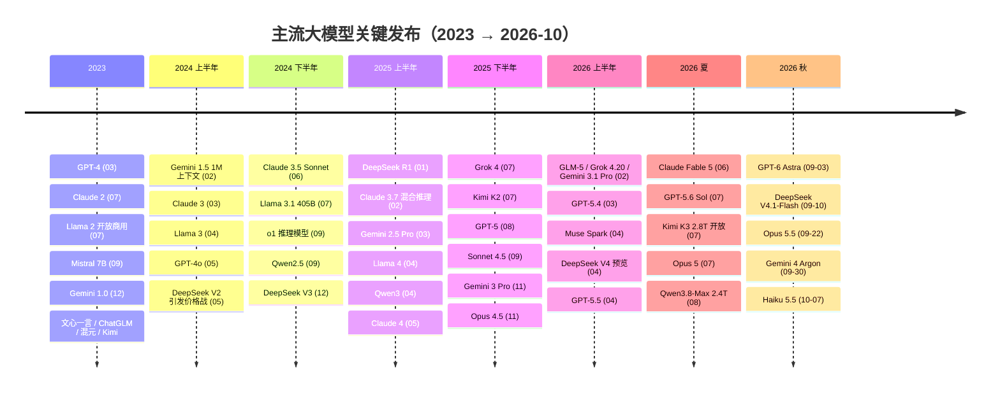
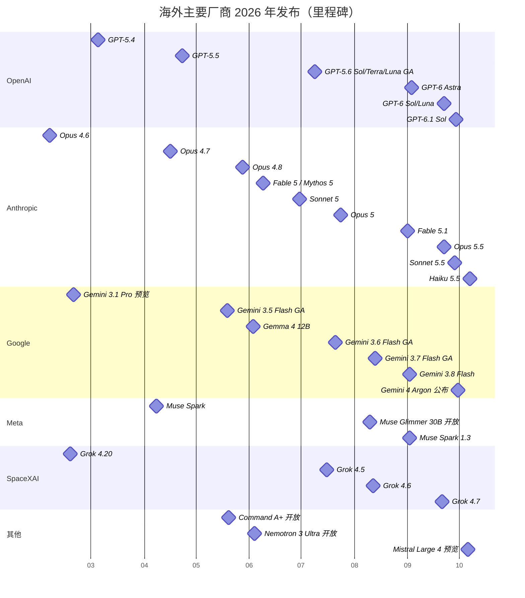
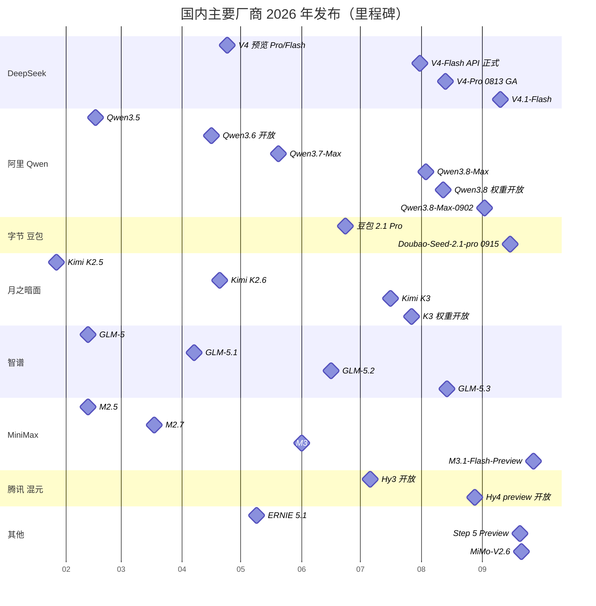
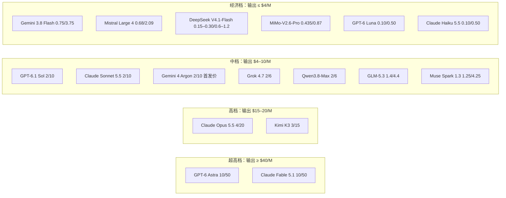
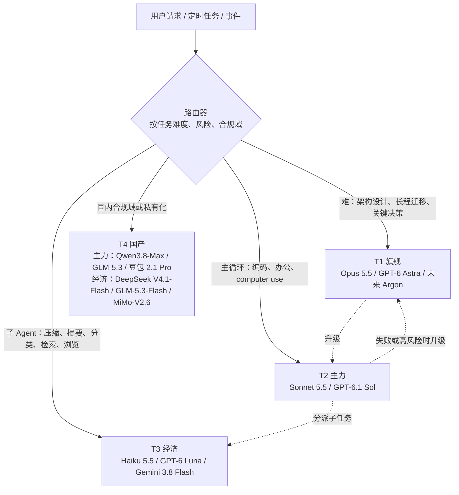

> 本文专门回答一个问题：**截至 2026-10-10，各家最热门的模型是哪些，它们的成本、性能、速度和开放程度怎样。**
>
> 资料优先取自一手来源：官方模型页、定价页、发布博客、API 文档。性能和热度数据取自 Artificial Analysis（AA）、LMArena、OpenRouter 等榜单，每个数字都尽量标了取数日期。
>
> 标注约定：
> - **[二手]**：来自媒体、聚合站或榜单镜像站。
> - **[推断]**：作者依据公开信息做的推论或估算。
> - **【待核实】**：没能找到一手来源，或不同来源互相矛盾。
> - **[厂商自报]**：厂商发布博客里的成绩，测试设置（harness、effort、是否带工具）各家不同，**不能跨厂商直接比**。
>
> 价格单位：美元 / 百万 tokens（$/M），国内厂商同时给出官方人民币价（¥/M）。文中"约合"美元按 1 USD ≈ 6.9 CNY 粗算【待核实：汇率按小米官方 ¥3 ↔ $0.435 反推】。
>
> 信息截至 2026-10-10（北京时间）。

# 0. 关键结论（先看这里）

1. **当前第一梯队是"三强 + 一个挑战者"。**
   - 综合智能：AA Intelligence Index v4.3.2（2026-10-09/10）前列全是 Anthropic、OpenAI、Google：Claude Opus 5.5（57.6）、Sonnet 5.5（56.0）、Fable 5.1（53.4）、GPT-6 Astra（52.7）、Gemini 4 Argon（52.6）、GPT-6.1 Sol（51.8）。挑战者是 Meta 的 **Muse Spark 1.3（48.1）** 和 SpaceXAI 的 **Grok 4.7（46.4）**。[AA](https://artificialanalysis.ai/evaluations/artificial-analysis-intelligence-index)、[镜像 models.fru.dev](https://models.fru.dev/benchmarks/aa-intelligence-index) [二手]
   - 人类偏好：LMArena 文本榜（2026-10-08 数据）第一是 **Gemini 4 Argon（1525）**，其次 Opus 5.5（1507）。[BenchLeader 镜像](https://www.benchleader.com/benchmarks/lmarena_text) [二手]
   - 编码 Agent：AA Coding Agent Index v1.5 第一是 **Claude Code + Sonnet 5.5（68.4）**，Opus 5.5（66.0）次之，Antigravity + Gemini 4 Argon（63.8）第三。[benchlm 镜像](https://benchlm.ai/benchmarks/aacodingagents) [二手]
2. **各家"最热门"型号（2026-10-10）**：OpenAI **GPT-6.1 Sol**（09-29）；Anthropic **Claude Opus 5.5 / Sonnet 5.5**（09-22 / 09-28）；Google **Gemini 3.8 Flash**（GA，09-02），Gemini 4 Argon 已发布但只对受信用户开放；Meta **Muse Spark 1.3**（09-02）；SpaceXAI **Grok 4.7**（09-21）；Mistral **Large 4 Preview**（10-06）；DeepSeek **V4.1-Flash**（09-10）；阿里 **Qwen3.8-Max（0902 快照）**；字节 **Doubao-Seed-2.1-pro（0915）**；月之暗面 **Kimi K3**（07-16）；智谱 **GLM-5.3 / GLM-5.3-Flash**；小米 **MiMo-V2.6-Pro**（09-21）；腾讯 **Hy4 preview**（08-28）；阶跃 **Step 5 Preview**（09-20）；MiniMax **M3**（05-31/06-01）；百度 **ERNIE 5.1**（05-09）。
3. **"一代三档"成为标准产品形态，价格大幅下探。**
   - OpenAI：Astra $10/$50、Sol $2/$10、Luna $0.10/$0.50。
   - Anthropic：Fable $10/$50、Opus $4/$20、Sonnet $2/$10、Haiku 5.5 $0.10/$0.50。
   - Google：Argon 首发价 $2/$10（之后 $4/$20），3.8 Flash 首发价 $0.75/$3.75。
   - **中档（Sol / Sonnet / Argon 首发价）在 2026 年秋天统一到了 $2/$10。** 2023 年 GPT-4 是 $30/$60。
4. **缓存价格成了真正的竞争点。** Agent 的输入大部分是缓存命中，所以各家都在砍缓存读价：GPT-6.1 Sol $0.10、Sonnet 5.5 $0.10、Opus 5.5 $0.20、Haiku 5.5 / Luna $0.01，DeepSeek V4.1-Flash 闲时 $0.003。Anthropic 和 OpenAI 的博客都明说"缓存读是 Agent 成本的大头"。
5. **开放权重的第一梯队几乎全是中国模型，差距约一代。**
   - AA 指数前列的开放权重模型：MiMo-V2.6-Pro（46.3，MIT）、Qwen3.8 系列、GLM-5.3（44.8）、Step 5 Preview（43.7，权重 10-15 发布）、Kimi K3（43.6）、GLM-5.3-Flash（41.8，MIT）。
   - 美欧侧：Mistral Large 4（权重月底发布）、NVIDIA Nemotron 3 Ultra、Meta 的 Muse Glimmer 30B、Google Gemma 4。Meta 承诺开放 Muse Spark 1.2 权重，截至 10-10 尚未兑现。
   - 闭源头部和开放头部相差约 10 分（AA 指数），大致相当于闭源模型 3–6 个月前的水平 [推断]。
6. **按调用量看，OpenRouter 上最热的是便宜的中国模型。** 截至 10-09 的一周，前 5 名是 DeepSeek V4.1 Flash（37.6T tokens）、一个匿名模型、GLM 5.3 Flash、MiMo-V2.6-Flash、Hy4 preview。闭源模型里用量最高的是 GPT-6 Luna 和 Claude Opus 5.5。[OpenRouter](https://openrouter.ai/rankings)
7. **评测体系换代了。** SWE-bench Verified 已被 OpenAI 停用（饱和、污染），SWE-bench Pro 也被撤回推荐。现在主流引用的是 **DeepSWE v1.1、Terminal-Bench 4.0、FrontierCode、CursorBench 4.0、OSWorld 2.x、AutomationBench、GDPval-AA、AA-Briefcase、HLE**。2025 年报告里常见的 AIME、GPQA 已基本饱和（GPT-6 Astra GPQA 96.0%）。[OpenAI](https://openai.com/index/why-we-no-longer-evaluate-swe-bench-verified/)
8. **对内部平台最重要的几点 [推断]：**
   - Agent 主循环可选 Sonnet 5.5 / GPT-6.1 Sol 这一档，最难的任务升到 Opus 5.5 / Astra，压缩、摘要、子 Agent 用 Haiku 5.5 / Luna / DeepSeek V4.1-Flash。
   - 同样一个 50 步的 Agent 任务，按标价估算从 $0.1 到 $9 以上都有（§6.3），**路由和缓存设计带来的成本差异比选哪家模型更大**。
   - 合规上国内对外服务要用已备案模型，私有化部署的现实选项是 Qwen3.8、GLM-5.3 / 5.3-Flash、MiMo-V2.6、DeepSeek V4.1-Flash、Hy4（§4.5）。

---

# 1. 口径说明：本文用了哪些榜单，怎么读

| 指标 | 测什么 | 本文取数日期 | 注意 |
|---|---|---|---|
| **AA Intelligence Index v4.3.2** | 10 项评测的综合（AA-Briefcase、GDPval-AA、AutomationBench-AA、Terminal-Bench 4.0、SciCode、HLE、GDP.pdf、CritPt、AA-Omniscience、AA-LCR） | 2026-10-09/10 | 同一模型不同 effort 分开计分；本文默认取最高档。[说明](https://atlas.kevinhu.io/benchmarks/aa-intelligence-index-v4-3-2) [二手] |
| **AA Coding Agent Index v1.5** | DeepSWE v1.1、Terminal-Bench 4.0、SWE-Atlas-QnA 等权平均，测的是"模型 + harness"组合 | 2026-10 | 评的是系统不是裸模型 [二手] |
| **LMArena Text** | 匿名对战的人类偏好，带风格控制 | 2026-10-08 数据 | 官方页面当时显示的还是 09-02 快照，本文用 BenchLeader 每日镜像 [二手] |
| **OpenRouter Rankings** | 经 OpenRouter 路由的 token 量 | 截至 2026-10-09 | 只反映 OpenRouter 用户，偏向开发者和便宜模型；不代表质量 |
| **AA Output Speed** | 第一方 API 首 token 之后的中位输出速度（tok/s） | 2026-10-10 | 近两周实测中位数 [二手] |
| **DeepSWE v1.1** | 原创、长程的软件工程任务（91 个仓库） | 各厂商发布时 | 已替代 SWE-bench Verified 成为主流编码指标 [arXiv](https://arxiv.org/html/2607.07946) |
| **Terminal-Bench 4.0** | 终端内的多步专业任务 | 各厂商发布时 | 2.1 版已接近饱和（多家 85–88%） |
| **OSWorld 2.0 / 2.1** | 长程 computer use | 各厂商发布时 | 2.0 / 2.1、offline 子集、partial / strict 计分口径不一，**跨厂商不可比** |
| **HLE** | 跨学科专家级问答 | 各厂商发布时 | 分"带工具 / 不带工具" |
| **GDPval-AA v2.1、AA-Briefcase v1.1** | 44 种职业的真实知识工作、多周期项目交付（Elo） | AA 测 | 最接近"办公 Agent"的指标 |
| **AutomationBench** | Zapier 出品，跨 47 个工具的业务流程 | 各厂商发布时 | 有 safeguard 回退时各家处理方式不同 |

**读数原则 [推断]**：同一张表里的分数只在同一来源、同一口径下比较；跨厂商博客的数字只看量级。厂商自报的成绩一律标 [厂商自报]。

---

# 2. 演进路线图（2023 → 2026-10）

> 2023–2025 年的条目来自已知公开发布记录，**本轮没有逐条重新检索**，个别日期可能有 ±数天误差【待核实】。2026 年条目均经本轮检索核对，来源见第 3 节各厂商小节。

## 2.1 六个阶段

| 阶段 | 时间 | 标志事件 | 能力跃迁 |
|---|---|---|---|
| ① 对话大模型爆发 | 2023 | GPT-4（03）、Claude 2（07）、Llama 2 开放商用（07）、Mistral 7B（09）、Gemini 1.0（12）；国内"百模大战"：文心一言（03）、通义、ChatGLM、混元（09）、Kimi（10） | 通用对话、8K–32K 上下文 |
| ② 多模态与长上下文 | 2024 上半年 | Gemini 1.5（1M 上下文）、Claude 3（03）、Llama 3（04）、GPT-4o（05，原生语音）、DeepSeek V2（05）引发国内价格战 | 百万上下文、实时语音、价格首轮大降 |
| ③ 推理模型 | 2024-09 → 2025 上半年 | o1（2024-09）、DeepSeek R1（2025-01，开源推理）、Claude 3.7（混合推理）、Gemini 2.5 Pro、Qwen3（混合思考）、o3 | 测试时计算（thinking）成为标配 |
| ④ Agent 与编码 | 2025 下半年 | Claude 4 / Claude Code、Grok 4、GPT-5（08）、Kimi K2、GLM-4.5/4.6、Sonnet 4.5、Gemini 3 Pro、Opus 4.5 | 工具调用、长程编码、computer use |
| ⑤ 长程 Agent 与"效率前沿" | 2026 上半年 | GPT-5.4/5.5、Claude Opus 4.6–4.8、Gemini 3.1 Pro / 3.5 Flash、DeepSeek V4（1M 上下文）、Qwen3.5–3.7、GLM-5、Kimi K2.5/K2.6、Muse Spark（Meta 转闭源） | 小时级自主任务、effort 档位、1M 上下文普及 |
| ⑥ 新一代旗舰 + 安全分级发布 | 2026-06 → 10 | Claude Fable 5 / Mythos 5（06）、Opus 5（07）、GPT-5.6 Sol/Terra/Luna（07）、Kimi K3（07，2.8T 开放）、Qwen3.8-Max（08，2.4T 开放）、GPT-6 Astra（09）、Claude 5.5 家族（09–10）、Gemini 4 Argon（09-30） | 天级自主运行、网络安全能力触及"关键"阈值、按风险分级放量 |

## 2.2 总览时间线

## 2.3 海外厂商 2026 年发布节奏

## 2.4 国内厂商 2026 年发布节奏

## 2.5 各家家族谱系（2023 → 2026）

| 厂商 | 2023 | 2024 | 2025 | 2026（截至 10-10） |
|---|---|---|---|---|
| **OpenAI** | GPT-4、GPT-4 Turbo | GPT-4o、o1 | o3、GPT-4.5、gpt-oss（开放权重）、GPT-5、GPT-5.1/5.2 | GPT-5.4 → 5.5 → 5.6（Sol / Terra / Luna 三档）→ **GPT-6 Astra / Sol / Luna → 6.1 Sol** |
| **Anthropic** | Claude 1、2 | Claude 3（Haiku/Sonnet/Opus）、3.5 Sonnet | 3.7 Sonnet、Claude 4、Opus 4.1、Sonnet 4.5、Haiku 4.5、Opus 4.5 | Opus 4.6/4.7/4.8 → 新增 **Fable / Mythos** 档 → Sonnet 5、Opus 5 → Fable 5.1 → **Claude 5.5（Opus/Sonnet/Haiku）** |
| **Google** | Bard、Gemini 1.0 | Gemini 1.5、2.0 Flash；Gemma 1/2 | Gemini 2.5、Gemini 3 Pro / Flash；Gemma 3 | 3.1 Pro → Flash 系列高频迭代（3.5→3.8，6 周 3 版）→ **Gemini 4 Argon**；Gemma 4 |
| **Meta** | LLaMA、Llama 2 | Llama 3 / 3.1 / 3.2 | Llama 4（口碑受挫）、成立 MSL | **Muse Spark**（闭源 API）1.1→1.2→1.3；Muse Glimmer 30B 开放 |
| **xAI → SpaceXAI** | Grok-1 | Grok-1 开放权重、Grok-2 | Grok 3、Grok 4、4.1 | 并入 SpaceX → Grok 4.20 → 4.5 → 4.6 → **4.7** |
| **Mistral** | Mistral 7B、Mixtral | Large 2 | Mistral 3 / Large 3【待核实】 | **Large 4 Preview（1T MoE，权重月底开放）** |
| **DeepSeek** | DeepSeek LLM | V2（价格战）、V3 | R1、V3.1、V3.2 | V4（Pro 1.6T / Flash 284B，1M 上下文）→ **V4.1-Flash** |
| **阿里 Qwen** | Qwen-7B/14B | Qwen2、2.5、QwQ | Qwen3（混合思考）、Qwen3-Max | 3.5 → 3.6 → 3.7-Max → **3.8-Max（首次开放 Max 级权重）** |
| **字节** | 云雀 | 豆包大模型（价格战） | Doubao 1.5、Seed 1.6、Seed-OSS-36B（开放） | 豆包 2.x → **Doubao-Seed-2.1-pro**（+ evolving 持续版） |
| **月之暗面** | Kimi 长文本 | — | k1.5、K2（1T 开放）、K2 Thinking | K2.5 → K2.6 → **K3（2.8T 开放）** |
| **智谱** | ChatGLM | GLM-4 | GLM-4.5 / 4.6 | GLM-5 → 5.1 → 5.2 → **5.3 / 5.3-Flash** |
| **MiniMax** | abab | abab 6.5 | MiniMax-01、M1、M2 | M2.5 → M2.7 → **M3** → M3.1-Flash-Preview |
| **腾讯** | 混元 | Hunyuan-Large（开放） | T1、TurboS | HY 2.0 Think → Hy3（开放）→ **Hy4 preview（开放）** |
| **百度** | 文心一言、ERNIE 4.0 | ERNIE 4.0 Turbo | ERNIE 4.5 / X1、4.5 开源、ERNIE 5.0 | **ERNIE 5.1**（05-09） |
| **阶跃星辰** | — | Step-1 / Step-2 | Step-3 | **Step 5 Preview**（09-20，10-15 开放权重） |
| **小米** | — | — | MiMo-7B、MiMo-V2 | V2.5 → **MiMo-V2.6-Pro / Flash（MIT）** |

**谱系上看出的几条规律 [推断]**
- 迭代周期从 2023 年的半年到一年，缩短到 2026 年的 **3–8 周一个小版本**（Gemini Flash 6 周 3 版，Anthropic 9–10 月连发 4 个模型）。
- 命名普遍从"大小号"（Pro/Flash/mini）转向"**能力档 + 安全档**"：Anthropic 的 Fable 与 Mythos 是同一模型、不同防护等级；Google 和 OpenAI 也给网络安全场景单开受信通道（Fairwind、Daybreak）。
- Meta 从开放权重的旗手转向闭源 API（Muse Spark），开放生态的主导权转到中国厂商手里。

---

# 3. 各厂商当前主力模型

字段说明：发布日期 · 权重与许可 · 上下文 / 最大输出 · 模态 · 推理模式 · API 价格（输入 / 输出 / 缓存读）· 速度 · 关键评测 · 优劣势。

## 3.1 OpenAI：GPT-6 家族（Astra / 6.1 Sol / Luna）

| 字段 | GPT-6 Astra（旗舰） | **GPT-6.1 Sol（主力，最热）** | GPT-6 Luna（快 / 便宜） |
|---|---|---|---|
| API ID | `gpt-6-astra` | `gpt-6.1-sol` | `gpt-6-luna` |
| 发布 | 2026-09-03（先对受限组织开放） | 2026-09-29 | 2026-09-22 |
| 权重 | 闭源 | 闭源 | 闭源 |
| 上下文 / 最大输入 / 最大输出 | 1,050,000 / 922K / 128K | 1,050,000 / 922K / 128K | 1.05M / 922K / 128K [二手] |
| 模态 | 文本 + 图像 → 文本 | 文本 + 图像 → 文本 | 同左 [二手] |
| 推理档位 | low → max（不支持 none） | low / medium（默认）/ high / xhigh / max | 支持 none |
| 价格 $/M（入 / 出 / 缓存读） | 10 / 50 / 1.00；缓存写 12.5；>272K 输入整单 2× 输入、1.5× 输出 | **2 / 10 / 0.10** | 0.10 / 0.50 / 0.01 |
| Batch / Flex | 5 折；Fast 模式 2×；另有 Ultrafast | Ultrafast 即将上线（Codex 内最高 8× 生成速度） | — |
| AA 智能指数 v4.3.2 | 52.7（max） | 51.8（max） | 38.1（max） |
| AA 输出速度 | 47 tok/s | 56 tok/s | 139 tok/s |
| 关键评测 [厂商自报] | Terminal-Bench 4.0 57.9%；DeepSWE v1.1 74.1%；OSWorld 2.0 offline 72.6%；GPQA 96.0%；HLE（带工具）57.2%；ARC-AGI-3 99.9%；AutomationBench 41.4%；MRCR 512K–1M 96.3% | DeepSWE 与 Astra 持平、成本约 1/5；OSWorld 2.0 距 Astra 2.1 个百分点、成本约 1/7；AutomationBench 比 Opus 5.5（medium）高 2.2 个百分点 | DeepSWE v1.1 66.6%（GPT-6 Luna max，见 Sol/Luna 发布博客） |
| 突出优势 | computer use、科研、网络安全（达到 Preparedness "Critical"阈值）、长上下文检索 | **中档里性价比最高之一**；缓存读 $0.10；Agent 场景（computer use、业务流程） | 极低价，适合大批量抽取、分类、摘要 |
| 短板 | 最贵；网络安全类任务有强 safeguard，API 中会直接停；在 LMArena 上排名不高（1475） | 不在 ChatGPT Chat 里（只在 Work / Codex）；不支持 `none` | AA 测得编码 Agent 指数比 5.6 Luna 退步 2 分 |

来源：[GPT-6 Astra 发布](https://openai.com/index/gpt-6-astra/)、[Astra 模型页](https://developers.openai.com/api/docs/models/gpt-6-astra)、[GPT-6.1 Sol 发布](https://openai.com/index/introducing-gpt-6-1-sol/)、[6.1 Sol 模型页](https://developers.openai.com/api/docs/models/gpt-6.1-sol)、[Sol/Luna 发布](https://openai.com/index/introducing-gpt-6-sol-and-luna/)、[Using GPT-6](https://developers.openai.com/api/docs/guides/latest-model)、[AA 评测 Sol/Luna](https://artificialanalysis.ai/articles/gpt-6-sol-and-luna-push-the-cost-efficiency-frontier)

补充：
- ChatGPT 里的 GPT-6（10-07 起推送，带 "Intelligent UI"）付费档由 GPT-6 Sol 驱动，免费档由 Luna 驱动；Work 和 Codex 用的模型不变。ChatGPT 周活超过 12 亿。[OpenAI](https://openai.com/index/gpt-6-for-everyone/)
- GPT-6 API 新能力：异步工具调用、任务中途插话（mid-turn steering）、对话中调整推理强度且不破坏缓存、对 Astra 的异步"失准监控"。
- 上一代 GPT-5.6 Sol / Terra / Luna（07-09 GA）仍在服务，Sol 原价 $4/$20。

## 3.2 Anthropic：Claude 5.5 家族 + Fable / Mythos 5.1

| 字段 | Claude Fable 5.1（最强通用） | **Claude Opus 5.5（最热）** | **Claude Sonnet 5.5** | Claude Haiku 5.5 |
|---|---|---|---|---|
| API ID | `claude-fable-5-1` | `claude-opus-5-5` | `claude-sonnet-5-5` | `claude-haiku-5-5` |
| 发布 | 2026-09-01 | 2026-09-22 | 2026-09-28 | 2026-10-07 |
| 权重 | 闭源 | 闭源 | 闭源 | 闭源 |
| 上下文 / 最大输出 | 1M / 128K | 1M / 128K（Batch 可到 300K） | 1M / 128K | 1M / 128K |
| 模态 | 文本 + 图像 → 文本 | 同左 | 同左 | 同左 |
| 推理 | 自适应思考，常开，默认 high | 自适应思考，**常开不可关**，默认 medium | 自适应，默认 high；新增 `between_tools` | 自适应，默认 medium；首个可调 effort 的 Haiku |
| 价格 $/M（入 / 出 / 缓存读） | 10 / 50 / 0.25 | **4 / 20 / 0.20**（5 分钟缓存写 $5；Fast 模式 $8/$40） | **2 / 10 / 0.10**（10-07 起缓存读减半） | ≤100K 提示：0.10 / 0.50 / 0.01；>100K：0.50 / 2.50 / 0.05 |
| AA 智能指数 v4.3.2 | 53.4 | **57.6（第 1）** | 56.0（第 2） | 43.4 |
| AA 输出速度 | 70 tok/s | 96 tok/s | 141 tok/s | 240 tok/s |
| 关键评测 [厂商自报] | Terminal-Bench 4.0 55.8%（Mythos 60.9%）；HLE 60.9% / 65.0%（不带 / 带工具）；OSWorld 2.0 77.9%（partial）；CursorBench 3.2 73.4% | Terminal-Bench 4.0 66.4%；FrontierCode 54.4%；CursorBench 4.0 57.8%；GDPval-AA 1846；HLE（带工具）67.7%；OSWorld 2.1 81.8%（partial）；AutomationBench 40.0% | Terminal-Bench 4.0 70.6%；CursorBench 4.0 55.5%；GDPval-AA 1844；OSWorld 2.1 80.1%；HLE（带工具）64.5% | Terminal-Bench 4.0 39.2%；OSWorld 2.1 offline 72.4%；GDPval-AA 1620；HLE 45.9% / 57.4% |
| 突出优势 | 研究、长程无人值守任务 | **综合第一**；长程编码与迁移、提示注入防御（Gray Swan 并列最低成功率）、写作清晰 | 编码 Agent 指数第一（Claude Code + Sonnet 5.5）；性价比 | 极便宜、极快；适合压缩、摘要、子 Agent、浏览器操作 |
| 短板 | 最贵；生物与网络安全请求会回退到 Opus 4.8 / Opus 5 | 思考不可关；网络安全任务大多回退到 Opus 4.8；"防蒸馏"限制改写历史 thinking | 网络安全高风险任务回退到 Sonnet 5 | 复杂编码明显弱于 Sonnet / Opus |

来源：[Opus 5.5 发布](https://www.anthropic.com/claude-opus-5-5)、[Opus 5.5 文档](https://platform.claude.com/docs/en/models/opus-5-5/overview)、[Sonnet 5.5](https://www.anthropic.com/claude-sonnet-5-5)、[Haiku 5.5](https://www.anthropic.com/claude-haiku-5-5)、[Fable / Mythos 5.1](https://www.anthropic.com/claude-fable-and-mythos-5-1)

补充：
- **Mythos 5.1 与 Fable 5.1 是同一个模型**，只是防护等级不同；Mythos 只通过网络安全（CVP）和生命科学（LSVP）验证项目对少数机构开放，目前只限美国组织。
- 新推出 **Enterprise Frontier Safeguards（EFS）**：数据存在客户自己的云上，效果等同零数据保留（ZDR），今年秋季分阶段上线。
- 为符合欧盟 AI 法案，2026-08-02 之后发布的模型输出带不可见水印。
- 所有型号都上了 AWS Bedrock、Google Cloud、Microsoft Foundry。

## 3.3 Google：Gemini 4 Argon（预发布）+ Gemini 3.8 Flash（GA 主力）+ Gemma 4

| 字段 | Gemini 4 Argon（新旗舰，受限） | **Gemini 3.8 Flash（GA 主力，最热）** | Gemma 4（开放权重） |
|---|---|---|---|
| ID | 尚无公开 model ID（截至 10-08）[二手] | `gemini-3.8-flash` | E2B / E4B / 12B / 26B-A4B MoE / 31B |
| 发布 | 2026-09-30 公布，只对 Fairwind 项目和受信测试者开放；下一步开放给付费 API 客户和 AI Ultra 订阅者，**没有日期** | 2026-09-02 | 12B Unified 版 2026-06-03；家族首发日期【待核实】 |
| 权重 | 闭源 | 闭源 | **Apache 2.0** |
| 上下文 / 最大输出 | 【待核实】/ **1M 输出**（此前为 64K） | 1,048,576 / 65,536 | 依型号 |
| 模态 | 多模态（长视频 LVBench 91.7%） | 输入文本、图像、视频、音频、PDF → 文本 | 12B Unified 支持文本、图像、音频、视频输入 |
| 推理 | 深度推理 | thinking：low / medium / high（不支持 minimal） | — |
| 价格 $/M | **首发价 2 / 10**，缓存读打 5% 折（$0.10）；之后 4 / 20 | **首发价 0.75 / 3.75（至 2026-12-31）**；2027 起 1.50 / 7.50；缓存价【待核实】 | 开放权重自部署 |
| AA 智能指数 | 52.6（high） | 40.9（high） | — |
| AA 速度 | — | 125 tok/s | — |
| LMArena | **1525（第 1）** | 1497（第 8） | — |
| 关键评测 [厂商自报] | DeepSWE v1.1 77.9%（自称 SOTA）；AutomationBench 51.3%（自称第 1）；Vals Index 第 1；CWE-bench v1 68% | HLE-Verified 54.9%；DeepSWE 73.8%、Terminal-Bench 4.0 19.1%（引自 OpenAI 的 Astra 对比表） | — |
| 优势 | 人类偏好第一、长视频和视觉知识工作、网络安全防御、1M 输出 | 价格低、速度快、原生多模态（含音频视频）、Computer Use（预览）、Google 搜索与地图 grounding | 端侧和本地部署 |
| 短板 | 还用不上 | 终端类 Agent 任务弱（TB 4.0 仅 19%）；高 effort 下 token 消耗多 | 不是前沿级 |

来源：[Gemini 4 Argon](https://blog.google/innovation-and-ai/models-and-research/gemini-models/gemini-4-argon/)、[Argon 上线状态（二手）](https://trustloud.com/gemini-4-argon-release-date/)、[Gemini 3.8 Flash 发布](https://blog.google/innovation-and-ai/models-and-research/gemini-models/3-8-flash-and-3-8-flash-cyber/)、[3.8 Flash 模型页](https://ai.google.dev/gemini-api/docs/models/gemini-3.8-flash)、[Gemini API changelog](https://ai.google.dev/gemini-api/docs/changelog)、[Gemma 4](https://ai.google.dev/gemma/docs/core)

补充：
- 3.7 Flash 和 3.5 Flash 已于 10-08 弃用，请求自动路由到新版。
- **Pro 档的现状【待核实】**：2026 年公开记录里只看到 Gemini 3.1 Pro（02-19 预览），之后 Google 主推 Flash 系列，Argon 是下一代旗舰。
- 还有面向网络安全的 **3.8 Flash Cyber**，只通过 Fairwind 项目开放。

## 3.4 Meta：Muse Spark 1.3（闭源 API）+ Muse Glimmer（开放）

| 字段 | **Muse Spark 1.3** | Muse Glimmer 30B |
|---|---|---|
| 发布 | 2026-09-02（初代 Muse Spark 2026-04-08） | 2026-08-10 |
| 权重 | **闭源**，只通过 Meta Model API 提供。Meta 8 月称"即将开放 Muse Spark 1.2 权重"，截至 10-10 **未兑现**【待核实】 | **开放，Apache 2.0**，30B dense，面向本地 Agent |
| 上下文 | 1M | 【待核实】 |
| 模态 | 原生多模态（视频、图像、文档） | — |
| 推理 | 有 max 档 | — |
| 价格 $/M | 标准档 1.25 / 4.25 / 缓存 0.15；"贡献者档"（数据用于改进产品）0.10 / 0.20 / 0.002 | 自部署 |
| AA 智能指数 | **48.1（非三巨头里最高）** | — |
| AA 速度 | **280 tok/s（全榜第 1）** | — |
| LMArena | 1494 | — |
| 关键评测 [厂商自报] | GDPval-AA 1754；OSWorld 2.0 66.9%（partial）；DeepSWE v1.1 75.4%；Terminal-Bench 2.1 88.8%；MRCR 512K–1M 98.1% | — |
| 定位 | 驱动 Meta AI、Muse 个人 Agent 和 Muse Code | 本地 Agent，对标 Gemma |

来源：[Muse Spark 1.3 模型页](https://dev.meta.ai/models/muse-spark)、[Meta Model API 定价](https://dev.meta.ai/docs/pricing-rate-limits)、[Muse Spark 初版](https://ai.meta.com/blog/introducing-muse-spark-msl/)、[OfficeChai：权重承诺](https://officechai.com/ai/mark-zuckerberg-says-meta-will-release-weights-of-muse-spark-1-2-announces-30b-muse-glimmer-model-for-local-use/) [二手]、[Muse 1.2 权重状态](https://www.orcarouter.ai/blog/meta-muse-spark-1-2-explained) [二手]

> 回答任务里的问题"Muse 由什么驱动"：Meta 的 Muse 个人 Agent 背后是 **Muse Spark 系列**（Meta 超级智能实验室 MSL 出品），不是 Llama。Llama 4（2025-04）之后没有 Llama 5 [二手]。

## 3.5 SpaceXAI（原 xAI）：Grok 4.7

| 字段 | **Grok 4.7** |
|---|---|
| 发布 | 2026-09-21 |
| 背景 | xAI 2026 年 2 月并入 SpaceX，之后以 SpaceXAI 品牌发布 [二手] |
| 权重 | 闭源 |
| 上下文 | 500K；文本 + 图像输入；支持函数调用、Web / X 搜索、代码执行 |
| 价格 $/M | 2 / 6 / 缓存 0.50（输入 <200K）；≥200K 翻倍为 4 / 12 / 1；另有 2 倍速、2 倍价的快速版 |
| AA 智能指数 | 46.4（xhigh） |
| AA 速度 | 74 tok/s |
| 关键评测 [厂商自报] | CursorBench 4.0 46.3%；DeepSWE v1.1 71.0%；Terminal-Bench 4.0 37.6%；EEBench 64.0%；AA-Briefcase 1657 |
| 优势 | 输出价低（$6），电子工程和法律类任务表现好；Cursor 首发 |
| 短板 | Terminal-Bench 4.0 明显落后 Anthropic 和 OpenAI 旗舰 |

来源：[Grok 4.7](https://x.ai/news/grok-4-7)、[Grok 4.7 文档](https://docs.x.ai/developers/models/grok-4.7)

## 3.6 Mistral：Large 4 Preview（"le Chonk"）

| 字段 | **Mistral Large 4 Preview** |
|---|---|
| 发布 | 2026-10-06 公开预览；**权重月底开放**（具体日期 10-27 或 10-31，说法不一【待核实】） |
| 架构 | 约 1T 总参数 / 52B 激活的原生多模态 MoE；在 Mistral 欧洲自有数据中心训练（3,800 张 GB 系列 GPU） |
| 上下文 | 1M [二手] |
| 许可 | 尚未公布【待核实】 |
| 价格 $/M | 预览价 0.68 / 2.09 / 缓存 0.07；标价 1.36 / 4.18 [二手] |
| AA 智能指数 | 38.4（Preview） |
| 关键评测 [厂商自报] | DeepSWE v1.1 61.7%；Terminal-Bench 4 28.3%；AutomationBench 59.9%；Cybench 93%；Lakera B3 93.3% |
| 定位 | 欧洲主权 AI、网络安全（开放权重，不受闭源模型拒答限制）、可本地部署 |

来源：[Mistral Large 4](https://mistral.ai/news/mistral-large-4/)、[价格（二手）](https://www.mercatus-ai.com/blog/mistral-large-4-api-pricing)

## 3.7 其他海外厂商

| 厂商 | 当前型号 | 要点 | 来源 |
|---|---|---|---|
| **Amazon** | Nova 2 Lite / Pro（预览）/ Omni（预览）/ Sonic | Nova 2 Pro $1.25 / $10，Lite $0.30 / $2.50；Nova Premier 已弃用 [二手] | [AWS Nova](https://aws.amazon.com/nova/models/) |
| **Microsoft MAI** | MAI-Code-1.1-Flash（10-07） | 137B / 6.8B 激活 MoE 编码模型，256K 上下文，成本为 6 月版的 1/4；可本地运行，在 GitHub Copilot 中实验性推出 | [Microsoft AI](https://microsoft.ai/news/mai-code-1-1-flash-br-better-faster-at-a-quarter-of-the-cost/) |
| **Cohere** | Command A+（05-20） | **Apache 2.0 开放**，218B / 25B 激活 MoE，128K 输入 / 64K 输出，48 种语言，单卡 B200 或双卡 H100 可跑 | [Cohere](https://cohere.com/blog/command-a-plus) |
| **NVIDIA** | Nemotron 3 Ultra（06-04） | 550B / 55B 激活，Mamba-2 + MoE + 注意力混合架构，1M 上下文；权重、训练数据、配方全开放（OpenMDW 许可）；OpenRouter 免费版周用量第 7 | [NVIDIA](https://research.nvidia.com/labs/nemotron/Nemotron-3-Ultra/) |
| **匿名模型** | "Space Bunny Alpha" | OpenRouter 周用量第 2（16.9T tokens），来源不明【待核实】 | [OpenRouter](https://openrouter.ai/rankings) |

## 3.8 DeepSeek：V4.1-Flash

| 字段 | **DeepSeek-V4.1-Flash（最热）** | DeepSeek-V4-Pro-0813 |
|---|---|---|
| API ID | `deepseek-flash` | `deepseek-v4-pro` |
| 发布 | 2026-09-10 | 2026-08-13 GA（V4 预览 2026-04-24） |
| 架构 | 552B MoE，新的"因果编码器-解码器"结构：输入侧激活 8B、输出侧激活 16B；KV cache 显存降到 1/4 | 1.6T / 49B 激活 [二手] |
| 权重 | **开放，MIT** | 开放 [二手] |
| 上下文 / 最大输出 | 1M / 384K | 1M / 384K |
| 模态 | 原生图文多模态 | 不支持视觉 |
| 推理 | 思考（默认）/ 非思考两种模式 | 同左 |
| 价格 | 闲时 $0.15 / $0.60 / 缓存 $0.003；高峰翻倍。人民币：闲时 ¥1 / ¥4 / 缓存 ¥0.02，高峰 ¥2 / ¥8 / ¥0.04 | 闲时 $0.66 / $1.98 / $0.022；高峰翻倍 |
| 高峰时段 | 工作日 UTC 01:00–04:00、06:00–10:00，即北京时间 9–12 点、14–18 点 | 同左 |
| AA 智能指数 | 39.5 | 36.0 |
| AA 速度 | 217 tok/s | 89 tok/s |
| 热度 | **OpenRouter 周用量第 1（37.6T，+56%）、月用量第 1（96.2T）** | — |
| 兼容性 | OpenAI 格式、Anthropic 格式、Responses API | 同左 |

来源：[V4.1-Flash 发布](https://www.deepseek.com/en/news/deepseek-v4-1-flash/)、[定价](https://api-docs.deepseek.com/quick_start/pricing)、[V4 预览](https://www.deepseek.com/en/news/v4-preview/)

> **矛盾点【待核实】**：V4.1-Flash 发布稿说"09-14 起所有 `deepseek-v4-pro` 请求路由到 V4.1-Flash，按 Flash 计价，直到 V4.1-Pro 发布"；但当前定价页仍单列 V4-Pro-0813 和它自己的价格。接入前要实测确认。

## 3.9 阿里：Qwen3.8 家族

| 字段 | **Qwen3.8-Max（含 0902 快照）** | Qwen3.8-Flash（API）/ Flash-Next（开放） | Qwen3.8-27B |
|---|---|---|---|
| 发布 | 2026-08-03；权重 08-12；0902 快照 09-02 | 【待核实】 | 2026-08-14 |
| 架构 | 2.4T / 95B 激活 MoE | 125B / 6B 激活 MoE + 51B N-gram 表 | dense，多模态 |
| 权重 | **首次开放 Max 级权重**（2.4T-A95B）；0902 快照仅 API，许可【待核实】 | Flash-Next 开放 | 开放 |
| 上下文 / 输出 | 1M / 64K（按官方 OpenClaw 配置示例） | 1M | — |
| 推理 | reasoning_effort：xhigh（默认）/ medium / low；默认保留思考内容 | — | — |
| 价格 | 国际版 $2 / $6，隐式缓存 $0.25；百炼国内版 **¥12 / ¥36，缓存命中 ¥1.5**，Batch 半价 | 北京 ¥0.8 / ¥2.7 | OpenRouter $0.04 / $1.35 [二手] |
| AA 智能指数 | 45.4（0902）/ 40.2（初版） | 39.8（Flash-Next） | — |
| AA 速度 | — | 56 tok/s（Flash-Next） | 46 tok/s |
| LMArena | 1483 | — | — |
| 优势 | 多个 harness（QwenWork / Claude Code / Codex / OpenClaw / Hermes）上表现一致；兼容 OpenAI 和 Anthropic 协议；长程自主（官方演示 16 天自主开发） | 便宜 | 可单机部署 |

来源：[Qwen3.8-Max 博客](https://www.alibabacloud.com/blog/603421)、[QwenCloud 0902](https://www.qwencloud.com/models/qwen3.8-max-0902)、[百炼模型页](https://help.aliyun.com/zh/model-studio/qwen3-8-max)、[Qwen3.8-Flash](https://help.aliyun.com/en/model-studio/qwen3-8-flash)

## 3.10 字节：Doubao-Seed-2.1-pro

| 字段 | **Doubao-Seed-2.1-pro（260915）** |
|---|---|
| 发布 | 豆包 2.1 Pro 2026-06-23（火山引擎 FORCE 大会）；0915 版 2026-09-15 |
| 权重 | 闭源（字节此前开放过 Seed-OSS-36B） |
| 上下文 / 最大输出 | 1M / 256K |
| 模态 | 文本、图像、视频输入（不含音频）→ 文本 |
| 推理 | minimal / low / medium / high（默认 high） |
| 价格 | **¥6 / ¥30，缓存命中 ¥1.2**（1M 窗口内统一价）；2.1 Turbo 为 Pro 的一半 |
| 速度 | TPOT 15–18ms，约 55–65 tok/s [推断] |
| 特色 | 另有 **Doubao-Seed-evolving** 持续更新版（每月更新 2–4 次）；接入豆包、TRAE、扣子；兼容 Claude Code、OpenClaw、Codex CLI |
| 规模 | 截至 2026-06，豆包大模型日均 token 调用量超过 180 万亿；IDC 数据显示火山引擎在中国公有云 MaaS 市场份额 49.5% |
| 评测 | 官方称"多项评测优于 Claude Opus 4.6"，未进 AA 指数前 40【待核实】 |

来源：[澎湃：豆包 2.1 发布](https://www.thepaper.cn/newsDetail_forward_33434649)、[火山引擎 0915 版解读](https://www.volcengine.com/article/2945230)

## 3.11 月之暗面：Kimi K3

| 字段 | **Kimi K3** |
|---|---|
| 发布 | 2026-07-16；**权重 07-27 开放** |
| 架构 | 2.8T 参数（首个开放的 3T 级模型），896 个专家中激活 16 个；采用 Kimi Delta Attention 和 Attention Residuals；MXFP4 量化感知训练 |
| 许可 | 自定义 Kimi K3 License，商用或转售可能需要另签协议 [二手] |
| 上下文 | 1,048,576 |
| 模态 | 原生视觉 |
| 推理 | 首发只有 max 档 |
| 价格 | $3 / $15 / 缓存 $0.30；人民币 **¥20 / ¥100 / 缓存 ¥2**；官方称 Kimi API 在编码负载下缓存命中率超过 90% |
| 部署 | 权重约 1.4TB，建议 64 张以上加速卡 |
| AA 智能指数 | 43.6 |
| AA 速度 | 41 tok/s（慢） |
| LMArena | 1488（开放权重模型最高） |
| 官方自述局限 | 对思考历史回传很敏感，中途从别的模型切过来会不稳定；"过度主动"；体验仍不如 Fable 5 和 GPT-5.6 Sol |

来源：[Kimi K3 技术博客](https://www.kimi.com/blog/kimi-k3)、[许可分析（二手）](https://saassentinel.com/2026/07/28/moonshot-ai-releases-kimi-k3-weights-but-enterprises-face-license-and-infrastructure-hurdles/)、[人民币价格（二手）](https://www.cnblogs.com/vibecodinghuanzhe/p/22396404)

## 3.12 智谱：GLM-5.3 / GLM-5.3-Flash

| 字段 | **GLM-5.3** | **GLM-5.3-Flash** |
|---|---|---|
| 发布 | 2026-08-14；权重 08-28 | 【待核实】（09 月前后，曾以匿名的 `ox-alpha` 测试） |
| 架构 | 744B / 40B 激活 MoE（与 GLM-5.2 同一基座，只做了后训练） | 320B / 18B 激活，线性注意力 + 稀疏注意力混合；**首个原生多模态的 GLM-5 系列模型** |
| 许可 | 自定义 GLM-5.3 License：一般商用可以；近 12 个月营收超过 100 亿美元的 MaaS 运营方需经智谱安全审查 | **MIT** |
| 上下文 | 1M；仅文本 | 1M（按文中 IndexPool 描述）【待核实】 |
| 推理 | low / high / max（不能关闭思考） | — |
| 价格 | $1.40 / $4.40 / 缓存 $0.26；人民币 **¥8 / ¥28 / 缓存 ¥2** | 约为 GLM-5.2 的 1/10；跑一遍 AA 指数每任务约 $0.045（折扣价）；具体单价【待核实】 |
| AA 智能指数 | 44.8 | 41.8 |
| AA 速度 | 83 tok/s | 53 tok/s |
| 热度 | OpenRouter 周用量第 10 | **OpenRouter 周用量第 3（11.2T）** |
| 关键评测 [厂商自报] | DeepSWE v1.1 66.9%；Terminal-Bench 3.0 28.3%；CyberGym 84.5%（自称 SOTA） | DeepSWE 63.4%；OSWorld 2.0 59.1%；GDPval-AA v2 1773 |
| 特色 | 网络安全能力增长快（发现 2,436 个漏洞）；GLM Coding Plan 订阅 | **全部推理跑在国产 AI 芯片集群上**，每 token 成本据称与主流 NVIDIA GPU 相当 |

来源：[GLM-5.3](https://z.ai/blog/glm-5.3)、[GLM-5.3-Flash](https://z.ai/blog/glm-5.3-flash)、[GLM-5.3 许可](https://huggingface.co/zai-org/GLM-5.3/blob/187fb9fff6319062325ff825627ef6db084d9bc6/LICENSE)、[BigModel 定价](https://docs.bigmodel.cn/cn/guide/start/pricing)

## 3.13 小米：MiMo-V2.6-Pro / Flash

| 字段 | **MiMo-V2.6-Pro** | MiMo-V2.6-Flash |
|---|---|---|
| 发布 | 2026-09-21（官方页 09-22 更新） | 同左 |
| 权重 | **MIT，全开放**（同时开源技术报告、7K+ 个 RL 环境和训练框架） | MIT |
| 架构 | 约 1.02T MoE [二手] | — |
| 模态 | 原生全模态 | 同左 |
| 价格 | **¥3 / ¥6 / 缓存 ¥0.025**（约 $0.435 / $0.87 / $0.0036）；Batch 5 折；另有最高 20 倍速的 UltraSpeed 模式 | ¥1 / ¥2 / 缓存 ¥0.02 |
| AA 智能指数 | **46.3（开放权重第 1）** | 37.9 |
| AA 速度 | 43 tok/s | 58 tok/s |
| 热度 | — | OpenRouter 周用量第 4（10.9T） |
| 官方说法 | "同等智能下价格是海外模型的 1/20 到 1/60"；DeepSWE v1.1 72.6% [厂商自报] | DeepSWE 65.7% |

来源：[MiMo-V2.6](https://mimo.mi.com/docs/en-US/news/latest/v2-6)、[价格](https://mimo.mi.com/docs/zh-CN/price/pay-as-you-go)

## 3.14 腾讯：Hy4 preview

| 字段 | **Hy4 preview** |
|---|---|
| 发布 | 2026-08-28，同时开源 |
| 架构 | 770B / 49B 激活 MoE |
| 权重 | **Apache 2.0** [二手：GitHub README] |
| 上下文 | 1M（最大输入 960K，输出 64K）[二手] |
| 价格 | **¥6 / ¥18 / 缓存命中最低 ¥0.3** |
| 渠道 | 腾讯云 TokenHub、OpenRouter；WorkBuddy / CodeBuddy、元宝、ima 首发 |
| 热度 | OpenRouter 周用量第 5（7.96T） |
| 评测 | 内部 163 名专家、203 个工程任务盲测：Hy4 2.99/4，GLM-5.3 2.92，Kimi K3 2.94 [厂商自报] |

来源：[腾讯](https://www.tencent.com/zh-cn/tencent-releases-and-open-sources-tencent-hy4-preview/)、[GitHub](https://github.com/Tencent-Hunyuan/Hy4-preview)

## 3.15 阶跃星辰：Step 5 Preview

| 字段 | **Step 5 Preview** |
|---|---|
| 发布 | 2026-09-20；**权重定于 10-15 开放**（截至 10-10 仓库里还没有可用权重 [二手]） |
| 架构 | 600B / 27B 激活稀疏 MoE |
| 上下文 / 输出 | 1M / 64K |
| 模态 | 文本、图像、视频输入 |
| 推理 | low / medium / high |
| 价格 | **¥7 / ¥20 / 缓存 ¥0.35** [二手；阿里云百炼也上架了] |
| AA 智能指数 | 43.7（官方称开放模型前三）；官方称单任务成本是 Claude Opus 5 的 1/8 |
| AA 速度 | 87 tok/s |
| 热度 | OpenRouter **周涨幅第 1**；10-09 单日用量第 2（2.59T，+309%）；在 Cline、Kilo 等平台限时免费 |

来源：[阶跃官方](https://www.stepfun.com/news/step-5-preview)、[文档](https://platform.stepfun.com/docs/zh/guides/models/step-5-preview)、[百炼上架](https://help.aliyun.com/zh/model-studio/step-5-preview)

## 3.16 MiniMax：M3

| 字段 | **MiniMax M3** |
|---|---|
| 发布 | 2026-05-31（不同时区记为 06-01）；M3.1-Flash-Preview 09-27（只在 MiniMax Code 和订阅里提供） |
| 架构 | 约 428B / 23B 激活 |
| 权重 | 开放，minimax-community 许可 |
| 上下文 | 1M，原生多模态（文本、图像、视频） |
| 价格 | $0.30 / $1.20（≤512K）；人民币标价 ¥4.2 / ¥16.8 / 缓存 ¥0.84，当前标注"永久五折"为 **¥2.1 / ¥8.4 / ¥0.42** |

来源：[MiniMax M3](https://www.minimax.io/blog/minimax-m3)、[定价](https://platform.minimax.cn/docs/pricing/overview)、[M3.1-Flash-Preview（一财）](https://www.yicai.com/brief/103379438.html)

## 3.17 百度：ERNIE 5.1

| 字段 | **ERNIE 5.1** |
|---|---|
| 发布 | 2026-05-09；**ERNIE 6 尚未发布** |
| 权重 | 未开源 [二手] |
| 上下文 / 输出 | 128K（最大输入 119K）/ 65,536 |
| 价格 | ≤32K：¥4 / ¥18（每百万，即 ¥0.004 / ¥0.018 每千）；32K–128K：¥6 / ¥22 |
| 评测 | LMArena 1467；未进 AA 指数前列 |
| 特点 | 写作和创作见长；总参数是 ERNIE 5.0 的约 1/3 |

来源：[ERNIE 5.1 博客](https://ernie.baidu.com/blog/zh/posts/ernie-5.1-0508-release/)、[千帆计费](https://cloud.baidu.cn/doc/qianfan/s/wmh4sv6ya)

## 3.18 其他值得关注的国内模型

- **蚂蚁 inclusionAI Ling 3.1 Flash**：AA 指数 41.1，输出速度 214 tok/s，OpenRouter 周涨幅前列 [二手]。
- **K2 Horizon 375B-A23B**（Institute of Foundation Models）：AA 速度 119 tok/s【待核实：机构背景】。

---

# 4. 对比表

## 4.1 主力旗舰横向对比（每家取当前最强的可用型号）

| 模型 | 厂商 | 发布 | 开放 | 上下文 | 价格 $/M 入 / 出 / 缓存 | AA 指数 | AA 速度 | LMArena |
|---|---|---|---|---|---|---|---|---|
| Claude Opus 5.5 | Anthropic | 09-22 | 否 | 1M | 4 / 20 / 0.20 | **57.6** | 96 | 1507 |
| Claude Sonnet 5.5 | Anthropic | 09-28 | 否 | 1M | 2 / 10 / 0.10 | 56.0 | 141 | 1476 |
| Claude Fable 5.1 | Anthropic | 09-01 | 否 | 1M | 10 / 50 / 0.25 | 53.4 | 70 | 1501 |
| GPT-6 Astra | OpenAI | 09-03 | 否 | 1.05M | 10 / 50 / 1.00 | 52.7 | 47 | 1475 |
| Gemini 4 Argon | Google | 09-30（受限） | 否 | — | 2 / 10 / 0.10（首发价） | 52.6 | — | **1525** |
| GPT-6.1 Sol | OpenAI | 09-29 | 否 | 1.05M | 2 / 10 / 0.10 | 51.8 | 56 | 1484 |
| Muse Spark 1.3 | Meta | 09-02 | 否 | 1M | 1.25 / 4.25 / 0.15 | 48.1 | **280** | 1494 |
| Grok 4.7 | SpaceXAI | 09-21 | 否 | 500K | 2 / 6 / 0.50 | 46.4 | 74 | — |
| MiMo-V2.6-Pro | 小米 | 09-21 | MIT | — | 0.435 / 0.87 / 0.0036 | 46.3 | 43 | 1480 |
| Qwen3.8-Max-0902 | 阿里 | 09-02 | 部分 | 1M | 2 / 6 / 0.25 | 45.4 | — | 1483 |
| GLM-5.3 | 智谱 | 08-14 | 自定义 | 1M | 1.40 / 4.40 / 0.26 | 44.8 | 83 | 1478 |
| Step 5 Preview | 阶跃 | 09-20 | 10-15 开放 | 1M | ¥7 / ¥20 / ¥0.35 | 43.7 | 87 | — |
| Kimi K3 | 月之暗面 | 07-16 | 自定义 | 1M | 3 / 15 / 0.30 | 43.6 | 41 | 1488 |
| Gemini 3.8 Flash | Google | 09-02 | 否 | 1M | 0.75 / 3.75 /【待核实】 | 40.9 | 125 | 1497 |
| DeepSeek V4.1-Flash | DeepSeek | 09-10 | MIT | 1M | 0.30 / 1.20 / 0.006（高峰） | 39.5 | 217 | 1475 |
| Mistral Large 4 Preview | Mistral | 10-06 | 月底开放 | 1M | 0.68 / 2.09 / 0.07 | 38.4 | — | — |
| Doubao-Seed-2.1-pro | 字节 | 09-15 | 否 | 1M | ¥6 / ¥30 / ¥1.2 | — | — | — |
| Hy4 preview | 腾讯 | 08-28 | Apache 2.0 | 1M | ¥6 / ¥18 / ¥0.3 | — | — | — |
| MiniMax M3 | MiniMax | 06-01 | 社区许可 | 1M | 0.30 / 1.20 | — | — | — |
| ERNIE 5.1 | 百度 | 05-09 | 否 | 128K | ¥4 / ¥18 | — | — | 1467 |

AA 指数为 v4.3.2，取各型号最高 effort，数据日期 2026-10-09/10；速度为 AA 2026-10-10；LMArena 为 2026-10-08 数据（BenchLeader 镜像）；"—"表示本轮没查到。

## 4.2 性价比视图

**(a) 价格分档（2026-10）**

**(b) 跑一遍 AA 智能指数的单任务成本（AA 实测）**

| 模型 | 每任务成本 | 来源 |
|---|---|---|
| GPT-6 Sol（max） | $1.06（比 GPT-5.6 Sol 低约 50%） | [AA](https://artificialanalysis.ai/articles/gpt-6-sol-and-luna-push-the-cost-efficiency-frontier) |
| GPT-6 Luna（max） | $0.07 | 同上 |
| GLM-5.3-Flash | 约 $0.045（折扣价，口径为 AA v4.1.1）[厂商自报] | [Z.ai](https://z.ai/blog/glm-5.3-flash) |
| Step 5 Preview | Claude Opus 5 的 1/8 [厂商自报] | [阶跃](https://www.stepfun.com/news/step-5-preview) |

**(c) 厂商自报的"同分不同价"**
- Opus 5.5（默认 medium）在 FrontierCode 上超过 GPT-6 Astra 最高分，每任务成本约为后者的 20%；Terminal-Bench 4.0 与 Astra 持平，成本约 40%。[Anthropic]
- GPT-6.1 Sol 在 Terminal-Bench Science（max）每任务 $5.47，Opus 5.5 为 $23.21，Astra 为 $23.80。[OpenAI]
- GPT-6 Sol（xhigh）在 AutomationBench 上 33.2%、每任务 $0.27，Opus 5（max）只有 26.9%、成本是其 11.1 倍。[OpenAI]
- 两家都拿自己最有利的口径，只能看量级。

## 4.3 编码与 Agent 能力

**(a) AA Coding Agent Index v1.5（模型 + harness 组合，2026-10）[二手]**

| 排名 | 组合 | 分数 |
|---|---|---|
| 1 | Claude Code + Sonnet 5.5（max） | 68.4 |
| 2 | Claude Code + Opus 5.5（max） | 66.0 |
| 3 | Antigravity CLI + Gemini 4 Argon（high） | 63.8 |
| — | Codex + GPT-6 Sol（max） | 57（AA 9 月数据） |
| — | Mistral Large 4（ML4 官方引用） | 49.8 |

来源：[benchlm 镜像](https://benchlm.ai/benchmarks/aacodingagents)、[OfficeChai](https://officechai.com/ai/gemini-4-argon-with-antigravity-places-ahead-of-gpt-6-1-sol-on-codex-on-artificial-analysis-coding-agent-index/)

**(b) 主要 Agent 评测汇总**（全部为厂商自报，各家 harness 不同，只看量级）

| 模型 | DeepSWE v1.1 | Terminal-Bench 4.0 | OSWorld 2.x | AutomationBench | HLE（带工具） | GDPval-AA v2.x |
|---|---|---|---|---|---|---|
| Claude Opus 5.5 | — | 66.4% | 81.8%（2.1 partial） | 40.0% | 67.7% | 1846 |
| Claude Sonnet 5.5 | — | **70.6%** | 80.1%（2.1 partial） | — | 64.5% | 1844 |
| Claude Fable 5.1 | 67.4%（OpenAI 测） | 55.8% | 77.9%（2.0 partial） | 31.4% | 65.0% | 1853（v2） |
| GPT-6 Astra | 74.1% | 57.9% | 72.6%（2.0 offline） | 41.4% | 57.2% | 1542（v2.1，Anthropic 引） |
| GPT-6 Sol | 68.8% | ~43–44%（AA） | 60.5%（2.0 offline） | 33.2% | — | — |
| Gemini 4 Argon | **77.9%** | — | — | **51.3%** | — | — |
| Gemini 3.8 Flash | 73.8% | 19.1% | — | — | — | — |
| Muse Spark 1.3 | 75.4% | — | 66.9%（2.0 partial） | 49.6% | — | 1754 |
| Grok 4.7 | 71.0% | 37.6% | — | — | — | — |
| MiMo-V2.6-Pro | 72.6% | — | — | — | — | — |
| Kimi K3 | 67.5%（智谱引） | — | — | 46.7%（智谱引） | 59.8%（智谱引） | 1682 |
| GLM-5.3 | 66.9% | — | — | 48.2% | 62.5% | 1769 |
| GLM-5.3-Flash | 63.4% | — | 59.1%（2.0） | 48.8% | 55.3% | 1773 |
| Mistral Large 4 | 61.7% | 28.3% | — | 59.9%（AA 口径） | — | — |
| Qwen3.8-Max | 56.6%（智谱引） | — | — | 39.8%（智谱引） | 56.2%（智谱引） | 1739 |

注意：
- AutomationBench 有两种口径：Zapier 官方版和 AA 版（AutomationBench-AA）。Mistral 59.9%、GPT-6 Sol 62%（AA 测）用的是 AA 版，和 Anthropic、OpenAI 博客里的 30–50% 不是同一口径。
- OSWorld 2.0 和 2.1、offline 和 full、partial 和 strict 计分都不同，跨行不可比。

## 4.4 开放权重模型

| 模型 | 厂商 | 规模（总 / 激活） | 许可 | 上下文 | AA 指数 | 部署门槛 |
|---|---|---|---|---|---|---|
| **MiMo-V2.6-Pro** | 小米 | ~1.02T MoE | **MIT** | — | **46.3** | 多机 |
| Qwen3.8-Max（2.4T-A95B） | 阿里 | 2.4T / 95B | 【待核实】 | 1M | 39.9（2.4T-A95B 版） | 超大集群 |
| **GLM-5.3** | 智谱 | 744B / 40B | 自定义（大型 MaaS 需审查） | 1M | 44.8 | FP8 / BF16 多机 |
| Step 5 Preview | 阶跃 | 600B / 27B | 10-15 开放，许可【待核实】 | 1M | 43.7 | 多机 |
| Kimi K3 | 月之暗面 | 2.8T / 约 104B | 自定义（商用或转售可能需协议） | 1M | 43.6 | 约 1.4TB，64 张以上加速卡 |
| **GLM-5.3-Flash** | 智谱 | 320B / 18B | **MIT** | 1M | 41.8 | 单机多卡；已在国产芯片上量产 |
| **DeepSeek V4.1-Flash** | DeepSeek | 552B（激活 8B / 16B） | **MIT** | 1M | 39.5 | 中等 |
| Qwen3.8-Flash-Next | 阿里 | 125B / 6B | 开放 | 1M | 39.8 | 单机 |
| MiMo-V2.6-Flash | 小米 | — | MIT | — | 37.9 | — |
| Hy4 preview | 腾讯 | 770B / 49B | Apache 2.0 | 1M | — | 多机 |
| MiniMax M3 | MiniMax | 约 428B / 23B | minimax-community | 1M | — | 单机多卡 |
| Mistral Large 4 | Mistral | 约 1T / 52B | 未公布 | 1M | 38.4 | 多机，月底开放 |
| Nemotron 3 Ultra | NVIDIA | 550B / 55B | OpenMDW（可商用，数据和配方也开放） | 1M | — | 多机 |
| Command A+ | Cohere | 218B / 25B | Apache 2.0 | 128K | — | 单卡 B200 / 双卡 H100 |
| Muse Glimmer | Meta | 30B dense | Apache 2.0 | — | — | 单卡或 Mac |
| Gemma 4（至 31B） | Google | E2B–31B | Apache 2.0 | — | — | 端侧或单卡 |
| Qwen3.8-27B | 阿里 | 27B dense | 开放 | — | — | 单卡 |

**观察 [推断]**
- 开放权重的前 6 名全部是中国厂商。美国厂商里最强的开放模型（Nemotron 3 Ultra、Muse Glimmer、Gemma 4）都不在 AA 前 25。
- 开放模型的规模走向两极：一头是 2–3T 的"开放旗舰"（K3、Qwen3.8-Max），一头是 300–600B、激活 20B 上下的"高效主力"（GLM-5.3-Flash、Step 5、DeepSeek V4.1-Flash）。**企业私有化真正可用的是后者。**

## 4.5 中国可用性与合规

| 模型 | 国内直连 | 国内公有云 / 渠道 | 生成式 AI 备案 | 私有化部署 | 备注 |
|---|---|---|---|---|---|
| GPT-6 系列 | **不可用**（OpenAI 不支持中国大陆） | 无官方渠道 | 未备案 | 否 | 只能用于境外业务，或通过境外实体经 Azure / Bedrock 使用 |
| Claude 5.5 系列 | **不可用**（Anthropic 限制中国大陆及中资控股实体）[二手] | 无 | 未备案 | 否 | 同上；企业内部使用也有账号被封、数据出境风险 |
| Gemini | 不可用 | 无 | 未备案 | 否 | 同上 |
| Grok / Muse / Mistral | 不可用 / 未知 | 无 | 未备案 | Mistral Large 4 开放权重可自部署 | — |
| DeepSeek V4.1 | 可用 | 官方 API + 各大云 | 已备案【待核实具体型号】 | **可（MIT）** | 有高峰 / 闲时价 |
| Qwen3.8 | 可用 | 阿里云百炼 | 已备案【待核实具体型号】 | 可（开放型号） | 百炼也上架了 Step 5、MiniMax M3 等第三方模型 |
| Doubao-Seed-2.1 | 可用 | 火山方舟 | 已备案 | 闭源；需专属部署方案【待核实】 | 国内 MaaS 份额第一 |
| GLM-5.3 / Flash | 可用 | BigModel 开放平台 | 已备案【待核实具体型号】 | 可 | Flash 已在国产芯片上运行 |
| Kimi K3 | 可用 | 官方 API | 已备案【待核实】 | 可（许可限制） | 部署门槛高 |
| Hy4 | 可用 | 腾讯云 TokenHub | 已备案【待核实】 | 可（Apache 2.0） | — |
| MiMo-V2.6 | 可用 | 小米 MiMo 开放平台 | 【待核实】 | 可（MIT） | — |
| Step 5 / MiniMax M3 / ERNIE 5.1 | 可用 | 官方 + 百炼等 | 已备案【待核实】 | Step 5（10-15 后）、M3 可；ERNIE 不可 | — |

**合规要点 [二手 + 推断]**
- 截至 2026-08-31，已有 1,112 款生成式 AI 服务完成备案（见深度版 §0）。**对境内公众或客户提供服务**需要做安全评估和算法备案；直接调用已备案模型的，走登记流程。[腾讯云开发者社区](https://cloud.tencent.cn/developer/article/2732875)
- 企业**仅内部使用**境外模型一般不触发备案，但仍有个人信息出境、商业秘密和账号可用性的风险。[百宸律所](http://www.pacgatelaw.com/h-nd-411.html)
- 2026-07-15 起施行的《人工智能拟人化互动服务管理暂行办法》对有"人设"的个人助理类产品也有要求（见深度版补充 F.5）。
- 欧盟方面：2026-08-02 起透明度义务生效，Anthropic 已给新模型输出加水印。

## 4.6 速度与延迟（AA 输出速度，2026-10-10，tok/s）

| 档位 | 模型（tok/s） |
|---|---|
| > 200 | Muse Spark 1.3（280）、Claude Haiku 5.5（240）、DeepSeek V4 Flash Vision（221）、DeepSeek V4.1 Flash（217）、Ling 3.1 Flash（214） |
| 100–200 | Claude Sonnet 5.5（141）、GPT-6 Luna（139）、Gemini 3.8 Flash（125）、GPT-5.6 Terra（108） |
| 50–100 | Claude Opus 5.5（96）、DeepSeek V4 Pro（89）、Step 5 Preview（87）、GLM-5.3（83）、Grok 4.7（74）、Claude Fable 5.1（70）、MiMo-V2.6-Flash（58）、GPT-6.1 Sol（56）、Qwen3.8-Flash-Next（56）、GLM-5.3-Flash（53） |
| < 50 | GPT-6 Astra（47）、Qwen3.8-27B（46）、MiMo-V2.6-Pro（43）、Kimi K3（41） |

来源：[models.fru.dev 镜像](https://models.fru.dev/benchmarks/aa-speed) [二手]

另有付费加速档：GPT-6 Astra Fast（2 倍速、2 倍价）和 Ultrafast；6.1 Sol Ultrafast（Codex 内最高 8 倍）；Opus 5.5 Fast（2.5 倍速，$8 / $40）；Grok 4.7 快速版（2 倍速、2 倍价）；MiMo-V2.6-Pro UltraSpeed（最高 20 倍）。首 token 延迟（TTFT）本轮没有系统取数【待核实】。

## 4.7 热度：谁在被真正使用

**OpenRouter 周用量（截至 2026-10-09）**

| 排名 | 模型 | tokens | 周环比 |
|---|---|---|---|
| 1 | DeepSeek V4.1 Flash | 37.6T | +56% |
| 2 | Space Bunny Alpha（匿名） | 16.9T | −49% |
| 3 | GLM 5.3 Flash | 11.2T | +16% |
| 4 | MiMo-V2.6-Flash | 10.9T | +17% |
| 5 | Hy4 preview | 7.96T | +20% |
| 6 | GPT-6 Luna | 6.94T | +17% |
| 7 | Nemotron 3 Ultra（免费） | 6.38T | +7% |
| 8 | DeepSeek V4 Flash 0731 | 5.21T | −19% |
| 9 | Claude Opus 5.5 | 4.32T | +99% |
| 10 | GLM 5.3 | 3.42T | +34% |

- 按请求数算的作者份额（09-28 那一周）：DeepSeek 21.8%、Google 21.5%、OpenAI 18.2%、匿名 10.5%、Z.ai 6.6%、Qwen 6.2%、Anthropic 2.5%。
- 本周新晋：Step 5 Preview、Claude Haiku 5.5、Mistral Large 4。
- 来源：[OpenRouter Rankings](https://openrouter.ai/rankings)

**怎么读 [推断]**：OpenRouter 偏向便宜、开放、有免费额度的模型；Anthropic 和 OpenAI 的流量主要走自家 API 和云厂商，在这里被低估。所以"热度"要分两个维度看：
- **能力热度**：AA 指数和 LMArena 前列，是 Claude 5.5、GPT-6、Gemini 4。
- **调用热度**：OpenRouter 前列，是 DeepSeek、GLM、MiMo、Hy4 的 Flash 档。

---

# 5. 行业趋势

## 5.1 推理模型：从"可选模式"变成"常开 + 可调强度"

- 2024-09 的 o1 开启推理模型；2025 年的混合推理（Claude 3.7、Qwen3）让同一个模型可以切换思考 / 不思考。
- 到 2026 年，**effort 档位**（low / medium / high / xhigh / max）成为统一接口，而且越来越多旗舰**不再允许关闭思考**：Opus 5.5、GPT-6 Astra / 6.1 Sol、GLM-5.3。
- 新方向是**在对话中途调整推理强度而不破坏缓存**（OpenAI 的 `configuration_update`），以及思考内容在多轮工具调用中保留（Anthropic 的 preserved thinking、Qwen 的 `preserve_thinking`、豆包的 Remain Think）。
- 对平台的含义：**推理 token 记作输出 token，是成本大头**。同一个模型，effort 从 medium 调到 max，每任务成本可能差 3–10 倍（各家 accuracy-vs-cost 图）。

## 5.2 Agent 与 computer use：从"能用"到"按小时、按天计"

- 厂商宣传的自主时长从 2025 年的"数十分钟"变成了"数小时到数天"：Opus 5.5 有 18 小时无人值守、40 个 PR 的案例；Fable 5.1 有 38 小时实验；Qwen3.8-Max 演示了 16 天自主开发。
- OSWorld 2.x 上前沿模型（partial 分）已达 72–84%。Haiku 5.5 这类小模型也到了 72%（offline 子集），**computer use 正在下沉到便宜模型**。
- 新评测关注"交付"和"业务流程"：GDPval-AA、AA-Briefcase、AutomationBench、Agents' Last Exam、DeepSWE。
- 模型开始针对特定 harness 训练：Grok 4.7 原生理解 "Grok Bot harness"；Qwen3.8 在多个 harness 上做 RL。

## 5.3 价格：两年降一到两个数量级，竞争焦点转到缓存

| 时点 | 代表模型 | 输入 / 输出 $/M |
|---|---|---|
| 2023-03 | GPT-4（8K） | 30 / 60 |
| 2024-05 | GPT-4o | 5 / 15 |
| 2026-07 | GPT-5.6 Sol | 4 / 20 |
| 2026-09 | GPT-6.1 Sol / Sonnet 5.5 / Argon 首发价 | **2 / 10** |
| 2026-10 | Haiku 5.5 / GPT-6 Luna | 0.10 / 0.50 |
| 2026-10 | DeepSeek V4.1-Flash（闲时） | 0.15 / 0.60 |

（2023–2024 的价格来自历史官方定价，本轮未复核【待核实】）

- **前沿旗舰本身并没有变便宜**：Astra 和 Fable 都是 $10 / $50。便宜的是"上一代旗舰的能力"：Sonnet 5.5 在 AA 指数上超过 Fable 5.1，价格只有后者的 1/5。
- 价格战已经从标价转向**缓存读价**和**峰谷价**：DeepSeek 闲时 5 折，GLM Coding Plan 闲时 5 折。厂商也开始用"每任务成本"而不是"每 token 价格"来宣传。
- Google 和 Meta 用"首发价 / 贡献者档"补贴拉新：Argon 首发价是正式价的一半；Muse 的贡献者档用数据换低价。

## 5.4 开放与闭源的差距

- AA 指数 v4.3.2 上，闭源第 1（57.6）和开放第 1（MiMo-V2.6-Pro 46.3）差约 11 分。开放第 1 大致相当于闭源模型 GPT-5.6 Sol（47.0）和 Grok 4.7（46.4）的水平，也就是**落后约一代、3–6 个月** [推断]。
- 开放阵营的格局变了：
  - Meta 退出前沿开放（Muse Spark 闭源，1.2 权重的承诺尚未兑现）。
  - 中国厂商成了开放权重的主力，而且许可越来越宽：MIT（DeepSeek、MiMo、GLM-5.3-Flash）、Apache 2.0（Hy4）。
  - 欧美靠 Mistral Large 4、Nemotron 3 Ultra、Command A+ 和 Gemma 4 支撑。
- 闭源厂商在网络安全、生物能力上采取分级放量（Mythos、Fairwind、Daybreak）。Mistral 公开把"开放权重不受拒答限制"作为卖点，这是两种路线的分歧点。

## 5.5 中国与美国

- **能力**：美国三家占据 AA 前 6；中国最好的是 MiMo-V2.6-Pro（46.3）和 Qwen3.8-Max-0902（45.4），落后约一代。
- **成本和调用量**：中国模型在价格（低 5–60 倍）和 OpenRouter 用量上全面领先。
- **算力**：智谱 GLM-5.3-Flash 全部推理跑在国产芯片上，称每 token 成本与 NVIDIA 相当；Kimi K3 支持其他 GPGPU；DeepSeek V4.1 把 KV cache 显存降到 1/4。在算力受限下，**架构效率创新主要来自中国** [推断]。
- **地缘**：美国厂商对中国大陆不提供服务；Anthropic 公开谈"与中国竞争""防蒸馏"，从 Fable 5.1 起限制改写历史 thinking。海外开发者对"是否要用中国开放模型"也有顾虑，这正是 Meta 和 Mistral 主打"非中国开放模型"的原因。

## 5.6 MoE 与架构

- 前沿开放模型**全部是 MoE**，稀疏度越来越高：Kimi K3 896 选 16；DeepSeek V4.1 的激活参数只有 8B（输入侧）/ 16B（输出侧）；Qwen3.8-Flash-Next 125B 里只激活 6B。
- 注意力层的创新集中在长上下文降本：DeepSeek 稀疏注意力、Kimi Delta Attention、GLM 线性加稀疏混合注意力（IndexPool）、Nemotron 的 Mamba 混合。
- 量化感知训练（MXFP4 / NVFP4）成为标配。

## 5.7 长上下文

- **1M 上下文在 2026 年已经普及**：几乎所有主力模型都是 1M，只有 Grok 4.7（500K）和 ERNIE 5.1（128K）例外。
- 新的竞争点是：
  - **长输出**：Argon 1M 输出；DeepSeek 384K；豆包 256K；Claude Batch 300K。
  - **超长上下文的检索准确率**：Astra 在 MRCR 512K–1M 上 96.3%，Muse Spark 1.3 98.1%。
  - **长上下文计价**：GPT-6 Astra 超过 272K 整单加价；Grok 超过 200K 翻倍；Haiku 超过 100K 涨 5 倍；MiniMax 超过 512K 翻倍。
- 对 Agent 来说，"把 1M 塞满"既贵又慢。OpenAI（跨窗口笔记 + 历史可搜索）和 Anthropic（compaction）都在用**上下文管理**代替"更长窗口"。

## 5.8 多模态与全模态

- 视觉输入已是标配；**视频输入**在 Gemini、Qwen3.8、豆包 2.1、Step 5、Kimi K3、MiniMax M3、MiMo 上普及。
- "视觉进入 Agent 循环"是 2026 年主线：模型渲染出自己的产物，看截图再修改（Qwen3.8、GLM-5.3-Flash、Kimi K3、MiMo）。
- **全模态（omni）**：Gemini 3.8 Flash 输入含音频；Gemma 4 12B Unified；Amazon Nova 2 Omni；MiMo-V2.6 原生全模态。生成侧（图像、视频、音乐）大多仍是独立模型，如 Nano Banana 2.1、Seedance 2.5、MAI-Image-2.6。

---

# 6. 给内部 Agent 平台的选型观察（观察，不是结论）

## 6.1 分层路由：一个可参考的四档

- 这和 Anthropic 官方推荐的"Opus 做领队、Haiku 做子 Agent"（Devin Fusion 也这么用），以及 OpenAI 的"Astra / Sol / Luna 分工"一致。
- **同一档里至少保留两家供应商**，因为 safeguard 回退、限流、地区不可用都是常态。例如 Opus 5.5 的网络安全任务会被回退到 Opus 4.8；Fable 在 AutomationBench 上约 40% 的任务触发了回退。

## 6.2 哪些模型适合 Agent 循环

| 维度 | 观察 [推断] |
|---|---|
| 长程稳定性 | Claude 5.5 系列和 GPT-6 系列在多小时任务和遵守边界上领先（越界、规避审批的评测分数最低）；Kimi K3 官方自认"过度主动" |
| 工具调用协议 | 主力模型都支持 OpenAI Responses 或 Anthropic Messages 协议，国产（DeepSeek、Qwen、Step、豆包）大多两者都兼容，**平台可以统一用一种协议**。注意 GPT-6 Astra / 6.1 Sol 必须走 Responses 才能调工具 |
| 思考内容回传 | Claude（preserved thinking）、Kimi K3、Qwen3.8 都要求原样回传历史思考，**中途换模型会出问题**。路由器最好"按会话固定模型"，只在子任务边界切换 |
| 可控性 | 需要"别擅自行动"的场景，Astra 更倾向于先问再做，Kimi K3 更激进；system prompt 和 AGENTS.md 要相应调整 |
| 安全 | Opus 5.5 和 Fable 5.1 在 Gray Swan 提示注入测试中成功率最低；Argon 自称 IPI 鲁棒性领先；开放模型里 Mistral Large 4 的 B3 防御率 93.3% |

## 6.3 每任务成本：一个示意估算

假设一个典型 Agent 任务：**50 步，每步上下文 60K tokens，缓存命中率 90%，每步输出 1.5K tokens（含思考）**，即总输入 3M（其中缓存读 2.7M、未命中 0.3M）、总输出 75K。按标价计算，不含缓存写入费和工具费，也**假设各模型消耗的 token 数相同**（实际差异很大）。

| 模型 | 估算每任务成本 |
|---|---|
| GPT-6 Astra | ~$9.45 |
| Claude Fable 5.1 | ~$7.42 |
| Claude Opus 5.5 | ~$3.24 |
| Kimi K3 | ~$2.83（人民币价约 ¥18.9） |
| Grok 4.7 | ~$2.40 |
| Qwen3.8-Max（国际价） | ~$1.72（百炼人民币价约 ¥10.4） |
| GPT-6.1 Sol / Sonnet 5.5 / Argon 首发价 | ~$1.62 |
| GLM-5.3 | ~$1.45（人民币价约 ¥9.9） |
| Muse Spark 1.3 | ~$1.10 |
| Doubao-Seed-2.1-pro | ~¥7.3（≈$1.06） |
| Gemini 3.8 Flash（首发价，缓存价按 10% 假设） | ~$0.71 |
| Step 5 Preview | ~¥4.5（≈$0.66） |
| Hy4 preview | ~¥4.0（≈$0.57） |
| Mistral Large 4 Preview | ~$0.55 |
| MiniMax M3（五折价） | ~¥2.4（≈$0.35） |
| MiMo-V2.6-Pro | ~$0.21 |
| DeepSeek V4.1-Flash | ~$0.20（高峰）/ ~$0.10（闲时） |
| Haiku 5.5 / GPT-6 Luna | ~$0.09 |

**缓存命中率的影响**：命中率从 90% 掉到 30% 时，Opus 5.5 从 $3.24 涨到约 $10.1，GPT-6.1 Sol 从 $1.62 涨到约 $5.0，DeepSeek V4.1-Flash 从 $0.20 涨到约 $0.73。**缓存命中率仍是第一成本指标**，与深度版 §2.8 的结论一致。

厂商博客里也普遍强调"更贵的模型反而更省"：Opus 5.5 用的 token 和步数更少，官方称比 Opus 5 便宜 40%；Astra 宣称单任务 API 成本低于前代。**估算只能当量级参考，必须用自己的任务集实测"每成功任务成本"** [推断]。

## 6.4 国内合规选项

- **对内**（员工助理、研发提效）：可以考虑"海外旗舰 + 国产兜底"双轨。但要评估账号稳定性和数据出境：Anthropic、OpenAI 都不对中国大陆提供服务，企业主体与网络路径要先过法务。
- **对外**（面向客户或公众）：优先用**已备案的国产模型 API**（豆包、通义、GLM、DeepSeek、混元、Kimi、阶跃、MiniMax），平台本身按要求做登记或备案。
- **私有化 / 数据不出域**的现实选项（按规模）：
  - 单机级：Qwen3.8-27B、Qwen3.8-Flash-Next、Gemma 4、Muse Glimmer 30B。
  - 中等：GLM-5.3-Flash（MIT，320B / 18B，已在国产芯片上量产）、DeepSeek V4.1-Flash（MIT）、MiniMax M3。
  - 大型：GLM-5.3、Hy4（Apache 2.0）、MiMo-V2.6-Pro（MIT）、Step 5（10-15 后）。
  - 超大：Kimi K3、Qwen3.8-Max。
- **许可证要逐个看**：GLM-5.3 和 Kimi K3 是自定义许可，Qwen3.8-Max 的许可【待核实】；MIT 和 Apache 2.0 的最省事。

## 6.5 几条待团队讨论的问题

1. 路由策略按"任务类型"定（编码、办公、浏览），还是按"难度 / 风险"动态升降档？是否需要一个便宜模型先做难度分类？
2. 是否在平台层统一采用一种工具调用协议（Responses 或 Messages），再用适配层接国产模型？
3. 评测基线：建议用内部真实任务建一个小型评测集（参考 AutomationBench、GDPval 的形式），每次换模型都跑一遍"成功率 × 每任务成本"。
4. 各模型的 safeguard 回退和拒答怎么在审计日志里体现（例如 Opus 5.5 的网络安全任务被回退到 Opus 4.8）？
5. 是否要为"模型下线 / 改名"做抽象：OpenAI、Google、DeepSeek 近期都出现了模型 ID 自动重定向和弃用（3.7 Flash → 3.8 Flash、V4-Flash → V4.1-Flash）。

---

# 7. 待核实汇总

| 条目 | 现状 |
|---|---|
| 2023–2025 年历史发布日期、早期价格（GPT-4 $30/$60 等） | 来自已知公开记录，本轮未逐条复核 |
| Gemini 4 Argon 的上下文长度、正式开放日期、model ID | 官方只公布了 1M 输出和价格 |
| Gemini 3.8 Flash 缓存价格 | 未在官方页取到；估算按输入价的 10% |
| Google 当前是否还有比 3.1 Pro 更新的 Pro 档 GA 模型 | 只查到 3.1 Pro（02-19 预览） |
| Gemma 4 家族首发日期、Muse Glimmer 上下文 | 未查到一手来源 |
| Muse Spark 1.2 开放权重 | Meta 8 月承诺"即将开放"，截至 10-10 未见发布 [二手] |
| DeepSeek V4-Pro 是否仍独立服务 | V4.1 发布稿说已路由到 Flash，定价页仍单列 |
| Mistral Large 4 权重日期（10-27 或 10-31）、许可证、上下文 | 官方只说"月底" |
| Qwen3.8-Max 开放权重的许可证；0902 快照是否开放 | 二手来源称 0902 只有 API |
| Step 5 Preview 权重（10-15）和许可、官方人民币价 | 价格来自二手和百炼 |
| GLM-5.3-Flash 发布日期和 API 单价 | 官方博客未写日期 |
| Hy4 preview 的 1M / 960K / 64K 规格和 Apache 2.0 许可 | 来自 README 和腾讯云文档的二手摘要 |
| 各国产模型具体型号的备案状态 | 只确认了厂商整体有备案，具体型号未逐一核对 |
| Anthropic / OpenAI 对中国大陆的服务限制细节 | 依据律所文章和既有政策，未取最新官方条款 |
| 豆包 2.1 Pro 在 AA、LMArena 上的分数 | 未在榜单前列找到 |
| 匿名模型 "Space Bunny Alpha" 的来源 | 未知 |
| K2 Horizon 375B（Institute of Foundation Models）机构背景 | 未知 |
| Nova 2 价格、Muse 1.3 OSWorld 等 | 二手聚合站 |
| LMArena 数据 | 官方页面显示为 09-02 快照，本文用 BenchLeader 的 10-08 镜像 |
| 汇率 1 USD ≈ 6.9 CNY | 由小米官方双币价反推 |
| TTFT（首 token 延迟） | 本轮未系统取数 |

---

# 附：主要一手来源

- OpenAI：[GPT-6 Astra](https://openai.com/index/gpt-6-astra/) · [GPT-6 Sol / Luna](https://openai.com/index/introducing-gpt-6-sol-and-luna/) · [GPT-6.1 Sol](https://openai.com/index/introducing-gpt-6-1-sol/) · [Using GPT-6](https://developers.openai.com/api/docs/guides/latest-model) · [Astra 模型页](https://developers.openai.com/api/docs/models/gpt-6-astra) · [6.1 Sol 模型页](https://developers.openai.com/api/docs/models/gpt-6.1-sol) · [ChatGPT 中的 GPT-6](https://openai.com/index/gpt-6-for-everyone/) · [停用 SWE-bench Verified](https://openai.com/index/why-we-no-longer-evaluate-swe-bench-verified/)
- Anthropic：[Opus 5.5](https://www.anthropic.com/claude-opus-5-5) · [Opus 5.5 文档](https://platform.claude.com/docs/en/models/opus-5-5/overview) · [Sonnet 5.5](https://www.anthropic.com/claude-sonnet-5-5) · [Haiku 5.5](https://www.anthropic.com/claude-haiku-5-5) · [Fable / Mythos 5.1](https://www.anthropic.com/claude-fable-and-mythos-5-1)
- Google：[Gemini 4 Argon](https://blog.google/innovation-and-ai/models-and-research/gemini-models/gemini-4-argon/) · [Gemini 3.8 Flash](https://blog.google/innovation-and-ai/models-and-research/gemini-models/3-8-flash-and-3-8-flash-cyber/) · [3.8 Flash 模型页](https://ai.google.dev/gemini-api/docs/models/gemini-3.8-flash) · [API changelog](https://ai.google.dev/gemini-api/docs/changelog) · [Gemma 4](https://ai.google.dev/gemma/docs/core)
- Meta：[Muse Spark 1.3](https://dev.meta.ai/models/muse-spark) · [Meta Model API 定价](https://dev.meta.ai/docs/pricing-rate-limits) · [Muse Spark 初版](https://ai.meta.com/blog/introducing-muse-spark-msl/)
- SpaceXAI：[Grok 4.7](https://x.ai/news/grok-4-7) · [文档](https://docs.x.ai/developers/models/grok-4.7)
- Mistral：[Large 4](https://mistral.ai/news/mistral-large-4/)
- 其他海外：[Amazon Nova](https://aws.amazon.com/nova/models/) · [MAI-Code-1.1-Flash](https://microsoft.ai/news/mai-code-1-1-flash-br-better-faster-at-a-quarter-of-the-cost/) · [Cohere Command A+](https://cohere.com/blog/command-a-plus) · [Nemotron 3 Ultra](https://research.nvidia.com/labs/nemotron/Nemotron-3-Ultra/)
- DeepSeek：[V4.1-Flash](https://www.deepseek.com/en/news/deepseek-v4-1-flash/) · [定价](https://api-docs.deepseek.com/quick_start/pricing) · [V4 预览](https://www.deepseek.com/en/news/v4-preview/)
- 阿里：[Qwen3.8-Max](https://www.alibabacloud.com/blog/603421) · [百炼 qwen3.8-max](https://help.aliyun.com/zh/model-studio/qwen3-8-max) · [QwenCloud 0902](https://www.qwencloud.com/models/qwen3.8-max-0902)
- 字节：[豆包 2.1 发布（澎湃）](https://www.thepaper.cn/newsDetail_forward_33434649) · [Doubao-Seed-2.1-pro 0915](https://www.volcengine.com/article/2945230)
- 月之暗面：[Kimi K3](https://www.kimi.com/blog/kimi-k3)
- 智谱：[GLM-5.3](https://z.ai/blog/glm-5.3) · [GLM-5.3-Flash](https://z.ai/blog/glm-5.3-flash) · [BigModel 定价](https://docs.bigmodel.cn/cn/guide/start/pricing)
- 小米：[MiMo-V2.6](https://mimo.mi.com/docs/en-US/news/latest/v2-6) · [价格](https://mimo.mi.com/docs/zh-CN/price/pay-as-you-go)
- 腾讯：[Hy4 preview](https://www.tencent.com/zh-cn/tencent-releases-and-open-sources-tencent-hy4-preview/)
- 阶跃：[Step 5 Preview](https://www.stepfun.com/news/step-5-preview) · [文档](https://platform.stepfun.com/docs/zh/guides/models/step-5-preview)
- MiniMax：[M3](https://www.minimax.io/blog/minimax-m3) · [定价](https://platform.minimax.cn/docs/pricing/overview)
- 百度：[ERNIE 5.1](https://ernie.baidu.com/blog/zh/posts/ernie-5.1-0508-release/) · [千帆计费](https://cloud.baidu.cn/doc/qianfan/s/wmh4sv6ya)
- 榜单：[AA Intelligence Index](https://artificialanalysis.ai/evaluations/artificial-analysis-intelligence-index) · [AA 模型榜](https://artificialanalysis.ai/leaderboards/models/) · [OpenRouter Rankings](https://openrouter.ai/rankings) · [LMArena](https://lmarena.ai/leaderboard/text)（及 [BenchLeader 镜像](https://www.benchleader.com/benchmarks/lmarena_text)） · [DeepSWE](https://deepswe.datacurve.ai/blog/deepswe)
