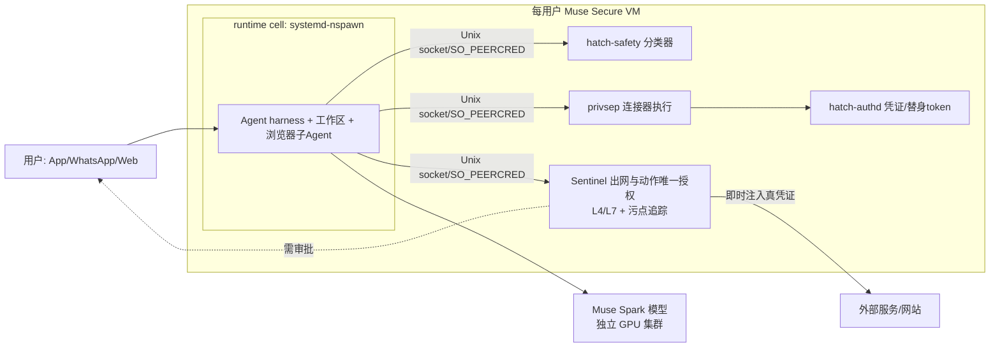
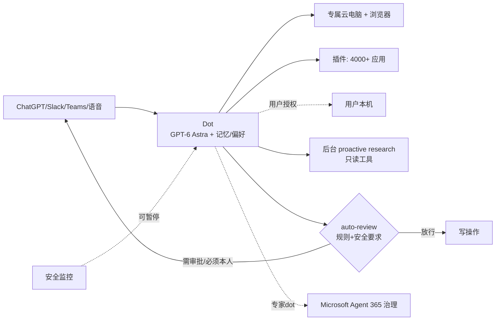
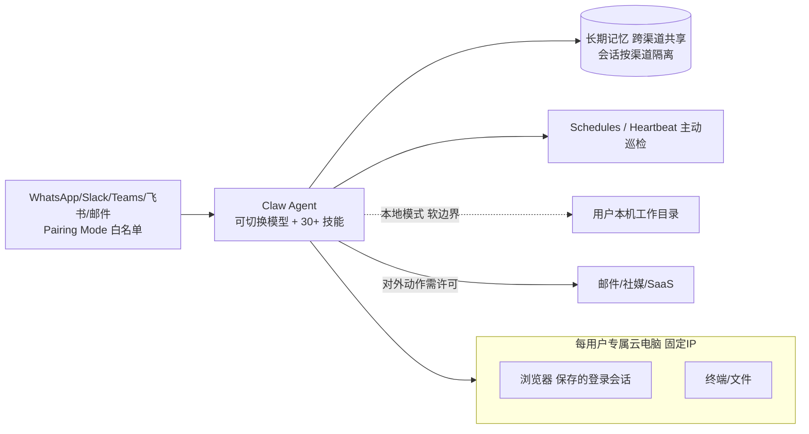
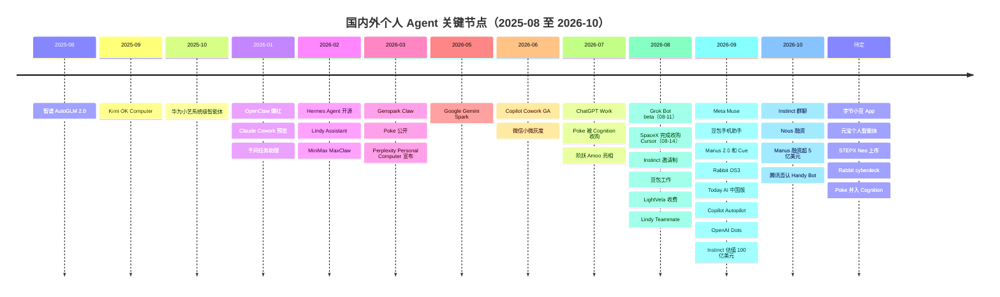

# 国内外个人 Agent：大厂与初创（截至 2026-10-10）

> **范围**：只看"个人 Agent"，即代表单个用户跨应用或跨电脑做事、并且有持久运行或记忆的产品。纯聊天机器人、开发者工具、通用工作流平台和基础设施不在范围内。
>
> **与旧版的关系**：本报告在《大厂个人 Agent 专题》（personal-agents-bigtech.md，原文保留）的基础上，加入了初创公司。
>
> **标注约定**：
> - 默认为一手来源，或多家媒体交叉印证。
> - 【二手】：只有媒体转述。
> - 【独家/未核实】：单一来源爆料。
> - 【推断】：作者推断。
> - 【待核实】：尚未找到可靠来源。

---

## 1. 总览

### 1.1 市场格局

**海外大厂：2026 年 5–10 月，六家都推出了"常驻云端的个人 Agent"。**
- Google Gemini Spark（05-19）
- SpaceXAI / Cursor Grok Bot（08-11，beta）
- Meta Muse（09-08）
- Anthropic Claude，Cowork 并入所有对话（09-16）
- Microsoft Copilot Autopilot（09-25，私测）
- OpenAI Dots（09-29）

Apple Siri AI 和 Amazon Alexa+ 走的是设备或系统助手路线，作为参照。

**海外初创：比大厂早一步把形态跑通，现在面临正面竞争。**
- OpenClaw（开源，2026 年初爆红）和 Nous Hermes Agent 是开源底座。
- Poke（03 月）、Lindy Assistant（02 月）、Genspark Claw（03 月）、Perplexity Personal Computer（03 月宣布）、Instinct（08 月邀请制）、Manus Cue（09 月）、Rabbit OS3（09-22）。
- 多数产品已经具备"一人一台云电脑 + 短信或 IM 入口 + 主动任务"。
- Muse 和 Dots 上线后，初创公司开始被正面挤压：
  - Poke 被 Cognition 收购（07 月）。
  - The Browser Company 被 Atlassian 收购（Dia 转向工作场景）。
  - Instinct 在 Muse 之后仍拿到 100 亿美元估值。

**国内大厂：多在内测、灰度或传闻阶段。**
- 手机系统级：豆包手机助手、华为小艺。
- 超级 App 内嵌：微信小微、千问。
- 独立 App 或托管：字节小豆（内测）、腾讯元宝（独家）、腾讯 LightVela。
- 状态变化：Handy Bot 已被官方否认，QClaw 将于 12-24 停运。

**国内初创：主要有两条路线。**
- 模型公司的"托管龙虾"（云端 OpenClaw）：MiniMax MaxClaw、Kimi（OK Computer / Hosted Agents）。
- 系统或终端路线：智谱 AutoGLM（2026-01 已在港股上市）、阶跃 Amoo + Step AOS + STEPX Neo（07 月亮相）、Today AI（齐俊元创立，09-24 上线中国版）。
- 国内**还没有一家初创做出 Instinct 或 Poke 那样的爆款消费级个人 Agent**。

### 1.2 关键判断

1. **形态已经趋同，初创是先行者。** 一人一机、常驻、主动、IM 或短信入口、敏感操作需审批，这套形态是 OpenClaw、Poke、Lindy、Genspark、Instinct 先跑出来的，大厂在 2026 年 8–9 月集中跟进（Grok Bot、Muse、Dots 等；Muse 公开承认"深受 OpenClaw 启发"）。各家的差异集中在三点：
   - 执行环境：常驻 VM，还是按任务即用即毁。
   - Agent 有没有独立身份，以及多 Bot 之间是否隔离（Grok Bot 让多个具名 Bot 共享同一台电脑，官方明确说安全边界在账户级）。
   - 面向消费者还是企业。
2. **初创的护城河要么是"入口和体验"，要么是"开放性"。**
   - 入口和体验：Poke 和 Instinct 没有 App，只用短信，人格化强；Perplexity 有浏览器。
   - 开放性：OpenClaw、Hermes、Rabbit OS3 支持自带模型（BYOK）、可以接入第三方 Agent、能控制多台设备。
   - 模型、分发和支付生态这些大厂优势，初创短期内无法追上。被收购或转向（Poke、Dia、Lindy 转企业）将是常态。
3. **海外的技术焦点转向安全边界和对外身份**：
   - Muse 的 Sentinel/authd 架构。
   - Dots 的主动任务只读。
   - Genspark 默认用配对模式（Pairing Mode）限制谁能给 Agent 发消息。
   - 亚马逊封禁 Muse。
   - 初创产品普遍只有"软边界"，例如 Genspark 本地模式的工作目录"不是硬边界"，OpenClaw 是单一可信操作者模型。
4. **国内的瓶颈是生态墙，不是模型。**
   - 豆包手机助手推出 SAEP 协议，让第三方 App 声明是否允许 AI 操作。
   - 小微只调起小程序。
   - 初创大多选择"托管开源龙虾"或"做硬件和 OS"来绕开生态墙。
5. **商业模式还没跑通**：
   - 大厂：免费加抽成（Meta）、订阅加用量（OpenAI、Microsoft、Anthropic、Google）、硬件或会员捆绑。
   - 初创：订阅加积分、单独收云电脑月费（Genspark、Manus），或暂时免费（Instinct），广告和推荐商品已经出现苗头。
   - 每用户的算力成本是共同难题。

---

## 2. 初创产品盘点

**纳入标准**：能代表用户跨应用或跨电脑执行任务，并且有持久运行或记忆。

**统计**：共盘点 26 个候选，纳入 14 个（其中 12 个写卡片，2 个归入相关卡片），排除 12 个。

| # | 候选 | 地区 | 现状（截至 10-10） | 结论 | 理由 |
|---|---|---|---|---|---|
| 1 | Manus Cue（Manus 2.0） | 海外/华人团队 | 09 月上线；10-08 融资超 5 亿美元 | **纳入** | 每个 Agent 有独立邮箱、电话、钱包和电脑 |
| 2 | Instinct | 海外 | 08 月邀请制上线，估值 100 亿美元 | **纳入** | 短信入口，有 VM 和凭证保险库 |
| 3 | Poke（Interaction Co.） | 海外 | 03 月公开；07 月被 Cognition 收购，继续运营 | **纳入** | IM 和短信个人助理，带集成和后台自动化 |
| 4 | Lindy Assistant / Teammate | 海外 | 02 月 Assistant，08 月 Teammate | **纳入** | 主动管理邮件和日历，有持久上下文 |
| 5 | Genspark Claw | 海外 | 03 月发布 | **纳入** | 专属常驻云电脑，可接 10 多种 IM |
| 6 | Perplexity Comet + Computer / Personal Computer | 海外 | Comet 全平台；Personal Computer 已向所有 Mac 用户开放 | **纳入** | 浏览器 Agent + 24/7 数字代理 |
| 7 | Rabbit OS3 | 海外 | 09-22 GA；R1 停产 | **纳入** | 云端 Agent OS，可控制多达 5 台设备 |
| 8 | OpenClaw（开源） | 海外 | 开源基金会运营，持续发版 | **纳入**（作为开源底座） | 自托管个人 Agent 的事实标准 |
| 9 | Nous Hermes Agent / Hermes Cloud | 海外 | 开源；10-07 B 轮 9000 万美元 | **纳入**（与 OpenClaw 合卡） | 开源个人 Agent，腾讯 LightVela 的底座 |
| 10 | Today AI（此间无限） | 国内 | 09-24 中国版五端上线 | **纳入** | 记忆、主动跟进、云电脑、GUI Agent |
| 11 | 智谱 AutoGLM | 国内 | 2.0 版本；智谱 2026-01-08 港股上市 | **纳入**（已上市，归为"创业系"） | 云手机和云电脑上异步执行 |
| 12 | 阶跃 Amoo（Step AOS / STEPX Neo） | 国内 | 07-13 亮相，手机"亮相不发布" | **纳入** | 拥有系统级身份的个人智能体 |
| 13 | MiniMax MaxClaw | 国内 | 02-26 上线，有移动端 | **纳入** | 云端托管 OpenClaw |
| 14 | Kimi OK Computer / Hosted Agents | 国内 | OK Computer 2025-09；Hosted Agents 09 月 beta（面向企业认证用户） | **纳入**（与 MaxClaw 合卡） | 虚拟电脑 Agent；托管 7×24 智能体 |
| 15 | Dia（The Browser Company） | 海外 | 2025 年被 Atlassian 以约 6.1 亿美元收购，10 月 Windows GA | 排除 | 已属大厂，且定位为工作浏览器，没有自主常驻 |
| 16 | Sierra | 海外 | 企业客服 Agent | 排除 | 不是个人 Agent（只作为 Poppy 协议的发起方被提及） |
| 17 | Character.AI 类 | 海外 | 陪伴聊天 | 排除 | 不代办事务 |
| 18 | 面壁 PilotDeck | 国内 | 开源智能体 OS | 排除 | 面向开发者部署，还没有消费级产品【待核实】 |
| 19 | Flowith Agent Neo | 国内 | 画布式长任务 Agent | 排除 | 调研和创作工具，没有跨应用代办和常驻 |
| 20 | 天工超级智能体（昆仑万维） | 国内 | 办公生成 | 排除 | 上市公司，属于生成办公工具 |
| 21 | 秒哒（百度） | 国内 | 无代码建应用 | 排除 | 大厂开发工具 |
| 22 | 百度心响 | 国内 | 2025-04 发布的通用任务 Agent | 排除 | 属于大厂，见大厂卡片 |
| 23 | 小米 miclaw | 国内 | 09-21 结束封测 | 排除 | 属于大厂，已转入超级小爱 |
| 24 | Rabbit R1 硬件 | 海外 | 停产 | 排除 | 由 OS3 承接 |
| 25 | Lovable / Replit / Devin 等 | 海外 | 编码 Agent | 排除 | 开发工具 |
| 26 | 腾讯 QClaw / Handy Bot | 国内 | 停运 / 被否认 | 排除 | 属于大厂，状态见大厂卡片 |

---

## 3. 大厂产品卡片

### 3.1 海外

#### Meta Muse

- **当前状态**：2026-09-08 在美国上线，内部代号 Hatch。
- **迭代路线**：
  - 已发布：
    - 09-08：iOS/Android App、WhatsApp、muse.ai；Mac 版随后几天上线。
    - Meta Connect：新增实时视频对话、Agent 专属邮箱、操控 Mac 应用；接入 PayPal 和多家零售商。
    - 10-07：iPad 版上线；新增面向小企业的连接器（Asana、Canva、Dropbox、Figma、QuickBooks、GitHub、Zoom、Notion 等）。
  - 已宣布：
    - Windows 原生版（微软 10-07 宣布，未定日期）。
    - AI 眼镜支持。
    - Confidential VM（年内推出，用户密钥加密）。
    - 09-28 进入 Meta 企业平台名单，但没有管理控制、价格或日期【二手】。
- **核心定位**：
  - 目标用户：美国消费者和小企业。
  - 入口：独立 App、WhatsApp、网页、桌面端。
  - 场景：生活事务（预订、比价、购物、账单、日程），并开始扩展到小企业营销和获客。
- **主要特点**：
  - 每个用户免费获得一台完整的 Ubuntu 云电脑。
  - 主动推进任务。
  - 产品上"深受 OpenClaw 启发"（Nat Friedman 原话），代码从零写，沿用了 SOUL.md 等文件约定。
  - 上线一周用户超过 50 万，日活超过 25 万【The Information 引用内部数据】；Sensor Tower 估算安装量超过 660 万【二手估算】。
- **技术实现**（Meta 安全博客为一手来源）：
  - **执行环境**：每用户一台 Muse Secure VM，VM 内分两个安全域。
    - runtime cell：用 systemd-nspawn 隔离，root 映射为非特权用户，过滤系统调用。
    - cell 外的安全服务：hatch-safety 分类器、privsep 连接器执行、hatch-authd 凭证代理（签发替身 token）、Sentinel（连接器动作和全部出网的唯一授权方，在 L4/L7 检查，并在出网时注入真实凭证）。
  - **规格**【用户探测，非官方】：每个沙箱 2 核、8GB 内存，宿主为 AMD EPYC，推理在独立的 GPU 集群上。
  - **模型**：Muse Spark 系列（已到 1.3【二手】）。
  - **数据流控制**：eBPF/LSM 污点追踪，读过用户数据的进程不能自动放行出网。
  - **审批**：是严格的能力授予，范围可以是一次、会话、任务、限时或永久。
  - **最小权限**：
    - 邮件连接器过滤验证码和重置密码链接。
    - 浏览器子 Agent 只看无障碍树，不能执行 JS。
    - 支付每次都要人工审批，并使用 Stripe Link 一次性虚拟卡。
  - **训练数据**：默认用于训练，可关闭。
- **商业模式**：
  - 免费档（约每周 1 亿 tokens，含 VM），付费档 20 美元和 100 美元/月。
  - 长期打算对 Agent 完成的交易收小额抽成（扎克伯格在 Connect 上的表态）。
- **局限**：
  - 只在美国可用。
  - 没有企业管理后台和 SSO【二手】。
  - 被亚马逊封禁（09-20 起）。
  - 内测中曾出现卡顿和敏感数据未授权暴露（Reuters）。
  - 每用户一台常驻 VM，成本高。
- **来源**：[Meta 发布](https://about.fb.com/news/2026/09/introducing-muse-personal-ai-agent/)、[Meta 安全博客](https://research.meta.ai/blog/security-and-safety-for-ai-agents-our-approach-with-muse)、[Reuters](https://www.reuters.com/business/meta-launches-ai-agent-that-can-access-other-apps-send-emails-make-payments-2026-09-08/)、[The Decoder：规模](https://the-decoder.com/metas-ai-agent-muse-draws-500000-users-in-a-week-along-with-claims-it-copied-openclaw/)、[The Decoder：Ubuntu 云电脑](https://the-decoder.com/metas-muse-agent-gives-every-user-a-full-cloud-computer-running-ubuntu-linux/)、[Tom's Hardware](https://www.tomshardware.com/pc-components/cpus/meta-muse-runs-agents-on-amd-epyc-turin-hosts-with-two-cores-and-8gb-of-memory-ai-agent-can-pass-terminal-commands-to-ubuntu-host-system)、[Yahoo：抽成](https://finance.yahoo.com/technology/article/metas-zuckerberg-says-muse-ai-agent-will-take-a-small-fee-from-transactions-234639802.html)、[TechCrunch：iPad](https://techcrunch.com/2026/10/07/metas-muse-launches-on-ipad-just-a-month-after-its-mobile-debut/)、[GeekWire：亚马逊封禁](https://www.geekwire.com/2026/amazon-blocks-metas-muse-ai-assistant-in-new-standoff-over-agentic-shopping/)

#### OpenAI：Dots（以及 ChatGPT Work）

- **当前状态**：Dots 于 2026-09-29 发布，正向 Pro 和 Business Premium 推出，企业版需管理员开启 beta。ChatGPT Work 于 07-09 发布，面向付费档。
- **迭代路线**：
  - 已发布：
    - 2025-07 ChatGPT agent → 2026-07-09 ChatGPT Work（ChatGPT agent 和 Atlas 下线）。
    - 新桌面 App 把 Chat、Work、Codex 合在一起。
    - 09-29 Dots。
    - 10-08 GPT-6.1 Sol 进入 Work 和 Codex。
  - 已宣布：
    - 可以添加多个 dots，按速度或工作量扩容。
    - 短信入口。
    - "专家 dot"：有独立身份和凭证，可由 IT 配发硬件，目前以企业试点形式推进。
    - 专家 dot 接入 Microsoft Agent 365 治理。
    - Chat 与 Work 年底合并（Greg Brockman 表态【二手】）。
- **核心定位**：
  - 目标用户：高端个人和知识工作者、企业。
  - 入口：ChatGPT（桌面、网页、移动）、Slack、Teams，可以语音通话。
  - 场景：长期项目跟进，例如修 bug 提 PR、发布会材料、销售提案、内容生产。
- **主要特点**：
  - "始终在线"，会随着反馈学习用户偏好。
  - 用户不在时做"proactive research"。
  - 一个 dot 可以同时推进多个项目。
  - 可以授权它连接用户自己的电脑。
- **技术实现**：
  - **执行环境**：每个 dot 有自己的云电脑和浏览器，用户可以随时打开查看。
  - **模型**：GPT-6 Astra。
  - **连接器**：通过插件生态接入 4000 多个应用。
  - **安全与权限**：
    - 后台主动研究**只用只读工具**。
    - 可以代填已保存的密码，但不把密码暴露给模型。
    - auto-review 按"指令 + 自定义规则 + 安全要求"判定一个动作是直接放行、需要审批，还是必须用户本人做；改密码等动作永远留给用户。
    - 安全监控可以暂停或终止 dot 的工作。
    - 提供 Activity View。
  - **身份**：主 dot 代表用户本人；专家 dot 有独立身份。
  - **ChatGPT Work 的运行时**：每个任务一个隔离的 microVM，配托管 Chrome。工作区持久化，按需恢复，不常驻。Pro 档为 8 CPU、20GB 内存、64GB 磁盘【二手/用户探测】。
- **商业模式**：
  - 第一个 dot 包含在 Pro 或 Business Premium 订阅里（字母榜称需 200 美元/月【二手】）。
  - 和 dot 对话不占用额度；让它在 Work 或 Codex 里跑任务，按常规用量计。
  - 以后可以付费增加 dots 或提高吞吐。
- **局限**：
  - 只开放给高端档。
  - 专家 dot 还在试点。
  - 消费者场景的电商和支付生态不如 Meta 明确。
- **来源**：[Introducing dots](https://openai.com/index/introducing-dots/)、[Release notes](https://help.openai.com/en/articles/6825453-chatgpt-release-notes)、[Changelog](https://learn.chatgpt.com/docs/changelog)、[Latent Space：Work](https://www.latent.space/p/unpacking-chatgpt-work)

#### Anthropic：Claude（Cowork 并入对话）

- **当前状态**：
  - 09-16 起，Cowork 能力向 Pro 和 Max 用户的所有对话逐步开放，不再需要先选模式，覆盖网页、桌面和移动端。
  - Team 和 Enterprise 暂时仍保持分开【二手】。
- **迭代路线**：
  - 01-12：Cowork 研究预览（本地 VM）。
  - 03-17：手机端可以通过一个常驻 Agent 线程管理 Cowork 任务（Dispatch）。
  - 03-23：Cowork 和 Claude Code 加入 computer use。
  - 07-07：Cowork 上线网页和移动端，**会话在云端运行（beta）**，关掉电脑也能继续，定时任务不需要设备在线。
  - 08-26：加入内置浏览器。
  - 09-16：Cowork 融入所有对话。
  - 宣布中：Claude Code 的 projects 支持多线程并行，Agent 会在 chat 和 Cowork 中推广。
- **核心定位**：
  - 目标用户：Pro/Max 订阅的知识工作者和开发者。
  - 入口：Claude App。
  - 场景：报告、表格、演示文稿、调研、电脑操作。
  - 更偏"工作代办"，不做生活和电商。
- **主要特点**：
  - 对话和代办合在一起。
  - 带 projects、connectors、skills、定时任务。
  - 默认每个动作先请求许可，可以设置成"直到遇到需要审批的动作再停"。
- **技术实现**：
  - **本地版 Cowork**：
    - 宿主机上跑完整 VM：macOS 用 Apple Virtualization，Windows 用 HCS。
    - 只挂载用户选中的文件夹，挂载方式分只读、读写、读写但禁删。
    - 凭证留在宿主的 keychain，VM 只拿到每个会话的降权 token。
    - 后来把 agent loop 移到 VM 外，只把代码执行留在 VM 里。
  - **云端会话**：以 Managed Agents 的 session、harness、sandbox 三分离为参考架构【推断：消费端具体实现未公开】。凭证放 vault，经 MCP 代理注入。
  - **企业审计**：Compliance API 可以取回 Cowork 会话转录。
- **商业模式**：
  - 订阅（Pro/Max），用量受档位限制。
  - Max 和 Team 档每月包含 API 额度。
- **局限**：
  - 没有电商和支付生态。
  - 有观点认为，合并后"会话边界"不再起审查作用，后台任务读到不可信内容的风险上升【二手评论】。
- **来源**：[Claude 发布说明](https://support.claude.com/en/articles/12138966-release-notes)、[How we contain Claude](https://www.anthropic.com/engineering/how-we-contain-claude)、[Managed Agents](https://www.anthropic.com/engineering/managed-agents)

#### Google：Gemini Spark（以及企业版 Gemini agent）

- **当前状态**：
  - Spark 于 05-19 在 I/O 发布，先给受信测试者和美国 Ultra 用户，7 月扩大到美国 AI Pro 和全球 Ultra（不含欧洲经济区、英国、瑞士等）【二手】。
  - 企业版 **Gemini agent** 于 10-08 在 Gemini at Work 发布。
- **迭代路线**：
  - 已发布：Spark、Daily Brief（晨报 Agent）、新 Gemini App。
  - 宣布中（I/O 时）：
    - 用 MCP 连接 Canva、OpenTable、Instacart。
    - 可以通过短信或邮件给 Spark 下任务。
    - 自定义子 Agent。
    - 操作用户本地浏览器。
    - 进入 macOS 桌面 App，处理本地文件。
- **核心定位**：
  - 目标用户：Google 生态的订阅用户。
  - 入口：Gemini App 和 Workspace。
  - 场景：定时和触发任务（例如每月扫信用卡账单、汇总学校邮件）、跨 Gmail/Docs/Slides 的工作流。
- **主要特点**：
  - 跑在云端，合上电脑也继续。
  - 支持"教它新技能"。
  - 花钱、发邮件等高风险动作前先问用户。
- **技术实现**：
  - **模型与 harness**：Gemini 3.5（Flash）加 **Antigravity harness**。
  - **执行环境**【二手：据 Simon Willison 转述的企业说明】：**每个任务一台全新、严格隔离、用完即毁的 Google Cloud VM**，任务和用户之间不共享状态。出网走 Agent Gateway，并执行 DLP 策略。凭证加密存放，不暴露给 Agent。
  - **连接器**：Workspace 原生接入，加 MCP。
- **商业模式**：AI Pro 和 Ultra 订阅；企业版走 Gemini Enterprise。
- **局限**：
  - 按任务即用即毁的 VM，意味着长期"自己的电脑"这种感受弱于 Muse【推断】。
  - 欧洲等地区暂不可用。
- **来源**：[Google 博客](https://blog.google/innovation-and-ai/products/gemini-app/next-evolution-gemini-app/)、[Gemini agent](https://blog.google/innovation-and-ai/infrastructure-and-cloud/google-cloud/gemini-at-work/)、[Engineered.at / Simon Willison 摘要](https://engineered.at/articles/google-i-o-gemini-spark-antigravity)

#### Microsoft：Copilot Cowork（个人账户）与 Copilot Autopilot

- **当前状态**：
  - 企业版 Copilot Cowork 于 06-16 GA。
  - 个人账户：Copilot Tasks 已转为 Copilot Cowork（预览），需要符合条件的 Microsoft 365 订阅。
  - **Autopilot（原名 Scout）** 于 09-25 发布，09 月底进入私测。
- **迭代路线**：
  - 03 月：Cowork 进入 Frontier。
  - 06-16：Cowork GA。
  - 09-25：新 Copilot 推出 Home（Chat 和 Cowork 合一）、Code、Autopilot。
  - 10 月：Today（主动的每日指挥台）私测。
  - 宣布中：
    - 用户不必再选模式，Copilot 自动路由到 Chat、Cowork 或 Code。
    - 用 Entra 区分 Agent 和人的操作。
    - Agent 365 的管控延伸到本地 Agent（配合 10-07 正式可用的 MXC 执行容器）。
    - Ignite（11-17 至 20）还会有更多发布。
- **核心定位**：
  - 目标用户：企业员工（"在租户内的数字同事"）。
  - 入口：Teams、Outlook、Copilot App。
  - 场景：跟进线程、跑周期性工作、管理供应商评审这类多日流程。
- **主要特点**：
  - Autopilot 可以设定名字、角色和目标。
  - 不等提示就主动工作，几天后能接着之前的项目继续。
  - 可以像同事一样 @它。
- **技术实现**：
  - **执行环境**：Autopilot 在租户内托管，**有自己的身份、记忆、电脑和工作区**。
  - **企业上下文**：基于 Microsoft IQ / Work IQ。
  - **治理**：权限、审计和治理来自 Agent 365，底层复用 Entra Agent ID、Defender、Purview。
  - **Cowork 本身**：基于 Anthropic Cowork 的技术平台，多模型。
- **商业模式**：
  - Cowork、Code、Autopilot 都按用量计费（Copilot Credits，0.01 美元/credit）。
  - 预算可以按租户、组、用户三级控制。
  - Agent 365 为 15 美元/用户/月。
- **局限**：
  - Autopilot 还在私测。
  - 消费者版只是 Cowork 预览。
  - 用量计费的成本难以预测。
- **来源**：[Microsoft 官方博客 09-25](https://blogs.microsoft.com/blog/2026/09/25/introducing-the-new-copilot-with-home-code-and-autopilot/)、[Copilot Cowork GA](https://www.microsoft.com/en-us/microsoft-365/blog/2026/06/16/copilot-cowork-is-now-generally-available/)、[个人账户变更](https://support.microsoft.com/en-us/microsoft-365-copilot/learning/changes-microsoft-copilot-app)、[MXC](https://blogs.windows.com/windowsdeveloper/2026/10/07/microsoft-execution-containers-policy-driven-containment-for-ai-agents/)

#### SpaceXAI（Cursor）：Grok Bot

- **厂商归属**：
  - 发布方是 SpaceXAI，由 SpaceXAI 与 Cursor 联合推出。按官方公告和媒体报道：
    - SpaceX 于 2026-02 并入 xAI。
    - 2026-04 与 Cursor 签订合作和收购协议。
    - 2026-08-14 完成对 Cursor 的收购（媒体报道作价 600 亿美元）。
  - 官方文档说明，Grok Bot 运行在 Cursor 托管的云电脑上，计费和隐私走 Cursor 账户，管理后台在 Cursor dashboard。
  - 因此本文把它归入**大厂（海外）**。
  - 官网和文档的署名写作"SpaceXSI"，新闻稿和媒体多写"SpaceXAI"，命名不一致【待核实】。
- **当前状态/发布时间**：
  - 2026-08-11（周二）发布早期 beta。日期依据是新闻稿中的"周二"，加上非官方 README【待核实，未找到带日期的官方页】。
  - 支持 macOS、Windows、Linux、iOS、Android。
  - 企业版目前是候补名单。
- **迭代路线**：
  - 已发布：
    - 起点是内部原型，公告称在公司内部"迅速推开"。
    - 公开 beta。
    - 团队和企业管控（Team Rules、Network Controls、Enforce Auto-review 等，文档更新于 2026-09 至 10 月）。
    - 可以把编码任务委派给 Cursor Cloud Agents。
  - 已宣布或传闻：公开渠道未找到路线图【待核实】。
- **核心定位**：
  - "AI 队友"（AI teammates）：给 Bot 起名字、定岗位，像同事一样发消息交派工作。
  - 目标用户：SuperGrok 和 Cursor 付费个人用户、团队；企业用户在候补名单上。
  - 入口：桌面和手机 App，以及与 Bot 的私聊或群聊。
  - 场景：
    - 销售外联和 CRM 更新。
    - 运营（新员工入职、处理 Gmail 里的发票）。
    - 营销。
    - 复现 bug、提工单、修复代码。
- **主要特点**：
  - 多 Bot 并行：一个"幕僚长" Bot 统筹多个专职 Bot。Bot 之间可以互相发消息，也可以在群聊里自行协调。
  - 演示一次即可学会流程：用户做一遍，Bot 跟着学，保存为技能或例行任务（routine），之后自动重跑。
  - 记忆跨会话累积，随时间变得更主动。
  - 可以操作没有 API 或 MCP 的网站。
- **技术实现**（据官方文档和产品界面）：
  - **执行环境**：
    - **每个用户一台常驻 Firecracker microVM**，带浏览器、桌面、文件系统和终端，由该用户的所有 Bot 共享。
    - 每个 Bot 在共享电脑上有自己的屏幕，可以并行操作。
    - 合上笔记本后 Bot 照常工作；用户可以实时观看、随时接管。
  - **模型**：文档只写"调用模型提供方"，具体模型未公开【待核实】。
  - **记忆**：每个 Bot 保留稳定偏好、岗位上下文和工作摘要，对话按 Bot 隔离。Bot 之间通过共享文件、私信、群聊传递上下文。
  - **工具和连接器**：
    - MCP 连接器在账户级生效（如 Gmail、Notion、GitHub），可从 Marketplace 安装连接器和打包技能。
    - 技能库所有 Bot 共用。
    - 例行任务（routine）可定时触发（间隔至少 5 分钟），也可由事件触发（如 Slack 消息、GitHub 通知），每个 Bot 最多 50 个。
    - 支持后台子 Agent，以及委派给 Cursor Cloud Agents。
    - 在用户本机执行动作需要逐项审批。
  - **安全与权限**：
    - 对外发送消息先生成**草稿卡片**，由用户确认（人在回路）。
    - **Auto-review** 自动审查 shell 命令、插件调用、computer use、自动化写操作和子 Agent 委派，结果分为放行、需审批、拒绝三种；企业版可由管理员强制开启并下发规则。
    - 密码、2FA、验证码、支付确认要交还给用户接管。
    - 可以用 1Password 填充用户批准过的凭证。
    - 安全密钥请求的内容会被遮蔽，不进对话记录，也不给模型看。
    - 文档明确指出，**安全边界在账户级，不同 Bot 之间不构成安全边界**。
    - 不支持本地部署或自带镜像。
  - **身份**：代表用户在用户自己的工具里登录和操作；文档未提到 Bot 有独立的对外身份【待核实】。
- **商业模式**：
  - 包含在所有 Cursor 付费个人档位和 Cursor Teams 中，也可以关联 SuperGrok、SuperGrok Plus、SuperGrok Heavy。
  - 用量独立于 Grok 和 Cursor 的原有额度，每周重置；符合条件的账户可按模型和 token 成本加购。
  - 具体价格见 Cursor 定价页，本文未核实【待核实】。
- **局限**：
  - 账户内所有 Bot 共享登录态和文件，权限没法按 Bot 隔离。
  - 只能用云端托管。
  - 早期 beta，功能和档位可能变化。
  - 网站可能封禁自动化或要求验证码。
  - 不支持旧版隐私模式（Legacy Privacy Mode），必须存储数据。
- **来源**：
  - [官方公告](https://x.ai/news/introducing-grok-bot)
  - 官方文档：[概览](https://docs.x.ai/grok-bot/overview)、[电脑与应用](https://docs.x.ai/grok-bot/computer-and-apps)、[团队与企业](https://docs.x.ai/grok-bot/teams-and-enterprises)、[安全 FAQ](https://docs.x.ai/grok-bot/security-faq)、[审批与隐私](https://docs.x.ai/grok-bot/approvals-security-and-privacy)、[技能与例行任务](https://docs.x.ai/grok-bot/skills-routines-and-automations)、[FAQ](https://docs.x.ai/grok-bot/faq)、[Bot 管理](https://docs.x.ai/grok-bot/bots)
  - 收购相关：[Cursor 博客：并入 SpaceX](https://cursor.com/blog/joining-spacex)、[9to5Mac](https://9to5mac.com/2026/08/14/spacex-lands-deal-to-likely-purchase-claude-code-and-openai-codex-competitor/)
  - [USA Today 刊发的新闻稿](https://www.usatoday.com/press-release/story/39819/spacexai-and-cursor-team-up-on-grok-bot-persistent-ai-agents-that-sign-into-your-apps/)（属于新闻稿，不是独立报道）

#### Apple：Siri AI（系统助手路线，作为参照）

- **当前状态**：06 月 WWDC 发布，09 月随 iOS 27 推出 beta（目前仅英文，10 月增加法、日、韩、葡、西语），需要排队。
- **定位与特点**：
  - 系统级个人助理，能理解个人上下文（消息、邮件、照片）、屏幕内容和全系统的 App 动作。
  - 有独立 App 回看对话。
  - **不提供"自带云电脑、7×24 自主执行"的能力**。
- **技术实现**：
  - 端侧 AFM 模型加服务器端模型（"bold new architecture … protect users' privacy"）。
  - 服务器端功能有每日用量限制，"将来会对扩展访问收费"。
- **局限**：没有长时异步任务和后台常驻 Agent。
- **来源**：[Apple 6 月发布](https://www.apple.com/newsroom/2026/06/apple-introduces-siri-ai-a-profoundly-more-capable-and-personal-assistant/)、[Apple 9 月发布](https://www.apple.com/newsroom/2026/09/siri-ai-a-profoundly-more-capable-and-personal-assistant-is-here/)、[支持页](https://support.apple.com/en-us/121115)

#### Amazon：Alexa+（家庭助手路线，作为参照）

- **当前状态**：美国、加拿大全量；多个欧洲和拉美国家抢先体验。
- **迭代路线**：
  - Moonraker（一句话完成多个连续动作）在研。
  - 据报道今年 GPU 成本可能超过 1 亿美元，内部讨论过推迟或缩减【二手：Business Insider 内部文件】。
- **定位与特点**：
  - 家庭场景：家庭日历、提醒、订餐、叫车、预约维修、智能家居。
  - 能通过人脸和声纹识别家庭成员。
- **技术实现**：
  - Bedrock 上的大模型（Amazon Nova 和 Anthropic）。
  - "experts"机制编排数万个服务和设备。
  - 可以自主浏览网页完成任务（例如通过 Thumbtack 预约维修）。
- **商业模式**：Prime 会员免费；非会员 19.99 美元/月；另有有限的免费聊天版。
- **来源**：[Amazon：Alexa+ 介绍](https://www.aboutamazon.com/news/devices/new-alexa-generative-artificial-intelligence)、[Amazon：Prime 免费](https://www.aboutamazon.com/news/devices/alexa-plus-available-free-prime-members-us)、[Android Authority / BI](https://www.androidauthority.com/alexa-project-moonraker-project-3685647/)

### 3.2 国内

#### 字节：小豆（Spell）/ 豆包手机助手 / 豆包工作

字节的产品分工（据界面新闻）：豆包主 App 做通用对话，**豆包工作**做办公，**小豆**做消费级个人助理，**豆包手机助手**做手机系统级入口。

**① 小豆（Spell）**

- **当前状态**：内测，没有公布上线时间。
- **迭代路线**：
  - 2026-04 起 Spell 内测。
  - 名称"小豆"在暑期确定，计划以独立 App 发布。
  - Muse 走红后，字节加快了联调节奏。
  - 来源可信度：多家媒体基于知情人士报道，字节官方没有回应。
  - 头条 ZFinance 称由李福祥主导、Ocean 硬件团队提供端侧能力【独家/未核实】；界面新闻和动点科技称由豆包手机助手团队主导，**两种说法冲突**。
- **核心定位**：消费级常驻个人助理。做独立 App 而不放进豆包，理由是"Agent 和 Chat 的评测体系不兼容"【独家/未核实】。
- **技术实现**：未公开【待核实】。
- **来源**：[界面/新浪](https://finance.sina.com.cn/jjxw/2026-10-01/doc-initsyaf1265752.shtml)、[动点科技](https://cn.technode.com/post/2026-09-30/bytedance-doubao-xiaodou-standalone-ai-assistant-app/)、[界面](https://www.jiemian.com/article/15151283.html)

**② 豆包手机助手（消费者版）**

- **当前状态**：
  - 2025 年底推出技术预览版（当时遭遇"生态墙"）。
  - **2026-09-14 发布消费者版**，首发机型努比亚 NaviX Ultra，09-16 开售。
- **定位与特点**：
  - 手机系统级 AI 助手，通过语音或专属 AI 键唤醒（带指纹鉴权）。
  - 支持系统工具调用和批量任务。
  - 本地记忆检索。
  - "操作手机"Beta：GUI Agent 识别屏幕后模拟点击、滑动、输入。
- **技术实现与安全**：
  - 以豆包 App 为基础，和手机厂商做系统层合作。
  - GUI 操作加一方接口调用。
  - **SAEP（屏幕自动化操作声明协议）**：第三方 App 可以拒绝，或单独限制截图、模拟输入、内容修改，也可以禁止登录、抽奖、秒杀等环节。
  - 30 天公示期（约到 10 月中旬）内"未同意就不操作"；公示期后变成"未拒绝就默认开放"。
  - Agent 防护体系对可操作范围分层、分级管理。
- **局限**：
  - 支持的第三方 App 有限。
  - 依赖手机厂商合作。
- **来源**：[官网](https://o.doubao.com/)、[腾讯新闻](https://news.qq.com/rain/a/20260914A06IY300)、[新京报](https://www.bjnews.com.cn/detail/1789467395129839.html)、[腾讯新闻：SAEP](https://news.qq.com/rain/a/20260917A0DL4I00)

**③ 豆包工作 / 豆包工作伙伴**

- **当前状态**：2026-08-25 发布。
- **迭代路线**：
  - 扣子 2.0（01 月）→ 2.5（04 月，Agent 有独立邮箱、云电脑和云手机）→ 3.0（06 月）。
  - 08-24 扣子和 TRAE 团队并入豆包。
  - 08-25 发布豆包工作。
- **定位与特点**：
  - 办公场景。三个入口：独立 PC 端、豆包 App 内、飞书内。
  - 用飞书账号登录后继承本人权限。
  - 验证过的流程可以沉淀为 Skill。
- **技术实现**：
  - "豆包工作伙伴"有**独立身份、权限和记忆**。
  - 沿用扣子 2.5 的设计：跨渠道共享长期记忆，但按 Session 隔离权限；云电脑和云手机。
- **来源**：[飞书](https://www.feishu.cn/content/article/7677519271848610746)、[新浪财经](https://finance.sina.com.cn/stock/t/2026-08-24/doc-inipmnpq6049441.shtml)、[eNet：扣子 2.5](http://enet.com.cn/article/2026/0407/A202604071275228.html)

#### 腾讯：小微 / LightVela / WorkBuddy / 元宝

**状态更正**：
- **Handy Bot**：腾讯混元 10-04/05 回应"内容失实，官方无此产品计划"，服务号已注销。[金融界](https://finance.jrj.com.cn/2026/10/05204758620966.shtml)
- **QClaw**：09-24 宣布 12-24 停运，团队并入 WorkBuddy。[澎湃](https://www.thepaper.cn/newsDetail_forward_34140067)

**① 微信小微**

- **当前状态**：2026-06 起在微信 8.0.75 小范围灰度。入口在首页左上角，也可以右滑唤起。
- **定位与特点**：
  - 生在微信里的原生助手，可以操作微信原生功能（设置、发消息、打电话）。
  - 能调起美团、瑞幸、滴滴等小程序。
  - 发消息前需要确认，不能群发；支付要手动确认。
- **技术实现**：
  - 主模型是腾讯自研 WeLM，部分场景调用 DeepSeek【二手实测】。
  - 不是常驻 VM，而是通过小程序和微信能力编排。
- **局限**：
  - 复合指令容易出现上下文污染。
  - 长链路任务（订酒店、买高铁票）受小程序交互能力限制，被评为"60 分助手"【二手实测】。
  - 受微信"克制、不打扰"文化约束。
- **来源**：[腾讯新闻](https://news.qq.com/rain/a/20260623A003GI00)、[虎嗅](https://www.huxiu.com/article/4869447.html)、[MarsBit 实测](https://news.marsbit.co/20260708103746382436.html)

**② LightVela（腾讯轻量云）**

- **当前状态**：
  - 04 月上线，05 月内测，08 月全球正式收费。
  - 9 月新增：多 Bot、通知和脚本定时任务、工作台发布。
- **定位与特点**：个人云端 Agent 托管，7×24 在线，通过微信、QQ、飞书、WhatsApp、Discord、Slack 等下指令。
- **技术实现**：
  - **底层是 Nous Research 的开源 Hermes Agent**（官方 changelog 明确写出）；Labs 里还可以装 DeepSeek Harness。
  - 每个用户的实例有独立运行环境和资源。
  - 支持长期记忆和用户画像（可配置压缩），Soul 人设文件。
  - 技能来自 ClawHub 和 skills.sh。
  - 模型可以用各家 Coding/Token Plan，或任何 OpenAI 兼容端点。
  - 开通需要 QQ 或微信登录，并完成实名认证。
- **商业模式**：订阅套餐。官方页写 2 核 4G、50GB、每月 100 积分；字母榜称新用户获赠双核 8G、4500 积分、1 个月试用，**两者不一致，以官网为准**。
- **局限**：声量小；配置门槛偏高；技能来自开源市场，有供应链风险。
- **来源**：[LightVela 文档](https://lightvela.com/zh-cn/docs/who-is-lightvela-for/)、[Changelog](https://lightvela.ai/changelog/)、[腾讯云活动页](https://www.tencentcloud.com/act/pro/LightVela)

**③ WorkBuddy**

- **当前状态**：腾讯 AI 办公的主力产品（"头狼"）。
- **定位与特点**：
  - 兼容 OpenClaw 的办公 Agent，可切换混元、DeepSeek、GLM、Kimi 等模型。
  - 新增独立的文件浏览器，能用 AI 修改 Office/PDF 文件后写回原文件。
  - 企业版打通腾讯文档、乐享、网盘等五款产品的账号、积分、记忆和数据层【二手】。
  - 承接 QClaw 的迁移用户。
- **来源**：[网易](https://www.163.com/dy/article/L8O0QH4C051180F7.html)、[ai123](https://ai123.com/news/14835)、[WorkBuddy 更新日志](https://www.workbuddy.cn/docs/workbuddy/Changelog)

**④ 元宝**

- **状态**：据字母榜独家，元宝将推出个人智能体，形态和时间未定【独家/未核实】。
- **背景**：元宝春节高峰时 DAU 号称超过 5000 万，3 月底已不足千万（QuestMobile）【二手】。
- **来源**：[字母榜 / 人人都是产品经理](https://www.woshipm.com/ai/6473518.html)

#### 阿里：千问 App / "我的千问"

- **当前状态**：
  - 千问 App 已接入淘宝、闪购、支付宝（AI 付）、飞猪、高德。
  - "任务助理"从 2026-01 开始邀测。
  - 09-22 云栖大会宣布加速打造 Personal Agent，从"用千问"转向"我的千问"。
  - 截至 10-10 **还没有独立的个人 Agent 产品发布**。
- **迭代路线**：
  - 已发布：AI 购物和办事（一句话点外卖、订机票酒店并在对话内支付）、任务助理（整理发票、生成报告、做网页工具、电话订位）。
  - 已宣布：基于 Qwen 3.8 构建统一的个人 Context；已接入授权的健康、运动、理财数据；开放平台覆盖 20 多个领域、超过 1000 家伙伴申请。
- **核心定位**：依托阿里电商、支付和本地生活闭环的"能办事"助理。
- **技术实现**：
  - 统一个人 Context 加领域 Agent 和开放平台。
  - 是否提供每用户常驻 VM【待核实】。
- **局限**：评论认为这些更像"工具智能体"，与严格意义的个人智能体还有距离【二手观点】；生态以阿里系为主。
- **来源**：[阿里巴巴](https://www.alibabagroup.com/zh-HK/document-1948497434959151104)、[央广网](https://tech.cnr.cn/techph/20260115/t20260115_527494056.shtml)、[21 经济](https://www.21jingji.com/article/20260923/herald/6bd03994747c1f24359baaceff0e0438.html)

#### 华为：小艺（系统级智能体）

- **当前状态**：
  - HarmonyOS 6（2025-10-22）把小艺升级为系统级智能体。
  - HDC 2026（06-12）发布 HMAF 2.0，小艺成为"系统智慧大脑"。
  - 探索性的"小艺帮帮忙"（应用操控）在 HarmonyOS 7.0 不再支持新设备（10-03）。
- **定位与特点**：
  - 全场景设备（手机、手表、PC、音箱）入口。
  - 通过意图分发调度 2000 多个鸿蒙智能体、500 多个伙伴 Skills、2100 多项系统能力。
  - 经用户授权可以调用 200 多项系统级数据。
- **技术实现**：
  - HMAF 智能体框架，支持 A2A 协作和 Skill 调用。
  - **HPIC 个人智能计算平台**：在云端为每个用户建立隔离的个人计算空间，数据用完即删，不留存。
  - 发布了《鸿蒙智能安全白皮书》和智能体安全框架。
- **局限**：
  - 绑定鸿蒙设备。
  - GUI 操控路线（小艺帮帮忙）在收缩，转向"意图 + 智能体/Skill"的 API 化路线【推断】。
- **来源**：[中国日报网 HDC2026](https://caijing.chinadaily.com.cn/a/202606/12/WS6a2bce5aa310942cc49b181c.html)、[C114](https://www.c114.com.cn/other/241/a1299209.html)、[IT之家](https://www.ithome.com/1/009/516.htm)

#### 小米 / 百度（简述；智谱见 §4.2）

- **小米**：
  - miclaw（基于 MiMo 的系统级个人智能体，支持记忆、子 Agent、MCP）在 09-21 结束封测并停止服务。
  - 能力转入澎湃 OS 4 的**超级小爱 2.0 专家模式**。
  - 来源：[IT之家](https://www.ithome.com/1/005/341.htm)、[界面](https://www.jiemian.com/article/14078270.html)
- **百度**：
  - 心响 App（2025-04 发布）是通用任务型智能体，负责任务拆解和多智能体协作，底层是文心 5.x。
  - 没有检索到它向"常驻个人 Agent"演进的公开信息【待核实】。
  - 来源：[新浪科技](https://finance.sina.com.cn/tech/roll/2025-04-25/doc-ineuknpt2568346.shtml)

---

## 4. 初创产品卡片

### 4.1 海外

#### Manus Cue（蝴蝶效应 / Manus 2.0）

- **当前状态**：
  - Manus 2.0 和 Cue 于 2026-09 发布。
  - 公司在 2026-04 被要求撤销与 Meta 的交易，08 月恢复独立运营。
  - 10-08 宣布完成超 5 亿美元融资（博裕、IDG 领投，腾讯等跟投）。
- **迭代路线**：
  - 2025-03：通用 Agent 爆红。
  - 2025-12：Meta 宣布收购。
  - 2026-04：交易被叫停。
  - 2026-09：推出 2.0，包括 Cascade 引擎、Studio 本地工作区、Cloud Computer、Automations 和 Cue。
  - 据报道正在考虑香港上市【二手】。
- **核心定位**：
  - 目标用户：个人和小团队。
  - 入口：Cue 独立 App。
  - 场景：一支"个人 Agent 团队"处理多步日常和工作事务。
- **主要特点**：
  - **每个 Agent 有自己的邮箱、电话号码、钱包和电脑**。
  - 多个 Agent 按频道协作。
  - 在用户设定的额度内可以自主付款。
- **技术实现**：
  - Cloud Computer 是持久的云电脑，单独付费。
  - 支持 Remote Control / Computer Use 和事件触发的自动化。
  - 文件即记忆（todo.md 等），工具空间通过 logits 遮蔽控制（见深度报告 §1.3）。
  - 外界常说沙箱用的是 E2B【待核实】。
- **商业模式**：订阅加积分；Cloud Computer 每月 10、30、50 美元三档。
- **局限**：
  - 地缘和监管风险，曾被要求删除部分用户数据。
  - 消费者规模不及 Muse。
- **来源**：[Manus 2.0](https://help.manus.im/en/articles/17190150-what-is-new-in-manus-2-0)、[TechCrunch](https://techcrunch.com/2026/10/08/chinas-manus-raises-over-500m-in-first-funding-round-since-split-with-meta/)、[Reuters](https://www.reuters.com/world/asia-pacific/china-blocks-foreign-acquisition-ai-startup-manus-2026-04-27/)

#### Instinct（Spear Street Technology）

- **当前状态**：
  - 2026-08 邀请制上线，没有 App，也几乎没有官网。
  - 09-28 C 轮融资 10 亿美元，估值 100 亿美元。
  - 10-05 支持把 Agent 拉进群聊。
- **迭代路线**：
  - 已发布：打电话、群聊（好友没有账号也能用）、"可信好友的 Agent 互相协作"。
  - 计划：逐步扩大用户范围。目前免费，"会尽量保持便宜"。
- **核心定位**：
  - 目标用户：普通消费者的生活事务，例如预约 DMV、报名游泳课、发跟进邮件、办理退货。
  - 入口：iMessage、WhatsApp、邮件。
- **主要特点**：
  - 没有吉祥物，回复简短，"做的比说的多"。
  - 会主动提醒，例如日程冲突、找出历史确认邮件。
  - 创始人 Noah Shinn 是 Sierra 早期员工。
- **技术实现**：
  - 自带虚拟机（虚拟手机和电脑），走 computer use 路线。
  - 需要登录的网站通过"secure vault"链接让用户自己填凭证。
  - 可连接 Google Workspace、Slack、Notion。
  - 群里的 Instinct 与个人账户隔离，个人 Agent 分享信息前要征得授权。
  - 中间层侧重推理管线：小模型路由、上下文选择、并发、低成本核验【二手：头条文章】。
- **商业模式**：暂时免费。已出现"推荐商品"，分析师认为最终会走向广告或交易抽成【二手】。
- **局限**：
  - 邀请制，没有 App。
  - 面临 Muse 和 Dots 的直接竞争。
  - 网页数据质量问题会导致遗漏，例如没发现先修课的要求。
- **来源**：[SiliconANGLE](https://siliconangle.com/2026/09/28/everyday-personal-ai-assistant-startup-instinct-raises-1b-at-10b-valuation/)、[TechCrunch](https://techcrunch.com/2026/10/05/instinct-brings-its-ai-agent-to-group-chats-even-for-friends-without-an-account/)、[The Verge 实测](https://www.theverge.com/tech/1008254/instinct-agent-ai-hands-on-muse-dots)

#### Poke（The Interaction Company，已被 Cognition 收购）

- **当前状态**：
  - 2026-03 公开上线，取消等待名单，全球可用。
  - 07-23 被 Cognition（Devin 的开发商）收购，估值"低九位数美元"。产品继续独立运营到年底。
- **迭代路线**：
  - 已发布：Recipes（可分享的自动化配置）、Apple Messages 认证（官方称是首个）、Poke Ultra、Poke Human（真人协助完成难任务）。
  - 计划：2027 年部分任务使用 Cognition 的 SWE 模型，用 Poke 编排多个 Devin 会话；产品可能合并【二手】。
- **核心定位**：
  - "像发短信一样用 Agent"。
  - 入口：iMessage、SMS/RCS、Telegram、WhatsApp（部分市场）。
  - 场景：邮件、日程、提醒、健康、智能家居。
- **主要特点**：
  - 人格化强（俚语、幽默），这也是被收购的主要原因。
  - 没有 App，只需输入手机号即可开始使用。
- **技术实现**：
  - 通过 Linq 接入消息平台。
  - 集成加记忆，支持后台实时自动化。
  - Ultra 档使用前沿模型。
  - 具体执行环境未公开【待核实】。
- **商业模式**：
  - 免费起步，价格可以协商（"可以跟它讨价还价"）。
  - Ultra 199 美元/月，包含 Poke Human；代付的费用按原价收取。
- **局限**：
  - 被收购后方向不确定。
  - 受各 IM 平台政策限制（例如 Meta 限制 WhatsApp 上的通用聊天机器人）。
- **来源**：[Poke 文档](https://poke.com/docs)、[Poke 发布说明](https://poke.com/docs/release-notes)、[TechCrunch：上线](https://techcrunch.com/2026/04/08/poke-makes-ai-agents-as-easy-as-sending-a-text/)、[TechCrunch：收购](https://techcrunch.com/2026/07/24/why-cognition-bought-poke-ai-personality-is-becoming-a-competitive-advantage/)

#### Lindy（Assistant → Teammate）

- **当前状态**：
  - Lindy Assistant 于 2026-02 上线。
  - 08 月推出 Lindy Teammate，"AI 员工"进驻团队的 Slack。
- **迭代路线**：从 Agent 构建平台（流程编辑器）转向开箱即用的个人助理，再转向团队共享的 AI 员工，所有人教给它的东西进入同一个"中央大脑"。
- **核心定位**：
  - 职场人士的"AI 行政助理"：邮件分拣、按用户语气起草回复、日程、会前准备、会议记录、会后跟进。
  - 入口：iMessage、邮件、Slack、浏览器。
- **主要特点**：
  - 主动工作，不需要触发器。
  - 学习用户的写作和优先级习惯。
  - 宣称通过 SOC 2 Type II、HIPAA、GDPR 合规。
- **技术实现**：
  - 持久上下文（邮件、日历、历史对话）。
  - Teammate 有团队级记忆，并在后台持续优化记忆。
  - 底层用了 DeepSeek 等模型【二手：播客访谈】。
- **商业模式**：订阅加积分【待核实具体价格】。
- **局限**：
  - 移动 App 已停用。
  - 早期用户反映连接配置和积分消耗不够透明【二手：社区帖】。
- **来源**：[Lindy 博客](https://www.lindy.ai/blog/lindy-assistant-launch)、[Lindy 社区](https://community.lindy.ai/x/announcements/43j9k4ynbcx0/lindy-assistant-is-live)、[Cognitive Revolution 访谈](https://www.cognitiverevolution.ai/lindy-teammate-flo-crivello-on-multiplayer-agents-memory-why-he-d-ban-the-chinese-models-he-uses-newsletter/)

#### Genspark Claw

- **当前状态**：
  - 2026-03-12 随 AI Workspace 3.0 发布，定位"第一个 AI 员工"。
  - 公司当时宣称年化收入超过 2 亿美元，估值约 16 亿美元，06 月升至 26 亿美元。
  - 07 月发布 Workspace 6.0（持久记忆、agentic email）。
- **迭代路线**：Super Agent（按会话使用）→ Claw（持久的个人 Agent）→ 团队席位。
- **核心定位**：
  - 个人或职场助理。
  - 入口：WhatsApp、Slack、Teams、Telegram、LINE、Discord、Signal、Google Chat、**飞书**，外加专属邮箱。
- **主要特点**：
  - 内置 30 多个技能（包括打电话、生成视频）。
  - 支持 Schedules 定时任务，以及 **Heartbeat**（定期巡检邮箱、日历并处理需要关注的事）。
  - 有自动诊断和修复功能。
- **技术实现**（官方帮助中心）：
  - **两种部署方式**：
    - **专属云电脑**：独立的 CPU、内存、存储和固定 IP，24/7 运行，提供浏览器远程桌面、终端和文件管理。
    - **本地桌面模式**：限定工作目录，但官方明确说这"不是硬边界"。
  - **登录方式**：在云电脑的浏览器里由用户亲自登录，保存会话，而不是走 OAuth 托管。
  - **记忆**：长期记忆跨渠道共享，会话按渠道隔离。
  - **安全**：
    - 默认 **Pairing Mode**，只有用户批准过的联系人才能给 Agent 发消息。
    - 邮件发件人白名单。
    - 发邮件、发帖等对外动作需要许可。
    - 官方提示了提示注入风险和群聊泄露风险。
  - **成本控制**：支持切换模型、子 Agent 用轻量模型、Model Optimizer 技能自动给定时任务选最划算的模型。
  - **用户隔离**：每人一台隔离的云电脑，团队版也不共享。
- **商业模式**：
  - **云电脑月费**（Lite、Standard、Powerful 三档，固定费用，空闲时不耗积分）加积分（Plus/Pro 订阅）。
  - 本地模式只消耗积分。
- **局限**：
  - 本地模式只有软边界。
  - 删除云电脑后数据不可恢复。
  - 自有发信域名的信誉还低，邮件容易进垃圾箱。
- **来源**：[Genspark 帮助中心](https://www.genspark.ai/helpcenter/genspark-claw)、[BusinessWire](https://www.businesswire.com/news/home/20260312641003/en/)、[SiliconANGLE](https://siliconangle.com/2026/03/12/genspark-launches-claw-ai-assistant-secure-alternative-open-agent-platforms-openclaw/)

#### Perplexity：Comet + Computer / Personal Computer

- **当前状态**：
  - Comet 浏览器已覆盖 iOS、Android、Mac、Windows，并推出企业版。
  - Perplexity Computer 面向 Max 订阅用户。
  - Personal Computer 03 月宣布，**现已向所有 Mac 用户开放**。
- **迭代路线**：
  - Comet Assistant（浏览器内多步任务）→ Computer（"通用数字员工"，可以跑几小时到几个月）→ Personal Computer（接入本机文件、App 和浏览器上下文，可以跑在专用的 Mac mini 上 24/7 运行）。
  - 另外与三星合作，在 Galaxy S26 上实现系统级预装（"Hey Plex"）。
- **核心定位**：以"搜索 + 浏览器"为入口的个人和职场代理。
- **主要特点**：
  - 多模型编排：核心推理用 Claude，深度研究子 Agent 用 Gemini，等等。
  - 监听触发条件并主动执行任务。
  - 可以接入健康、金融等数据集。
- **技术实现**：
  - 云端的 Computer 加本地的 Personal Computer 节点。
  - 敏感动作逐一审批，有完整的审计记录和**紧急停止开关（kill switch）**。
  - Comet 企业版可通过 MDM 部署，管理员能控制 Agent 可执行的动作，安全方面与 CrowdStrike 合作。
- **商业模式**：Max 订阅；企业版。
- **局限**：
  - 浏览器 Agent 被网站封堵（亚马逊曾起诉 Perplexity）。
  - Personal Computer 依赖用户自己的 Mac 一直开着。
- **来源**：[Introducing Perplexity Computer](https://www.perplexity.ai/hub/blog/introducing-perplexity-computer)、[Changelog 03-13](https://www.perplexity.ai/changelog/what-we-shipped---march-13-2026)、[Personal Computer for all](https://www.perplexity.ai/changelog/personal-computer-for-all-users-on-mac)、[Changelog 02-27](https://www.perplexity.ai/changelog/what-we-shipped---february-27-2026)

#### Rabbit OS3

- **当前状态**：
  - 09-22 GA。R1 硬件停产，没有 R2 计划。
  - 下一款硬件是运行 OS3 的 "cyberdeck"，"几个月内"推出。
- **迭代路线**：R1 + LAM（2024 年，评价很差）→ rabbitOS 2 → DLAM 支持自带 Key → OS3（独立的 Agent 操作系统；rabbit intern 不再作为独立产品）。
- **核心定位**：
  - 跨设备的"Agent 操作系统"。
  - 入口：网页、Telegram、iMessage/RCS/SMS、R1。
  - 场景：操作本地文件和软件、写代码、跨设备任务。
- **主要特点**：
  - 一个账户最多连接 5 台设备，由 OS3 决定任务在哪台设备上跑。
  - 支持自带模型 Key（BYOK）。
  - 可以调用 Claude Code、Hermes、OpenClaw 等第三方 Agent。
  - 所有入口共用一段连续对话。
- **技术实现**：
  - 大脑在云端，执行靠安装在 Windows、macOS、Linux 或云 VM 上的本地 rabbit agent。
  - 主要通过终端执行，需要视觉操作时用 DLAM。
  - 本地文件不上传到 Rabbit 云；对话和记忆存在 Rabbit 服务器。
  - 敏感动作需要确认。
- **商业模式**：订阅或 BYOK【待核实具体价格】。
- **局限**：品牌口碑受 R1 拖累；用户规模小。
- **来源**：[Rabbit 新闻稿](https://www.rabbit.tech/newsroom/rabbitos-3-launch)、[Rabbit 支持页](https://www.rabbit.tech/support/article/rabbitos-3)、[WIRED](https://www.wired.com/story/rabbit-r1-os3-jesse-lyu/)、[The Verge](https://www.theverge.com/ai-artificial-intelligence/999094/rabbit-ai-agent-os3)

#### 开源底座：OpenClaw 与 Nous Hermes Agent

- **当前状态**：
  - OpenClaw：前身是 Clawdbot / Moltbot，2026 年初爆红。创始人 Peter Steinberger 于 2026-02 加入 OpenAI，项目转入独立基金会继续开源。08 月 GitHub 约 38.8 万 star。
  - Hermes Agent（Nous Research）：02 月开源，下载量超过 2400 万；10-07 B 轮融资 9000 万美元，估值 15 亿美元。
- **迭代路线**：
  - 微软 MXC 执行容器（10-07 GA）已接入 OpenClaw，Hermes 将接入（[Windows Developer Blog](https://blogs.windows.com/windowsdeveloper/2026/10/07/microsoft-execution-containers-policy-driven-containment-for-ai-agents/)）。
  - Hermes 推出商业版 Hermes Cloud / Business / Enterprise，用于设置团队 token 上限和共享定制。
- **核心定位**：自托管的个人 Agent，可以接入 IM（微信、Telegram 等）。是国内外大量"托管龙虾"产品的底座：
  - 腾讯 LightVela 基于 Hermes。
  - MiniMax MaxClaw、火山 ArkClaw、Genspark Claw 等对标 OpenClaw。
  - Meta 承认 Muse 受 OpenClaw 启发。
- **技术实现**：
  - Gateway 加 LLM 循环，技能通过 ClawHub 和 skills.sh 获取。
  - 文件即记忆（SOUL.md、MEMORY.md）。
  - 定时调度。
  - Hermes 带模型路由（按成本、速度、质量）和个性化模块，可以外接 RetainDB。
- **安全**：
  - OpenClaw 是"每个网关一个可信操作者"的模型，不支持多租户。
  - ClawHub 出现过 1100 多个恶意技能。
  - 公网暴露实例长期超过 4 万个，并有 CVE-2026-62201（SSRF，可绕过网络策略）。
- **商业模式**：开源免费；Hermes 商业版据 WSJ 报道 9 月中年化收入 3600 万美元【二手】。
- **来源**：[OpenClaw 文档](https://docs.openclaw.ai/security)、[GitHub Blog](https://github.blog/open-source/maintainers/openclaw-went-viral-meet-the-maintainers-building-and-securing-it/)、[ACM IMC](https://dl.acm.org/doi/10.1145/3777912.3847599)、[SiliconANGLE：Nous](https://siliconangle.com/2026/10/07/nvidia-samsung-back-90m-round-for-ai-agent-startup-nous-research/)

### 4.2 国内

#### Today AI（此间无限）

- **当前状态**：
  - 公司 2026-03-04 注册，07 月内测，09 月公测，**09-24 中国版上线**，覆盖 iOS、Android、Windows、Mac、Linux。
  - 创始人齐俊元：Teambition 创始人、前飞书副总裁、前豆包 PC 负责人。
  - 有 IDG 投资。"25 亿美元估值"属于传闻【未核实】。
- **迭代路线**：海外版 → 中国版。定位从 GUI Agent 手机延伸到"AI 操作系统"方向【二手】。
- **核心定位**：消费级个人助理，"更懂你"。
- **主要特点**：
  - Living Memory 长期记忆。
  - 主动推送早晚报并跟进事项。
  - 通过 Connector 接入外部服务。
- **技术实现**：
  - 24 小时在线的 Cloud Computer 加 GUI Agent。
  - 发送对外消息前需要用户确认。
- **商业模式**：基础版免费；新用户赠送 1 亿 Tokens 和 1 个月 Pro。
- **局限**：
  - "国内首款个人 Agent"是营销说法。
  - 规模和数据未公开。
- **来源**：[品玩](https://www.pingwest.com/a/317164)、[凤凰网](https://feng.ifeng.com/c/8wgVvfchQKA)、[ChooseAI](https://www.chooseai.net/news/7325/)

#### 智谱 AutoGLM（2026-01 已在港股上市，按"创业系"列入）

- **当前状态**：
  - 2025-08 发布 AutoGLM 2.0（云手机 + 云电脑）。
  - 已开源 Open-AutoGLM，提供 autoglm-phone API。
  - 智谱于 2026-01-08 在港交所上市（02513）。
  - 2026 年 10 月没有新的产品发布记录。
- **核心定位**：给每个用户的手机装一个"通用 Agent"，代办点外卖、订机票、查资料、写稿发布等。
- **技术实现**：
  - Agent 在**云端的手机或电脑**上异步执行，不占用用户本地的手机。
  - 支持适配 50 多个中文 App 的 Phone Use 框架。
  - 支持回放、审计和人工接管；验证码、支付、登录等敏感步骤需要用户确认。
  - 可以私有化部署。
- **商业模式**：C 端免费；API 按量计费。
- **局限**：
  - 同样受 App 生态墙约束。
  - 消费者端的声量下降【推断】。
- **来源**：[科技日报](https://www.stdaily.com/web/gdxw/2025-08/20/content_388086.html)、[智谱文档](https://docs.bigmodel.cn/cn/guide/models/vlm/autoglm-phone)、[证券时报](https://www.stcn.com/article/detail/3579827.html)

#### 阶跃星辰：阶跃 Amoo + Step AOS + STEPX Neo

- **当前状态**：
  - 2026-07-13 发布 STEPX 终端品牌、Step AOS 智能体原生操作系统、个人智能体**阶跃 Amoo**，并亮相 STEPX Neo 手机。
  - 手机是"亮相，不是发布"，配置和上市时间都没公布。
- **迭代路线**：
  - Step Edge 端侧模型家族（07-12）→ Step AOS → Amoo（有桌面版）。
  - 08-20 起与 B 站合作，向创客提供设备。
  - 100 天"许愿池"计划之后会推出"智能体乐园"。
- **核心定位**：
  - 打通"OS–Agent–终端"闭环的个人智能体。
  - Amoo 有**操作系统级身份**，官方表示不限于自家手机。
- **技术实现**：
  - Step AOS 统一调度 CPU、GPU、NPU 算力，并用统一语义数据层沉淀个人数据。
  - 操作在可信执行环境中完成，数据不出安全边界，每一步都可审计、可回溯（官方表述）。
  - 生态伙伴（携程、支付宝、滴滴、美团、WPS、剪映）**以接口方式接入**，而不是 GUI 模拟。
- **商业模式**：硬件加生态合作【推断】。
- **局限**：硬件还没上市；初创公司做手机，渠道和量产风险高。
- **来源**：[界面新闻](https://www.jiemian.com/article/14762619.html)

#### 模型公司的"托管龙虾"：MiniMax MaxClaw 与 Kimi

- **MiniMax MaxClaw**：
  - 2026-02-26 与 Expert 2.0 一起上线，是基于 OpenClaw 的云端智能体，集成在 MiniMax Agent 网页端。
  - 不需要服务器、Docker 或 API Key，一键部署，基础版会员即可使用。
  - 之后推出 iOS 和安卓移动端，支持同步。
  - 来源：[腾讯新闻](https://news.qq.com/rain/a/20260226A01WW300)
- **Kimi（月之暗面）**：
  - OK Computer（2025-09）给 Kimi 配了一台虚拟电脑，用于长程任务、做网站、PPT、数据可视化。
  - **Hosted Agents（托管智能体）** 于 2026-09 以 beta 形式上线，面向**企业认证用户**：提供 7×24 全托管运行环境、云沙箱、事件流、失败恢复、多智能体编排、技能和插件、跨会话记忆。
  - 来源：[Kimi 平台更新日志](https://platform.kimi.com/docs/changelog)、[腾讯新闻：OK Computer](https://news.qq.com/rain/a/20250927A03XYV00)
- **判断**：国内模型公司走的是"模型 + 托管开源 Agent 框架"，拿个人 Agent 拉动会员和 Token 消费。产品差异化弱，安全继承了 OpenClaw 的单操作者模型【推断】。

---

## 5. 对比

### 5.1 定位对比

| 产品 | 类型 | 阶段 | 目标用户 | 主入口 | 主场景 | 商业模式 |
|---|---|---|---|---|---|---|
| Meta Muse | 大厂 | 公开（美国） | 消费者、小企业 | 独立 App、WhatsApp | 生活事务、购物、小企业营销 | 免费为主 + 20/100 美元 + 交易抽成 |
| OpenAI Dots | 大厂 | 推出中（高端档） | 高端个人、企业 | ChatGPT、Slack、Teams | 长期项目、知识工作 | Pro/Business Premium 订阅 + 用量 |
| Claude（Cowork） | 大厂 | 推出中（Pro/Max） | 知识工作者 | Claude App | 文档、调研、电脑操作 | 订阅 |
| Gemini Spark | 大厂 | 公开（部分地区） | Google 订阅用户 | Gemini App、Workspace | 定时/触发任务 | AI Pro/Ultra 订阅 |
| Copilot Autopilot | 大厂 | 私测 | 企业员工 | Teams、Outlook | 多日企业流程 | 用量计费（Credits） |
| Grok Bot（SpaceXAI/Cursor） | 大厂 | beta（08-11） | SuperGrok/Cursor 付费个人、团队 | 桌面和手机 App、Bot 私聊/群聊 | 多 Bot 团队代办（销售、运营、工程） | 含在 Cursor 和 SuperGrok 订阅中，每周用量 + 按量加购 |
| Siri AI / Alexa+ | 大厂 | 公开 | 设备用户、家庭 | 系统、音箱 | 个人上下文、家庭 | 硬件/Prime 捆绑 |
| 字节小豆 / 豆包手机助手 / 豆包工作 | 大厂 | 内测 / 单机型 / 公开 | 消费者、手机用户、办公用户 | 独立 App、系统 AI 键、飞书 | 个人助理、跨 App 操作、办公代办 | 硬件合作 / 未详 |
| 微信小微 / LightVela | 大厂 | 灰度 / 公开（小众） | 微信用户 / 极客 | 微信首页 / 多 IM | 发消息、小程序办事 / 托管常驻 | 未商业化 / 订阅 |
| 千问 App | 大厂 | 公开（任务助理邀测） | 消费者 | 千问 App | 购物、办事、支付闭环 | 生态变现【推断】 |
| 华为小艺 | 大厂 | 公开 | 鸿蒙用户 | 系统 | 意图分发 | 硬件捆绑 |
| Manus Cue | 初创 | 公开 | 个人、小团队 | Cue App | 多 Agent 代办，可付款 | 订阅 + 积分 + 云电脑 10/30/50 美元 |
| Instinct | 初创 | 邀请制 | 消费者 | iMessage、WhatsApp、邮件 | 生活琐事、电话、群聊 | 暂时免费 |
| Poke | 初创（已被收购） | 公开 | 消费者 | iMessage、SMS、Telegram、WhatsApp | 邮件、日程、提醒 | 免费起步；Ultra 199 美元 |
| Lindy | 初创 | 公开 | 职场人士、团队 | iMessage、邮件、Slack | 邮件、会议、跟进 | 订阅 + 积分 |
| Genspark Claw | 初创 | 公开 | 个人、职场 | 10 多种 IM（含飞书）+ 专属邮箱 | 全能助理、定时巡检 | 云电脑月费 + 积分 |
| Perplexity Computer / Comet | 初创 | 公开 | 搜索和浏览器用户 | Comet、Mac、三星系统 | 浏览、调研、24/7 代理 | Max 订阅 + 企业版 |
| Rabbit OS3 | 初创 | GA | 极客 | 网页、Telegram、短信、R1 | 跨设备操作电脑 | 订阅或 BYOK【待核实】 |
| OpenClaw / Hermes | 开源 | 公开 | 开发者、极客 | 自建，接 IM | 自托管常驻 | 免费；Hermes 商业版 |
| Today AI | 初创 | 公开（09-24） | 消费者 | 五端 App | 记忆、早晚报、代办 | 基础版免费 + Pro |
| 智谱 AutoGLM | 创业系（已上市） | 公开 | 手机用户、开发者 | App、API | 云手机代办 | 免费 + API |
| 阶跃 Amoo | 初创 | 亮相 | 终端用户 | Step AOS、STEPX Neo | 系统级个人智能体 | 硬件 + 生态【推断】 |
| MaxClaw / Kimi | 初创 | 公开 / beta（企业） | 会员 / 企业开发者 | 网页、App / API | 托管龙虾 / 托管 Agent | 会员 / 按量 |

### 5.2 技术实现对比

| 产品 | 执行环境 | 模型 | 记忆 | 工具/连接器 | 安全与权限 | Agent 身份 |
|---|---|---|---|---|---|---|
| Muse | **每用户常驻 VM** | Muse Spark | VM 内持久 | 连接器 + 浏览器（无障碍树） | Sentinel 出网授权、替身 token、污点追踪、一次性虚拟卡 | 代表用户；专属邮箱 |
| Dots | 每个 dot 一台云电脑，可连本机 | GPT-6 Astra | 偏好 + dot 笔记 | 插件 4000+ | 后台只读、auto-review、密码不进模型 | 主 dot 代表用户；**专家 dot 独立** |
| Claude Cowork | 本地 VM / 云端会话 | Claude | projects、记忆 | connectors、skills、computer use | 文件夹挂载、凭证留宿主、降权 token | 用户 |
| Gemini Spark | **每任务一次性 VM**【二手】 | Gemini 3.5 | 技能、偏好 | Workspace + MCP | Agent Gateway + DLP | 用户 |
| Copilot Autopilot | 租户内托管电脑 | 多模型 | 自有记忆 | Microsoft IQ、插件 | Agent 365、审计 | **独立身份** |
| Grok Bot | **每用户常驻 Firecracker microVM，账户内多 Bot 共享**（各自屏幕） | 未公开【待核实】 | 每个 Bot 独立记忆 + 共享文件 | MCP 连接器、共享技能库、定时/事件例行任务、子 Agent、Cursor Cloud Agents、本机执行（逐项审批） | 草稿卡片、Auto-review、凭证接管、1Password；**账户级边界** | 代表用户（多个具名 Bot） |
| 豆包手机助手 | 端侧 GUI + 一方接口 | 豆包 | 本地 | 系统工具、三方 App | SAEP、分层分级 | 用户 |
| 豆包工作伙伴 | 云端（扣子云电脑/云手机） | 豆包 | 跨渠道共享 | 飞书、Skill | 继承飞书权限 | **独立身份** |
| 微信小微 | 微信内编排，无 VM | WeLM + DeepSeek【二手】 | 未公开 | 小程序 | 发送和支付前确认 | 用户 |
| LightVela | 每用户云实例（Hermes） | 用户自选 | 长期记忆 + 人设 | Skills、IM | 实名、实例隔离 | 用户的 Bot |
| 华为小艺 | 端侧 + HPIC 云隔离 | 盘古/小艺【待核实】 | 系统级个人数据 | 鸿蒙智能体、A2A | 用完即删 | 系统 |
| Manus Cue | **持久 Cloud Computer** | 未公开（Cascade 引擎） | 文件即记忆 | 邮箱、电话、钱包、自动化 | 限额内付款 | **每个 Agent 独立邮箱/电话/钱包** |
| Instinct | 自带 VM（手机 + 电脑） | 未公开（小模型路由）【二手】 | 个人上下文 | Google、Slack、Notion、电话 | 凭证保险库、群聊隔离、分享需授权 | 代表用户 |
| Poke | 未公开【待核实】 | 前沿模型（未来用 SWE）| 有 | 邮件、日历、集成 | 未详 | 代表用户 |
| Lindy | 云端 | 多模型（含 DeepSeek）【二手】 | 个人 + 团队中央大脑 | 邮件、日历、Slack | SOC2/HIPAA | Teammate 为团队成员 |
| Genspark Claw | **每用户常驻云电脑（固定 IP）** 或本地模式 | 可切换 + Optimizer | 长期跨渠道，会话按渠道隔离 | 30+ 技能、浏览器登录态 | Pairing、发件白名单、对外动作需许可 | 专属邮箱/域名 |
| Perplexity | 云端 Computer + 本地 Mac 节点 | 多模型编排 | 有 | 浏览器、本地文件、数据集 | 逐项审批、审计、kill switch、MDM | 用户 |
| Rabbit OS3 | 云端大脑 + **多台设备上的本地 agent** | BYOK | 单一连续对话 | 终端、DLAM、第三方 Agent | 敏感动作确认；文件不上云 | 用户 |
| OpenClaw / Hermes | 自托管（本机/VPS/Docker） | 任意模型 | 文件即记忆 | ClawHub skills、IM | 单一可信操作者，恶意技能风险 | 用户的 Bot |
| Today AI | 24h 云电脑 + GUI Agent | 未公开 | Living Memory | Connectors | 对外消息需确认 | 用户 |
| 智谱 AutoGLM | 云手机/云电脑 | GLM | 未详 | Phone Use（50+ App） | 敏感步骤确认、回放 | 用户 |
| 阶跃 Amoo | 端侧（TEE）+ 云 | Step Edge 等 | 统一语义数据层 | 生态伙伴接口 | TEE、步骤可审计 | **OS 级身份** |
| MaxClaw / Kimi | 云端托管实例 / 7×24 沙箱 | MiniMax / Kimi | 有 / 跨会话 | OpenClaw 技能 / 技能+插件 | 继承 OpenClaw【推断】 / 企业认证 | 用户的 Bot |

### 5.3 大厂与初创对比

| 维度 | 大厂 | 初创 |
|---|---|---|
| **定位** | 绑定自有入口：WhatsApp、ChatGPT、Workspace、Teams、微信、系统；消费和企业分线 | 借用别人的入口（iMessage、SMS、WhatsApp、飞书、浏览器），或者自建 OS 和硬件（Rabbit、阶跃）；人格化、"无 App" |
| **技术路线** | 自研模型；重安全架构（Sentinel、Agent 365、SAEP）；有一方数据和生态接口 | 多模型或 BYOK；基于开源框架（OpenClaw、Hermes）；云电脑 + 浏览器登录态；本地节点；安全多为软边界加审批 |
| **速度** | 2026 年 5–10 月集中发布，多数在灰度、私测或高端档 | 2025 年底到 2026 年初就已上线，迭代以周计（Poke、Genspark 发布说明频繁）；更早遇到安全事故（OpenClaw） |
| **商业模式** | 订阅档位 + 用量；交易抽成（Meta）；硬件或会员捆绑；生态变现 | 订阅 + 积分；**云电脑单独月费**；高价档 + 真人兜底（Poke Ultra）；免费换增长（Instinct）；被收购（Poke、Dia） |
| **优势** | 分发、模型、数据、支付和账户体系 | 体验和人格、开放（可接第三方 Agent）、跨生态（同时进 iMessage 和飞书） |
| **短板** | 生态封闭，被第三方封堵（亚马逊封 Muse） | 算力成本、被平台政策卡脖子（WhatsApp、iMessage）、安全边界弱 |

### 5.4 路线时间线

---

## 6. 对内部平台的观察

1. **执行环境：常驻还是按需，要有意识地选，或者混合。**
   - 常驻 VM：Muse、Genspark、LightVela、Grok Bot（每用户一台，多 Bot 共享）。
   - 按任务即用即毁：Gemini Spark、ChatGPT Work。
   - 云端大脑 + 本地节点：Rabbit OS3、Perplexity Personal Computer。
   - 建议的组合：常驻的轻量调度器和记忆，重任务按需拉起 VM；同时允许把员工本机注册为执行节点，并统一套上 MXC 类的隔离。
2. **安全架构对标 Muse 和 Dots，默认配置借鉴 Genspark。**
   - 凭证代理和出网授权放在 Agent 执行域之外。
   - 后台主动任务默认只读。
   - **默认用配对模式（Pairing Mode）限制谁能给 Agent 发消息，再加发件人白名单**。
   - 登录走保险库链接（Instinct），而不是让模型看到密码。
   - 不要重复 OpenClaw 的"单一可信操作者 + 开放技能市场"带来的问题。
3. **Agent 身份要分两层。**
   - 代表员工的个人 Agent，继承员工权限。
   - 有独立身份的岗位或专家 Agent（专家 dot、Autopilot、豆包工作伙伴、Manus Cue 每个 Agent 的独立邮箱和电话），可以单独审计、限权、吊销。
4. **入口：IM 优先，人格化有价值。** Poke 和 Instinct 证明"不需要 App，在 IM 里发消息"足以支撑消费级产品，被收购的理由正是人格。内部平台应接入公司 IM 和邮件，并支持群聊里的 Agent（Instinct 群聊默认与个人上下文隔离的设计值得借鉴）。
5. **成本可见、可控。**
   - 初创的通行做法："云电脑固定月费 + 积分"、空闲时不计费、子 Agent 用小模型、自动选最划算的模型（Genspark Model Optimizer）。
   - 内部平台应提供按 Agent 和按任务的成本归集与上限（参照 Hermes 的团队 token 上限）。
   - 对外访问时要主动表明 Agent 身份，尊重对方的声明（参照 SAEP、亚马逊封禁 Muse 一事）。
